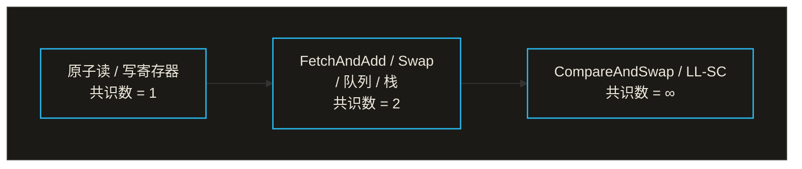
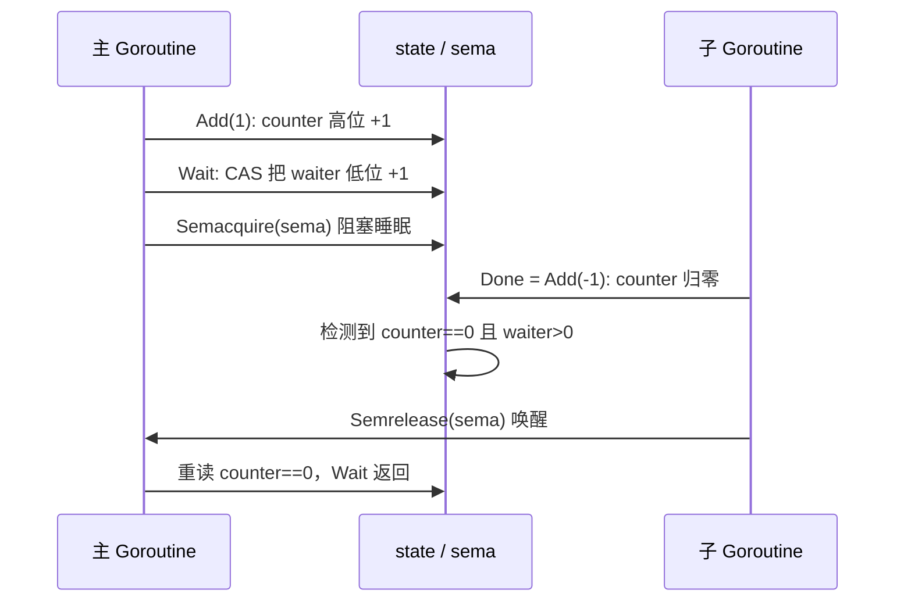

# 11 同步原语模式

11.1 共享内存式同步模式
11.2 互斥锁
11.3 原子操作
11.4 条件变量
11.5 同步组
11.6 缓冲池
11.7 并发安全散列表
11.8 上下文
11.9 内存一致模型

> 程序的构造可以使用更加简单的基础原语来表达这一事实，提供了一个有力的保障，即：这些基础原语所包含的内存能够与程序语言的其余部分在逻辑上保持一致。

在现代编程语言中，多线程的同步通常采用互斥，信号量等传统共享内存的手段。Go语言在同步原语（Primitive）的选择上与大多数语言不同，基于channel和select消息通信同步是该语言本身真正意义上的同步原
语。进而传统意义上的原子，互斥，条件变量，线程本地资源等概念在Go语言中变为用户态的同步模式（Pattern），形成了语言独有的特色。

## 11.1 共享内存同步模式

> 程序的构造可以用更简单的基础原语表达，这一事实是一个有力的保障：这些原语所包含的内容，能与程序语言的奇遇部分在逻辑上保持一致。

并发编程的全部困难，可以浓缩为一句话：多个执行单元要在同一份状态上协作,而它们推进的次序无法预知。如何让这种协作正确又高效，半个多世纪以来分化为两大传统。本章讲的就是其中一条，共享内存。在拆解Go
标准库sync与sync/atomic里面那些具体的原语之前。本节先把两条传统放在一起辨认清楚，说明它们为何是对偶的，再交代Go在其中所站的位置。读懂了这层取舍，后面11.2到11.9各节就不再是孤立的API，而是
同一种设计哲学落到不通场景上的样子。

### 11.1.1 并发的两大传统

并发编程历史上有两条大的传统。一条是共享内存：线程共享地址空间，靠互斥锁，信号量，条件变量等手段协调对共享状态访问。Dijkstra 1965年提出的信号量与Hoare 1974年提出的监管程（monitor）是他的基石，
它也是C/C++,Java，以及几乎所有操作系统内核主流路数。另一条是消息传递：执行单元不共享状态，指通过收发消息协调。Hoare的CSP（10.1）与Hewitt的Actor模型是它的两支，Erlang,occam是它的代表。

两条传统的分野，落在状态归谁所有这一点上。共享内存里面状态是公有的，谁都能碰，于是必须靠锁画出临界区，规定同一时刻只需一个执行单元进入：消息传递状态是私有的，别人想读写只能发一份信请它代劳，协调
由信道的收发时序天然完成。

值的一提的是，两者并非非此即彼。Dijkstra当年用信号量解的生产者与消费者哲学家就餐等问题。今天用channel同样能写；反过来，channel的内部实现本身就是一段互斥锁保护的共享缓冲（10）。这种换一种说法
能从一边翻译到另一边的观感并非错觉，下一小节会看到，它早在1979看就被证明是一条普遍的规律。

### 11.1.2 Lauer-Needham对偶

1979年，Hugh Lauer与Roger Needham提出一个影响深远的论断：基于消息传递的系统，与基于共享内存（他们称之为过程式）的系统，在表达能力上是对偶的，二者可以机械地相互转换，且转换后性能相当。他们
给出了两个系统组成成分之间的一张对照表。大意如下：

| 消息传递世界         | 共享内存（过程）世界     |
| -------------------- | ------------------------ |
| 进程，消息端口       | 受锁保护的模块，过程入口 |
| 发送请求消息并等回复 | 调用过程并等待返回       |
| 等待某端口的消息到达 | 在条件变量上等待         |
| 消息队列             | 一把锁加一个条件变量     |

这张表说的是：每一种用消息搭出来的协作模式，都有一个用锁加条件标量搭出来的等价物，反之亦然。它的意义不在于鼓励随意互换，而在于揭示了一件更深的事：正确性与性能并不取决于选择了哪个传统，两条路
在远离上是同一个座山的两侧。Lauer与Needham由此主张，选择应该当处于工程上何其更自然，更不易写错，更贴合手头硬件与运行时的判断，而非某条传统更优的信念。

这个对偶是理解Go立场的钥匙。既然两条路等级啊，Go就不必，也确实没有把小刺传递当成唯一真理，而是给它一个语言层面的偏好位置，同时把共享内存完整地保留在标准库里面。

### 11.1.3 Go的立场

Go的立场很鲜明：它把消息传递（channel与select）作为语言层面的核心，凝成那句广为流传的箴言。

> 不要以共享内存的方式通信，而要以通信的方式共享内存。（Do not communicate by sharing memory;instead,share memory by communicating.）

但是以此为核心不等于以此为唯一。Go并不否定共享内存。传统的互斥，原子，条件变量，线程本地资源等。被安放在标准库sync与sync/atomic里面，成为一组同步模式（pattern）而非语言原语。这个安放位置
本身就是一种表态：channel是语法的一等公民，锁与原子则是按需取用的工具。

为什么留着它们？因为对偶归对偶，工程上两条路的自然度并不对称。当读者要保护的只是一小段状态，比如一个计数器，一张配置表，一处一次性初始化，用一把锁把它围起来，往往比为它专设置一个goroutine，
再用channel把读写请求绕进去，更直接跟快。channel的么次收发都要经过调度与内存屏障，而一次无竞争的原子加可能只是一条CPU指令。10.9专门讨论何时不该用channel，本章接续那条线，回答那时候该用
什么。

下面这段对照，是用一个并发安全计数器的两种写法。左边用channel串行化所有操作，右边用一把锁保护一个整数。两者都正确，但当语义简单到只是给一个加一时，右边更贴合问题本身：

```go
// 写法一：以通信的方式共享内存（channel串行化）
type counter struct { ch chan int }

func (c *counter) inc() { c.ch <- 1 } // 把加一当成一条消息发出
func (c *counter) loop() { // 专设一个goroutine持有状态
    n := 0
    for delta := range c.ch {
        n += delta
    }
}

// 写法而二： 共享内存加一把锁锁（sync.Mutex)
type counter struct {
    mu sync.Mutex
    n int
}

func (c *counter)inc() {
    c.mu.Lock()
    c.n++ // 临界区：一次自增
    c.mu.Unlock()
}
```

判断标准并不玄妙：状态的所有权要不要在多个goroutine之间流转，协作的逻辑是否本身就是一条数据管线，是则倾向channel；只是几个goroutine偶尔碰一碰同一小块状态，是则倾向锁或者原子。Go把两套工具
都备齐，是要让那个写程序的人按照场景挑选，而不是被语言逼着走一条路。

### 11.1.4 本章地图

本章逐一拆解这些共享内存同步原语的实现与取舍。每一节都既要讲清楚它解决了什么问题，也要讲清楚它背后的理论传统与工程演进，并点明它在正确，简单，性能三者之间所做的那次具体权衡：

- 互斥锁（11.2）：最基本的临界区保护。从Dijkstra的互斥问题，操作系统提供的futex地基，到Go自己的正常模式与饥饿模式之间的权衡。
- 原子操作（11.3）：最贴近硬件的一层。共识层面，ABA问题，无锁结构的谱系，以及为何Go值暴露顺序一致的原子。
- 条件变量（11.4）：等待某个条件成立。Hoare与Mesa两种signal语义分歧，以及它在Go里面为何常被channel取代。
- 同步组（11.5）：fork-join公式并发的计数闩与栅栏。
- 缓存池（11.6）：对象复用与为GC减负。每P分片与victim缓存的演进。
- 并发安全与散列表（11.7）：并发散列表的解法谱系，与sync.Map两代实现的取舍。
- 上下文（11.8）：沿任务树传播取消与截止时间。协作式取消与结构化并发。
- 内存一致模型（11.9）：上述一切之所以成立的底层契约，也是本章的理论收尾。

读完会发现一条贯穿始终的主线：每一个源于都是在正确，简单，性能三者之间的一次具体取舍，而Go的偏好始终是把简单与正确放在性能之前。互斥锁宁可让出公平性的极致也要避免饥饿，原子只给顺序一致这一档
而不是暴露弱序，sync.Map用空间和复杂度换读多写少时的性能，无一不是这条偏好注脚。这与9调度器，10通道一脉相承，三者共同构成Go并发的全貌。

## 11.2 互斥锁

sync.Mutex时最朴素的同步原语：同一时刻只让一个goroutine进入临界区。朴素的接口之下，它要在两个相互拉扯的目标间反复权衡，吞吐（让锁尽快被某人拿走，别让CPU闲着）与公平（别让某个倒霉蛋的等待
者永远排不到队）。这两者无法同时拉满：把锁严格按到达次序移交，最公平，却要为每次交接付一次上下文切换；放任刚醒来的与正在跑的自由竞争，最快，却可能让某个等待者一次次落空。这一节先把互斥锁这个
古老问题的理论与硬件地基展开。再看Go的mutex如何在这条钢丝上行走。

### 11.2.1 互斥问题与它的硬件地基

互斥是并发理论最早的课题之一。Dijkstra于1965年形式化了互斥问题，并给出第一个不借助任何硬件特殊指令，仅凭借普通读写就能让多个进程进入临界区的软件解。其后Lamport于1974年的面包店算法
（bakery algorithm）把这条路走到一个漂亮的终点：每个想进临界区的线程先取号，在按号从小到大依次进入，即保证互斥，又保证先到先得的公平排队，而全程只用普通读写，不需要任何原子读改写指令。

纯软件解决在理论上自足，工程上却昂贵：面包店算法要遍历所有线程的号码，开销随着线程数增长，且严重依赖顺序一致的内存模型（11.9）,在现代弱序硬件上还要另加屏障。因此现代锁不在走纯软件这条路。
而是直接站在硬件提供的原子读写指令上，比较并交换（compare-and-swap,CAS）,取后加（fetch-and-add）等（11.3）。一条CAS就能原子地完成面包店算法要好几步才能模拟的事情，地基一换，上层设计
随之改观。

围绕这些原语，锁长出了一个谱系，理解它有助于看清Go的mutex站在那里。

- 自旋锁（spin lock）最简单：用一个CAS反复试，抢到就进，抢不到就原地空转再试。它在低竞争下几乎零成本，但高竞争下是灾难：多个核心争同一个锁，每次CAS都让那条缓存在核心之间来回失效，重取，称为
  缓存行弹跳（cache-line bouncing）竞争者越多越糟。
- 票号锁（ticket lock）用fetch-and-add发号，再让每个线程自旋等自己的号被叫到，由此恢复了FIFO公平。但所有等待者仍然自旋在同一个当前服务号变量上，缓存行弹跳的老问题并未根除。
- MCS锁（Mellor-Crummey与Scott，1991）是高扩展锁的经典之作。它让每个等待者都把自己挂进一条显式队列，并各自自旋在本地变量上，前一个持锁者释放时只写后继者那个本地变量。如此一来，无论多少
  竞争者，每次交换只触发一行缓存，竞争下的缓存流量降到常数。

以上都是忙等一脉，等待者占着CPU空转。另一条线把睡眠等待做廉价，早年线程要阻塞只能陷入内核，即便锁根本没有竞争也要付出系统调用的代价。Linux的futex(fast userspace mutex,Franke,Russell
与Kirkwood，2002)解决了这个痛点：无竞争时加解锁在用户态用一次原子操作完成，主要真要阻塞或者唤醒等待者时，才带着那个用户态地址陷入内核去排队。几乎所有现代用户态锁，包括Go的mutex,都踩在futex
(以及平台的等价物)这块用户态快，内核态兜底的地基上。Go自己不直接调用futex,而是由运行时的信号量（runtime_SemacquireMutex/runtime_Semrelease）封装个平台的底层阻塞原语，对上层呈现统一
接口。

### 11.2.2 状态字与快路径：无竞争时候几乎零成本

Go的mutex把一把锁压缩成两个字段：一个状态字加一个信号量。

```go
type mutex struct {
    state int32     // 位域：bit0已上锁，bit1有被唤醒者，bit2饥饿模式，其余高位 等得者数
    sema uint32 // 用于阻塞/唤醒等待者的信号量
}

const (
    mutexLocked =1 << iota // bit0:是否已上锁
    mutexWoken  // bit1:是否有一个被唤醒，正在抢锁的等待者
    mutexStarving   // bit2: 是否处于饥饿模式
    mutexWaiterShift = iota // = 3,高位 state >> 3记录等待者数量
    starvationThresholdNs = 1e6 // 1ms：切入饥饿模式的等待阈值
)

```

把多种信息塞进同一个int32,是为了让一次原子操作同时读到，改到锁的全部关键状态：是否上锁，有无被唤醒者，是否饥饿，还有几个等待者。低三位是标志位，高位是等待者计数，加减一个等待者给state加减
`1<<mutexWaiterShift`。这种位域编码让加锁的快路径退化成一个对整数的单次CAS。

无人竞争时，上锁只是把state从0（未锁，无等待者）原子地改为mutexLocked:

```go
func (m *Mutex) Lock() {
    if atomic.CompareAnsSwapInt32(&m.state, 0, mutexLocked) {
        return // 快路径：一次CAS成功，全程不进内核
    }
    m.lockSlow() // CAS失败说明有竞争，转入慢路径
}
```

这条快路径不进内核，不睡眠，是mutex被高频使用却仍然轻快的关键，绝大多数加解锁到此为止。只有CAS失败，说明锁正被占着或者已有等待者，才落入慢路径lockSlow。解锁对称地走快路径：把mutexLocked
位剪掉，若减完state恰为0（没有等待者，没有表的标志），则一切结束，连unlockSlow都不必进入。

### 11.2.3 慢路径：先自旋，再睡眠

竞争发生时，goroutine并不立刻去睡。睡眠和唤醒都要与运行时打交道，代价不菲；而锁常常只被暂停持有，马上就会释放。于是lockSlow先自旋几轮，赌锁很快会释放，赌赢了就省下了一整轮睡眠和唤醒。

自旋有严格的准入条件，不满足任意一条就会放弃自旋，转去睡眠：

```go
func (m *Mutex) lockSlow() {
    var waitStartTime int64
    starving, awoke, iter := false, false, 0
    old := m.state
    for {
        // 仅在已上锁且非饥饿模式且runtime判定值自旋时，才空转
        if old&(mutexLocked|mutexStarving) == mutexLocked && runtime_canSpin(iter) {
            // 自旋前置一个mutexWoken标志，告诉Unlock不必再唤醒别人
            if !awoke && old&mutexWoken == 0 && old >>mutexWaiterShift != 0 &&
            atimic.CompareAndSwapInt32(&m.state, old, old|mutexWoken) {
                awoke = true
            }
            runtime_doSpin() 执行若干次PAUSE指令
            iter++
            old = m.state
            continue
        }
        // ...自旋条件不再满足：计算新状态，CAS入队，挂到信号量上睡去（细节见下文）
    }
}
```

runtime_canSpin把值得自旋收得很紧：必须是多核机器，自旋次数没有超过上限（默认4次），本地运行队列里面没有等着跑的其他goroutine。换言之，只有在很可能马上拿到锁，且空转不会饿死别人才自旋；一旦
锁处于饥饿模式，或者自旋次数耗尽，就老实地把自己挂到信号量sema上睡去，等持有锁解锁时候再唤醒。这种短等自旋，长等睡眠的混合策略并非Go独创，pthread的自适应互斥锁
（PTHREAD_MUTEX_ADAPTIVE_NP）,Java的偏向/轻量级锁，parking_lot等都采用统一思路，区别只在自旋多久，何时放弃的阈值。

### 11.2.4 公平：正常模式与饥饿模式

mutex最见功力的设计，是它在Go 1.9引入的两种模式。它们对应11.2.1里面那条钢丝的两端：一端追求吞吐，一端守住公平。

正常模式追求吞吐，等待者按照FIFO排队，但刚被唤醒的等待者并不直接拿到锁，它要和当下正在运行，也想加入锁的新来者竞争同一把锁。新来者有天然优势：它正跑在CPU上，无需经历唤醒；被唤醒者却刚从睡眠中
爬起来，还没真正调度上来。于是新来者常常插队（baarging）抢到锁。barging减少了上下文切换，显著提升了吞吐，代价是那个被唤醒却没抢过的等待者可能被反复挤到队首，一次次落空，陷入饥饿。

为了兜住这种最坏的尾延迟，mutex引入饥饿模式。当某个等待者从入队拿到锁的等待时间超过1ms（starvationThresholdNs）仍未成功，它就在拿到锁的那一刻把mutex切入饥饿模式。此后规则反转：解锁时不再
允许任何人插队，而是直接把锁的所有权FIFO移交给队首等待者（解锁时候连mutexLocked位都不置，由被移交者醒来后自己置上）;新来的goroutine即便看到了锁像是空的也不尝试获取，不自旋，老实排到队尾。
等到队列排空，或者队首等待者这次只等了不到1ms，再切回到正常模式。

这套机制顺带解开了一个读者常有的疑问：既然解锁时候唤醒的是FIFO队首者，为什么还会饿死等待者？关键在于，正常模式下唤醒不等于移交锁。unlockSlow取得唤醒一人的权利后，唤的却是是队首等待者，但它醒来
后还的和新来者重新竞争，被唤醒只是拿到一张参赛卷，不是锁本身。

```go
func (m *Mutex)unlockSlow(new int32) {
    if new&mutexStarving == 0 {
        // 正常模式
        old := new
        for {
            // 无等待者，或者已有人被唤醒/抢到锁/已经饥饿模式，则无需再唤醒任何人
            if old > mutexWaiterShift == 0 ||
                old&(mutexLocked|mutexWoken|mutexStarving) != 0 {
                    return
                }
                // 取得唤醒一人的权利：等待者计数减一，置mutexWoken
                new = (old - 1<<mutexWaiterShift) | mutexWoken
                if atomic.CompareAndSwapInt32(&m.state, old, new) {
                    runtime_Semrelease(&m.sema, false, 1) // 唤醒队首者，但它仍要去抢锁
                    return
                }
                old = m.state
        }
    } else {
        // 饥饿模式：把所有权直接交给队首者，handoff = true表示FIFO移交
        runtime_Semrelease(&m.sema, true, 1)
    }
}
```

两种模式结合起来，让mutex绝大多数时候享受barging带来的高吞吐，又用1ms阈值为最坏情况兜底：任何等待者最多被插入一阵子，超过1ms必然FIFO顺序拿到锁。正常模式效率高，因为一个goroutine即便面前
堆着一群阻塞的等待者，也能连续多次抢到同一把锁；饥饿模式则专门压制病态尾延迟。

### 11.2.5 别家怎么做：公平性光谱

吞吐优先，有界兜底并非Go独有，而是工业界反复收敛到的折中。把各家锁按照公平性排开，会得到一条光滑，两端分别是完全公平（严格FIFO直接移交，无饥饿但吞吐低，交接开销大与完全不公平（自由barging,
吞吐高但可能饿死等待者）。

- Java的ReentrantLock干脆把选择交给用户：构造时候可以指定公平或者非公平两种锁。默认是非公平锁，理由与Go选barging一致，吞吐更高；公平锁严格按FIFO发放，适合堆延迟敏感，不能容忍饥饿的场景，
  但是吞吐明显更低。
- Rust的parking_lot走最终公平：平时放任barging抢吞吐，但每隔一小段时间（越1ms量级）强制一次公平移交，确保等待者不会无限饥饿。思路与Go的饥饿模式异曲同工，只是触发条件由时间间隔而非单个等待
  的等待时长决定。

Go的1ms阈值，就是把这条光谱上一个具体而精确到的取舍点：默认吃barging的吞吐红利，用一个固定时间上界把公平性兜成有界等待。值得一提的是，这个阈值时工程经验而非理论最优，它在兜底太晚导致可感知卡顿
与兜底太频繁拖累吞吐之间取了个折中。

### 11.2.6 读写锁与TryLock

sync.RWMutex在互斥之上区分读者与写者：多个读者可同时持有锁，写者则独占。它适合读多写少的场景，但要当心其中的取舍，若持续由读者到来，写者可能长期拿不到锁（写着饥渴）。Go的实现为此让后到的读者
在已有写者等待时也阻塞，以免被读者无限拖延。RWMutex的happens-before保证（一次Unlock同步先于后的Lock,RUnlock同步限于其后的Lock）见11.9。

TryLock(以RWMutex的TryLock/TryRLock，均于Go 1.18加入)尝试加锁但是绝不阻塞：拿到返回true，拿不到立即返回false。它的用途很窄，光方文档专门提醒：正确使用TryLock的场合确实存在，但很少，
频繁依赖TryLock往往是某处锁用法本身有设计问题的信号。从内存模型上看，一次成功的TryLock等价于一次Lock，而失败的TryLock不建立任何syncchronizes-before关系。

### 11.2.7 工程取舍

mutex的设计处处权衡，而每一处都印证了那句老话：性能的提升从不白来，它总是伴随着复杂度的重新安置。用状态字位域把多种信息压进一个int32，省下来的是加锁路径上的原子操作次数，付出的是位运算的晦涩；
用自旋赌一把短等待，赌赢则省下了睡眠与唤醒，赌输则白白空转了几轮；用barging换吞吐，又不得不再加一套饥饿模式与1ms阈值来为公平兜底，整个lockSlow的复杂度，多半都来自这层兜底。

把mutex放回Go并发的全景里面，它和channel代表的两种风格：mutex直白地表达互斥，channel表达通信。Go的格言不要以共享内存来通信，而要以通信来共享内存推荐后者，但这是倾向而非禁令。该用哪个，
取决于要表达的是保护一块共享状态还是在goroutine间传递数据的所有权，而非哪个更高级。下一节转向mutex脚下的那块原子读改写的地基本身。

## 11.3 原子操作

sync/atomic是Go同步原语里面最贴近硬件的一层。互斥锁（11.1），channel（8）这些更高层的工具，内部都建立在原子操作之上。它提供不可分割的读写与读改写：一个原子操作要么完整发生，中间不会被别的
goroutine看到一半。但是原子操作的意义远不止如此防撕裂。它是无锁编程的地基，而无锁编程背后，有一套关于哪些原语能做什么的深刻理论，那是本节真正想要讲清楚的东西。

本节先把基本操作摆出来，落到CAS这块基石；再退后一步，借Herlihy的共识层级回答为什么是CAS；接着进入无锁的暗礁ABA与内存回收，说明Go把硬的无锁结构留在运行时内部；最后回到工程，讲sync/atomic
的顺序一致承诺，以及Go 1.19那次把该用的原子访问编进类型的演进。

### 11.3.1 集中基本操作

原子操作的家族不大：Load(原子读)，Store(原子写)，Add(原子增减)，Swap(原子交换)，CompareAndSwap(比较并交换，CAS),以及Go 1.23起来补齐的And/Or（原子位运算）。它们都落到单条带LOCK前缀
的CPU指令上：x86上CAS是Lock CMPXCHG,ARMv8上是LDXR/STXR的load-linked/store-conditional重试对，加法是LOCK XADD。换言之，原子性的最终保证来自硬件，sync/atomic只是把这些指令包装成可
移植的Go函数。

其中CAS是无锁编程的基石。它原子地完成如果当前值还是我以为的那个，就改成新值，否则什么都不做并告诉我失败：

```go
// CompareAndSwap 的语义（伪代码，整体不可分割地执行
func CompareAndSwapInt64(addr *int64, old, new int64) (swapped bool) {
    if *addr == old {
        *addr = new
        return true
    }
    return false
}
```

为什么单单一个CAS就能够撑起无锁？因为几乎所有无锁算法都能写成同一种骨架，一个重试循环：读出当前值，据它算出想要的新值，再用CAS把它写回去；只有这期间没人动过时CAS才成功，否则拿到的就是别人更新
后的值，重来一遍即可。

```go
for {
    old := atimic.LoadInt64(&x) // 读取当前值
    new := f(old) // 据此算出期望值
    if atomic.CompareAndSwapInt64(&x, old, new) {
        break // 没人抢先修改过，提交成功
    }
    // CAS失败说明有别的goroutine抢先改了x, 拿新值再算一遍。
}
```

这个循环藏着无锁的代价。与锁不同，CAS失败不会让goroutine阻塞，而是立刻重试。竞争平和时这很划算，省去了上锁，可能的睡眠与唤醒；可一旦竞争激烈，多个goroutine反复读取到彼此覆盖后的值，反复CAS
失败，CPU全耗在空转上，吞吐反而不如一把老老实实的锁。还有一处隐患叫活锁：大家都在重试，系统整体看似在动，单个goroutine却可能长时间提交不成。所以原子操作适合的是单字，低竞争，或者读多写少的场
景，计数器，标志位，配置指针之类；把一段复杂临界区硬拆分成CAS循环，往往得不偿失。

### 11.3.2 共识层级：为什么是CAS

读者或许会问，既然Load与Store也是原子的，为什么不能拿它们搭出无锁结构，偏要CAS？答案出自Herlihy 1991年的经典工作，共识层级（cnsensus hierarchy），它给一个同步原语到底有多强一个精确的，
可证明的度量。

考虑n个线程就一个值达成一致：每个线程提议一个值，最终所有线程必须读到同一个线程被选中的提议，且这个值确实是某个线程提议过的。能用某种共享对象在无等待（每个线程有限步内完成，不依赖别人的进度）的
前提下解决n个线程共识的最大n,就是该对象的共识数（consensus number）。



普通的原子读写寄存器，共识数只有1，连两个线程都协调不了。直觉上的证明是这样：两个线程要对谁先到达成共识，必有一个临界时刻，系统状态在最终选择A与最终选择B之间摇摆。用读写寄存器，先手线程只能要么
读，要么写某个单元。若它读，没留下任何痕迹，后手无从分辨它是否来过；若它写，要么写到一个后手覆盖的单元（痕迹被抹去），要么两人写的是不同单元，而后手读的次序由决定不了谁先。无论怎么排，总能构造
处两个线程都无法区分的执行，于是无等待共识不可能。这是一个典型的不可能（impossibility）结论，与FLP同属一脉。

而CAS的共识数是无穷。证明却出奇地短：拿一个初始值无人胜出的共享单元，每个线程用`CompareAndSwap(&cell, 空，我的提议)`去抢；只有第一个成功的把自己的值写了进去，其余全部失败，然后所有线程读出
cell,读到的就是那个唯一的胜利者。一行CAS就让人意多线程达成了无等待共识。

这条1与无穷的鸿沟，真是个语言原子库都把CAS摆在中心的根本原因。Herlihy进一步证明，任何共识数为无穷的原语都是通用（universal）的：有了它，任何顺序对象都能造成一个等价的无等待并发实现（所谓
universal construction）。CAS之于无锁世界，就像图灵机之于计算性，是那把万能钥匙。ARM，POWER一族用的load-linked/store-conditional(LL/SC)是CAS的近亲，共识数同样是无穷。而
FetchAndAdd,Swap,乃至原子队列于栈，共识数都停留在2，搭不出对任意线程都无等待的协调。Go把`Add/Swap/CAS`都给了用户，但唯一CAS撑得起一般的无锁算法，原因就在这里。

### 11.3.3 无锁的谱系：阻塞，无锁，无等待

无锁其实一族保证，强弱有别。Herlihy与Shavit在`<<多处理器编程艺术>>`里面给出标准三档进展性（process）层次：

- 无阻塞（obstruction-free）：若某个线程在某一时刻独占运行（别人都暂停）,它一定能在有限步中完成。最弱，多个线程同时推进可能相互搅黄，谁都进不去（活锁）。
- 无锁（lock-free）：任何时候，只要系统继续跑，总有某个线程完成操作。它排除了死锁与活锁，保证整体在推进，但不保证线程都不挨饿。上一节的CAS重试循环正是典型：每次有人CAS失败，必有另一人CAS成功
  了。
- 无等待（wait-free）：每个线程都在与其他线程无关的有限步内完成。最强，也最难实现，代价通常是更复杂的算法与更高效的常数开销。

值得点出的一处常见误解：Go的channel与mutex内部用CAS，但它们本身是有锁的，会让goroutine阻塞，让出。用了原子指令不等于无锁；无锁是对进展性的保证，不是对手实现收发的描述。真正追求lock-free的，
是Treiber栈，Michael-Scott队列这类专门的并发数据结构。以最简单的treiber栈为例，它把整个无锁栈写成一个CAS循环：

```go
// 无锁栈的压栈：把11.3.1的重试循环套在换栈顶指针上
type node struct {
    val int
    next *node
}

type Stack struct {
    top atomic.Pointer[node] // 栈顶，Go 1.19类型化原子
}

func (s *Stack) Push(v int) {
    n := &node{val: v}
    for {
        old := s.top.Load() // 读到当前栈顶
        n.next = old // 新节点指向它
        if s.top.compareAndSwap(old, n) {
            return // 栈顶没变过，挂上去成功
        }
        // 有人抢先改了栈顶，拿新栈顶重新
    }
}
```

这段代码看着无害，却恰恰是下一节那枚暗礁的引信。

### 11.3.4 ABA与内存回收：无锁的暗礁

CAS有一个著名的陷阱，ABA问题。线程读取到值A,正打算CAS，期间别的线程把它从A改成B，又改回A;CAS看到的还是A便以为没人动过，照旧提交，其实结果早已翻天覆地。

把它放回上面的Treiber栈就具体了：线程甲Load到栈顶节点A,记下A.next指向B，正要CompareAndSwap(A, B)弹出A。此刻线程乙连弹两次，把A和B都弹走，又压回一个复用了A那块内存的新节点A‘；A'的next
早已经指向了别处。甲的CAS比较的是指针值，A'与A地址相同，于是CAS成功了，栈顶被设回了一个next已失效的节点，栈就此损坏。问题的根子有二：CAS只认值不认中间发生过什么，以及被弹出的节点内存被提前
回收复用了。

经典的对策有两类。其一，给指针附加一个版本号标签（tagged pointer），每次修改连标签一起递增，让ABA暴露成A1不等于A3,CAS比较的是指针+标签整体，复用同一地址也骗不过它。代价是一条能原子操作双
字宽的执行，且标签会回绕。其二，从根本上解决内存何时能安全回收，这是更深的一类技术：

- 危险指针（hazard pointers,Michael 2004）：每个线程都把自己正在访问的指针登记到一处公共数组，回收方在真正释放先扫一遍，凡被登记的一律推迟回收。
- 纪元回收（epoch-based reclamation）：用全局递增的纪元分代，只有确认所有线程都超越了某个纪元，那之前退休的节点才安全释放。
- RCU(read-copy-update):Linix内核里面读者几乎零开销，写着复制后延迟释放的范式。

这正是Go选择不鼓励用户手写复杂无索结构的背景。无锁的正确性极其微妙，ABA与内存回收是反复绊倒老手的暗礁，而Go又有GC：垃圾回收恰好天然消解了一类ABA，只要还有指针指向某节点，它就不会被回收复用，
`atomic.Pointer[T]`因此比C里面裸指针的CAS安全得多。即便如此，Go仍把真正棘手的无锁结构留在运行时内部，调度器的工作窃取队列，内存分配的无锁span集合（12.2）这些反复打磨的快路径，而向用户层
只提供地基原语，并建议优先使用channel与锁。这与11.9只暴露顺序一致原子，不暴露弱序原子，是同一种把复杂度挡在外面的取舍。

### 11。3.5 原子操作是顺序一致的

`sync/atomic`的所有操作都是顺序一致原子（sequentiall consistent atomics）。自Go 1.19的内存模型修订，这条成了明文承诺（11.9）：所有原子操作存在一个全局全序,若原子操作A的效果被原子操作B观察到，则A happends before B。这意味着原子操作不仅自身不可分割，还能在goroutine间建立发生序，可以正经地用作同步手段，而不是只防撕裂。一个原子写之前的普通写，对观察到该原子写的读者也一并可
见，这正是无锁算法赖以传递数据的根源。

把它放进语言的谱系看，Go的取舍格外鲜明：

| 语言    | 暴露的内存序                                        | 设计取向                         |
| ------- | --------------------------------------------------- | -------------------------------- |
| C/C++11 | `relaxed/acquire/release/acq_rel/seq_cst`整套       | 榨干硬件，把弱序的难度交给开发者 |
| Java    | volatile(SC) + VarHandle细颗粒度                    | 默认SC,专家可下探                |
| Rust    | `Ordering::{Relaxed,Acquire,Release,AcqRel,SeqCst}` | 同C++一套档位                    |
| Go      | 仅顺序一致                                          | 只给一档，刻意不暴露弱序         |

C++那张内存序菜单能贴着硬件压榨出每一分性能，代价是把读懂弱内存模型这桩出了名难的事情丢给应用开发者，relaxed原子里的out-of-thin-air之类问题至今是学界的硬骨头。Go的判断是：对绝大多数程序，
SC原子的性能已经够用，它换来的可推断理性远比那一点峰值更值。于是Go只给顺序一致这一档。这与Go在调度，垃圾回收上一贯的性格意志，以可控的性能让渡，换取语义简单与不易出错。读用用atomic.AddInt64时
候无需在脑中模拟store buffer,这本身就是一种设计上的善意。

### 11.3.6 类型化原子：把该用原子访问编进类型

`sync/atomic`早期只有函数式API，如`atomic.AddInt64(&x, 1)`。它能用，却有两个长期为人诟病的陷阱。

其一，漏用。没有任何机制组织在别处对同一变量做普通（非原子）访问，x++与`atomic.AddInt64(&x, 1)`在编译器眼里访问的都是同一个普通int64，一旦某处漏用原子函数，就埋下了一个数据竞争，而编译期间
无从觉察，只能寄希望-race在运行时撞上。其二，对齐。32为平台上对64位变量做原子操作要求8字节对齐，而结构体里面裸int64字段的对齐方式取决于它前面字段的排布，于是出现教科书级别的坑：结构体字段顺序
一调，同一份代码在amd64上跑的好好的，到32位ARM上就因为未对齐的原子访问而崩溃。

Go 1.19引入类型化原子（提案#50860）,从类型层面一句堵上了这两个口子。

```go
// 裁剪后类型速写：把int64包成一个只能原子访问的类型
type Int64 struct {
    _ noCopy // go vet 据此报告首次使用后被复制
    _ align64 // 强制8字节对齐，消除32位平台的对齐坑
    v int64
}

func (x *Int64) Load() int64 { return LoadInt64(&x.v) }
func (x *Int64) Store(val int64) { StoreInt64(&x.v, val) }
func (x *Int64) Add(delta int64) int64 { AddInt64(&x.v, delta) }
func (x *Int64) CompareAndSwap(old, new int64) bool {
    return CompareAndCompare(&x.v, old, new)
}
```

把变量声明成atomic.Int64,由于v是私有字段，访问它就只能通过`Load/Store/Add/CompareAndSwap`等方法，普通访问在类型层面被堵死，漏用的可能性从源头上消失。align64这个零宽度标记字段告诉编译器
对整个类型施加8字节对齐，对齐坑也随之消失。noCopy则让go vet拦下原子变量被值复制这另一类隐蔽错误。整套类型化原子是`atomic.Int32/Int64/Uint32/Uint64/Uintptr/Bool/Pointer[T]/Value`。

泛型成全了其中最有意思的一个，atomic.Pointer[T]。它用类型参数把这是一个\*T的原子指针表达出来，读者自带类型，省略了满地的unsafe.Pointer转换。源码里面还有一处巧思：

```go
type Pointer[T any] struct {
    _ [0]*T // 提一下*T，让不同的Pointer[T]之间无法相互转换（issue 56603)
    _ noCopy
    v unsafe.Pointer
}
```

那个零长度数组`[0]*T`不占空间，存在的唯一目的是让atomic.Pointer[A]与atomic.Pointer[B]在类型上互不兼容，堵住一条本科绕过类型安全的后门。这事API设计与语言特性协同演进的范例：用类型把这个字段
必须原子访问从程序员的自觉，编程编译器可强制的契约。新代码一律优先使用类型化原子，而非裸函数。

atomic.Value时这一族里面特别的一个，它用于整体地原子地替换一个任意类型的值，典型的用途是配置热更新：后台准备好整份新配置,用Store一次性换上，所有读者用Load要么读到完整的旧的配置，要么读到
完整的新配置，绝不会读到修改了一半的中间态。

```go
var cfg atomic.Value // 存 *Config
cfg.Store(loadConfig()) // 启动时放一份

func reload() { cfg.Store(loadConfig()) } // 写者：整体替换
func handler() { c := cfg.Load().(*Config); _ = c } // 读者：无所取一份完整的快照
```

它的内部实现是一处教科书级的小心翼翼。interface{}在运行时由类型指针+数据指针两端组成（2）,要原子地换掉整个interface,就要避免读者撞见类型已换，数据还没换的半成品。Value的办法是：首次
Store时先用CAS把类型指针置成一个特殊的进行中的标记firstStoreInProgress，期间runtime_procPin禁止当前goroutine被抢占，待数据指针，类型指针依次落定再放行；读者一旦Load看到这个标记，
就知道熟悉写入尚未完成，返回nil。这是一种轻量的写时复制：读者无锁，写者整体替换，适合读远多于写的配置类数据。Go 1.19以后，多数新代码可以用`atomic.Pointer[Config]`替代atomic.value，
既有类型安全又避免了类型断言，唯一需要存放的类型在运行期才确定的值时，atomic.Value仍不可替代。

### 11.3.7 小结：地基与边界

原子操作是Go并发设施的最底层，往上托起mutex,channel与整个运行时的无锁快路径。本节的主线可以收成三句：CAS是无锁世界里面共识位无穷的万能原语，理论上撑的起无锁结构；但是无锁的正确性被ABA与
内存回收这些暗礁守着，工程上极难做对：Go因此把硬的无锁结构关进运行时，向用户只给顺序一致的地基原语，并用类型化原子把该原子访问编程编译契约。写一节（11.9）会把这里的顺序一致放进整个完成的
内存模型里面讲透，那是理解本节每一处承诺的来由所在。

## 11.4 条件变量

互斥锁（11.2）回答对的事谁能进入临界区，条件变量则是两外一个问题：一个Goroutine已经进入临界区，却发现现在还不能干活，它该如何等到干活那一刻，同时把临界区让给别人。生产者消费者是最常见的例子。
队列满的时候，生产者既不能写入，又不能一直攥着锁空转，否则消费者永远拿不到锁去腾空间，于是双方一起卡死。条件变量是sync.Cond给出的办法是：让生产者带锁睡去，原子地交出锁并阻塞，等消费者
腾出空间以后把它唤醒，醒来时候又回到它的手上。

这一节先把用法讲清楚，尤其是那条几乎所有教材都强调，却很少解释清楚来由的规矩：Wait必须写在for循环里。这条规矩不是Go的发明，它根植于1970年代关于管程（monitor）的两种唤醒语义之争。讲清楚这段历
史，读者就会明白为什么从pthread到Java再到Go，现代条件变量无一例外要求循环复查。随后我们给出Go实现速写（notifyList到ticket机制，禁止拷贝的copyChecker），最后说明一个也许出乎意料的事实，
channel与close广播大多把它取代了。

### 11.4.1 用法：Wait为何要写在for循环里面

先看一段标准的生产者消费者。condition是受锁保护的共享状态，cond用一把锁构造：

```go
func main() {
    cond := sync.NewCond(new(sync.Mutex))
    condition := 0

    // 消费者
    go func() {
        for {
            cond.L.Lock()
            for condition == 0 {
                cond.Wait()
            }
            condition--
            cond.Signal() // 腾出空间，唤醒一个生产者
            cond.L.Unlock()
        }
    }()

    // 生产者
    go func() {
        for {
            cond.L.Lock()
            for condition == 100 { // 队列满了，带锁睡去
                cond.Wait()
            }
            conditon++
            cond.Signal() // 有货了唤醒一个消费者
            cond.L.Unlock()
        }
    }()
}
```

Wait的契约是三步合一：原子地解锁c.L,阻塞当前Goroutine，被唤醒后重新锁上c.L再返回。原子地解锁并阻塞时关键一步，它堵死了一个否则必然出现丢失唤醒窗口：若先解锁，再阻塞分为两步，解锁之后阻塞之前
的那一瞬，另一方完全可能改好条件并发出Signal,而此刻还没睡着的本方收不到这个信号，待它睡去便无人来唤，于是永久错过。Wait把解锁合入队做成了一体，正是为了消除这个窗口。

真正需要解释的是循环。注意上面每个Wait都裹在for condition == ...里面，而不是if。直觉上，既然消费者是在condition == 0时候才睡去的，被唤醒以后理应condition > 0,用if判断一次足矣，何必
循环？答案是：Wait返回时候，那个让goroutine睡去的条件不保证仍成立。被唤醒只意味着也许就可以了，去复查一下，而非条件以满足。要理解这个也许从何而来，需要回到管程的唤醒语义。

### 11.4.2 管程的两种唤醒语义：Hoare与Mesa

条件变量并非凭空设计，它是1970年管程这一并发抽象的组成部分。管程由Hoare在1974年的论文`<<Monitors: An Operating System Structing Concept>>`中系统提出，它把共享数据与操作这些数据的过程
封装到一起，保证任意时刻至多一个进程在管程内活动，并配以条件变量供进程在条件不满足时主动让出管程，等待被唤醒。

分歧出现在唤醒的那一刻。当进程A在管程内执行signal唤醒了正在某条件上的进程B时，管程互斥的约束要求二者不能在内活动，于是必须有人让路。让谁，何时让，给出两种根本不同的语义。

Hoare语义，又称为signal-and-wait。Hoare原始论文规定：signal立即把管程的控制权移交给被唤醒的B,发信者A自己挂起，等B离开管程后再恢复。这套语义的好处是对程序员极其友好：A再signal前刚刚令条件
为真，控制权又交给B,中间没有任何第三者插入的机会，因此B醒来时条件一定成立。在Hoare语义下，等待方写if足矣：

```go
// Hoare (signal-and-wait)语义下伪代码，仅做对照，Go并非如此
c.L.Lock()
if condition == 0 { // if即可：醒来时候添加成立
    c.Wait()
}
// 此处condition > 0一定成立
```

代价藏在实现里面。立即移交，发信者挂起要求一次额外的上下文切换，还要为被挂起者维护一个特殊的优先队列，使其在被唤醒方让出抢在普通竞争者之前重入。这套机制实现复杂，切换频繁，性能并不讨喜。

Mesa语义，又称signal-and-contine.Lampson与Redell在1980年的论文`<<Experience with Processes and Monitors in Mesa>>`中，根据Xerox PARC用Mesa语言构建真实的系统经验，选择了
相反的做法：singnal仅仅把B标记为可运行，发信者A继续持锁运行到自己情愿推出管程位置。被唤醒的B这时只是回到了就绪状态，它还要重新竞争这把锁。问题就在这里：从A出发signal到B真正拿到锁，Wait返回，
这中间隔着一段不确定的时间，期间不仅A可能继续修改共享状态，别的第三个进程也可能抢先拿到锁，把A刚腾出来的那点条件重新消耗掉。等B醒来，它睡前的等待条件可能又不成立了。

结论顺理成章：在Mesa语义下，被唤醒不等于条件成立，等待方必须在返回后重新检查条件，若仍然不满足就在此Wait。这正是for循环的由来。把if换成for,等价于把我相信醒来即可用改成醒来后在确认一次，
不行接着睡：

```go
c.L.Lock()
for !condition() { // for 而非if:醒来后复查，不成立则Wait
    c.Wait()
}
// 循环退出，此刻condition()一定为真
c.L.Unlock()
```

### 11.4.3 为何现代条件变量一律是Mesa语义

既然Hoare语义对程序员更友好（if 即可）,为何今天的条件变量几乎清一色选择了Mesa? Lampson与Redell在论文里面给出的理由至今成立，可归为三点。

其一，实现简单，性能更好。Mesa语义下signal只需要把等待者标记为就绪，无需额外的上下文切换，也无需为发信者维护抢占式的重入队列。唤醒与调度解耦，交换给通用的调度器即可。
其二，对伪唤醒天然友好。现实系统中，等待者可能因为种种与条件无关原因被唤醒：操作系统信号，超时，为简化实现而允许的。Hoare语义对此十分脆弱，Mesa语义因为本就要求循环复查，这些意外被唤醒同一个
for顺手吸收，复查一遍发现条件不满足，接着睡就是了。
其三，与广播语义相容。Broadcase一次唤醒全部等待者，但是其中通常只有一个（或几个）能真正继续，其余被唤醒后发现条件🥃先导者抢走了。这种唤醒多余可用的模式只有在醒来必须复查的前提下才是安全的，
而这正是Mesa语义内建的前提。

于是我们看到一条跨越语言与平台的统一规则：

| 系统                               | 唤醒语义                                   | 等待写法                |
| ---------------------------------- | ------------------------------------------ | ----------------------- |
| Hoare原始管程                      | signal-and-wait                            | if足矣                  |
| POSIX pthread_cond_wait            | signal-and-continue(且运行spurious wakeup) | 必须while               |
| Java Object.wait / Condition.await | signal-and-continue                        | 必须while(官方文档明示) |
| Go sync.Cond.Wait                  | signal-and-continue                        | 必须for                 |

Go的文档把这一点写的很直白：Because c.L is not locked while Wait is waiting, the caller typically cannot assume that the condition is true when Wait returns, the
caller should Wait in a loop。这句话翻译过来，就是Mesa语义的工程化忠告。

### 11.4.4 Go的现实：notifyList与copyChecker

理解了语义，再看Go的实现就剩机械的部分了。sync.Cond的结构很薄：

```go
// sync.Cond：薄薄一层，真正的等待队列在notifyList里面
type Cond struct {
    noCopy noCopy // 供go vet -copylocks静态检查，禁止拷贝
    L Locker // 观察/修改条件持有的锁，可为*Mutex或者*RWMutex
    notify notifyList // 通知列表：等待队列+ticket计时器
    checker copyChecker // 运行时检测拷贝，拷贝到panic
}
```

L的类型是Locker接口（只需要Lock/Unlock两个方法），故*Mutex与*RWMutex都能用。三个方法`Wait/Signal/Broadcast`各自先调用一次checker.check()，剩余的活全部交给运行时notifyList:

```go
func (c *Cond) Wait() {
    c.checker.check()
    t := runtime_notifyListAdd(&c.notify) // 取一张 ticket
    c.L.Unlock() // 解锁
    runtime_notifyLisWait(&c.notify, t) // 凭ticket阻塞，等待通知
    c.L.Lock()
}

func (c *Cond) Signal() { c.checker.check(); runtime_notifyListNotfyOne(&c.notify) }
func (c *Cond) Broadcast() { c.checker.check(); runtime_notifyListNotifyAll(&c.notify) }
```

ticket机制。notifyList的核心是一对单调递增的计数器，用取号排队的方式解决一个微妙的竞态：Wait内部是先notifyListAdd取号，再Unlock,最后notifyListWait真正入队阻塞，三步并非一气呵成。若在取
号与入队之间恰好来了Signal，这个尚未睡着等待者不能被漏掉。ticket正是为此而生：

```go
// notifyList: 基于ticket的通知列表（速写）
type notifyList struct {
    wait atomic.Uint32 // 下一个waiter的号：无锁原子自增
    notify uint32 // 下一个被通知的号;持锁写，可无锁读
    lock mutex
    head *sudog // 已入队，正在阻塞waiter链表
    tail *sudog
}
```

Wait先wait.Add(1)领到一个号t。等它走到notifyListWait，会比较t与notify:若`t < notify`,说明轮到我的号早已经被叫过（Signal在我入队之前就发生了）,于是立即返回，不必阻塞。否则才真正构造
sudog，入队，并goparkunlock把自己挂起，这一步会把G从M上解绑，置为等待状态，交还调度器（9）。Signal（notifyListNotifyOne）则把notify加一，在链表中找到持有该号的sudog并goready它；
Broadcase(notifyListNotifyAll)把notify直接追平wait,唤醒链表中全部等待者。两者都有一条无锁快路径：若wait == notify(notifyListNotifyAll)把notify直接追平wait，唤醒链表中全部等待
者。两者都有一条无锁快路径：若wait == notify(自上次通知以来没有心等待者)，直接返回，连锁都不必拿。

copyChecker:禁止拷贝。Cond一旦使用便不可拷贝，拷贝会复制出一份独立的notifyList，令唤醒发往错误的队列，造成难以排查的丢失唤醒。Go用两道防线来挡：noCopy字段是给`go vet -copylocks`看
静态标记，编译器就能报警；copyChecker则是在运行期的兜底，它是一个uintptr，存放自己的地址：

```go
func (c *copyChecker) check() {
    if uintptr(*c) != uintptr(unsafe.Pointer(c)) &&
        !atomic.CompareAndSwapUintptr((*uintptr)(c), 0, uintptr(unsafe.Pointer(c))) &&
        uintptr(*c) != uintptr(unsafe.Pointer(c)) {
            panic("sync.Cond is copied")
        }
}
```

它的精巧在于：未拷贝时候，*c存的就是c自己的地址，三步检查走最快的第一条比较即返回；首次使用*c还是零，由中间的CAS把自身地址写入。一旦发生拷贝，新对象里面存的还是原对象的地址，与新地址不符，CAS
也因非零而失败，三步走完便`panic("sync.Cond is copied")`。用一个uintptr就把我没有被搬过家编码进去，不占额外空间，这与12.2里面自由表用空闲块自身存指针是同一个路数的省地手法。

11.4.5 happens-before保证

`sync.Cond`在Go内存模型（11.9）里有一条明确的额发生序保证：一次能唤醒某个Wait的Signal或者Broadcast调用，synchronized before它所唤醒的那次Wait返回。也就是说，发信者在Signal之间对共吸纳
高状态的写入，被唤醒方在Wait返回后一定看得见。不过这条保证只覆盖唤醒与被唤醒之一对事件之间的可见性，它不保证条件本身成立，那是11.4.2已经讲过的Mesa语义另说的事情。可见性与条件性成立是两码事，
前者靠内存模型，后者靠那个for循环。这也从类型模型一侧印证了为什么裸用if不安全。

### 11/4/6 为何Go里面很少用sync.Cond

读到这里读者或许会问：既然条件变量这么经典，为什么在Go代码里面却难得一见？答案是Go把它的两大用途，都交给了更顺手的channel。

sync.Cond官方文档自己就写着：For many simple use cases, users will be better off using channels than a Cond，并给出对应关系：Signal对应channel发送一个值，Broadcast对应
close一个channel。后者尤其常用：关闭一个channel会让所有阻塞在其接收上的Goroutine同时返回零值，这天然就是一次广播，而且关闭时幂等可被多次观察的，比cond.Brodcast需要配一把锁和一个for
循环要省心得多。一个典型的一次性广播写法是：

```go
done := make(chan struct{})
// 等待方：阻塞直到done被关闭
go func() {
    <-done
    // 被广播唤醒，继续
}()
// 广播方：一次close唤醒所有等待者
close(done)
```

正因为如此，连标准库自己也在去Cond化。早年的io.Pipe曾用sync.Cond协调读写两端，后来重写成了纯channel的实现。如今标准库里面sync.Cond的真实用例屈指可数，且都集中在channel反而别扭的场景：
`database/sql`的closemu(一把读写锁配备两个Cond，区分读写等待),`net/http`服务器在优雅关闭时等待在飞请求归零等。这些场景的共同点是等待一个随时间反复变化的微辞，channel的一发一首或者一次性
关闭语义恰好不贴合，而条件变量等一个会变的条件真是为此而生。

放进谱系看，sync.Cond时管程传统在Go里面的一处遗存。Go的并发哲学偏向CSP以通信共享内存，而条件变量属于以共享内存配同步原语的另一脉。Go两者都提供，但把前者立为默认，于是条件变量推到了角落，
成了为数不多的却是需要共享内存式协调时候才请出来的工具。它仍然在标准库里面，文档却反过来劝读者先想一想channel，这种提供但不鼓励的姿态，本身就是Go并发取向的一个注脚。

## 11.5 同步组

前几节的互斥锁（11.2）与条件变量（11.4）解决的是多个Goroutine争用一份共享状态的问题。本节要谈的是sync.WaitGroup解决的是另一个问题：一个Goroutine派生出若干子任务，然后等它们全部完成
再继续，前者是争用，后者是会合。这是编程中最常见的一种结构，称为fork-join，而WaitGroup正是Go标准库给出的答案。

### 11.5.1 屏障与闩锁的谱系

在认识WaitGroup的实现之前，先把它放进同步原语的谱系里面，看清楚它解决的是哪一类问题。等待一组事件全部发生这件事，并发文献里面有一个专门的家族，叫屏障（battier）与闩锁（latch）。家族里面的
几位成员形态各异，Java的java.util.concurrent把它们分得相当清楚，正好用来定位WaitGroup:

| 原语                  | 形态                              | 可复用           | 计数是否动态增减    |
| --------------------- | --------------------------------- | ---------------- | ------------------- |
| CountDownlatch (Java) | 一群等待者等计数减到0，一次性     | 否               | 否，构造时钉死      |
| CyclicBarrier (Java)  | N个对等方互相等齐，到齐后自动重置 | 是               | 否， 参与方数目固定 |
| Phaser (Java)         | 分阶段屏障，参与方可中途注册/注销 | 是               | 是                  |
| sync.WaitGroup        | 一方等一组任务全部完成，fork-join | 是（Wait返回后） | 是（Add可正可负）   |

WaitGroup最接近CountDownLatch：都是计数从某个正值减到0，等待者随之放行。区别在两处，其一，CountDownLatch的计数在构造时候定死，WaitGroup的计数靠Add动态累加，这点更像Phaser的注册机制。
其二，CountDownLatch时一次性的，减到0便报废，而WaitGroup在一轮返回后便可重新使用。

CyclicBarrier则是另一种形态，它要求N个对等的参数方彼此等齐，是多对多的会合，而非WaitGroup的一方等多方。把它列在这里，是为了说清楚WaitGroup不是什么，它不负责让一组Groutine互相等待，只负责
让一个（或者几个）等待者等一组任务收尾。

### 11.5.2 用法：Add,Done,Wait

WaitGroup的接口只有三个方法。Add(delta)把任务计数器加上delta(可正可负)，Done()等价于Add(-1)，Wait()阻塞到计数器归零。最典型的fork-join写法是这样的：

```go
var wg sync.WaitGroup
for _, task := range tasks {
    wg.Add(1) // 派生前先把计数加1
    go func() {
        defer wg.Done() // 任务结束计数器减1
        process(task)
    }()
}
wg.Wait() // 阻塞，直到所有任务都Done
```

主Goroutine在每次派生子任务前调用Add(1)，子任务用defer wg.Done()保证无论正常返回还是中途return都扣减计数，最后Wait把主Goroutine挂起到计数归零。这些写法有两条铁律，下文11.5.5会从实现
的角度解释它们的由来。

### 11.5.3 内部结构： 把计数器与等待者都塞进一个字

WaitGroup的搞笑视频，关键在它把两个看似独立的量塞进同一个64位字里。裁剪后的速写如下：

```go
// WaitGroup：等待同一组任务（速写，省去race与synctest细节）
type WaitGroup struct {
    noCopy noCopy // 触发 go vet报告首次使用后被复制

    // 一个64位字，按位段切分（从高到低）
    // bits[0:32] counter:未完成的任务数目
    // bits[32] synctext bubble标志（测试框架用,核心机制可忽略）
    // bits[33:64] waiter:阻塞在Wait上的Goroutine数
    state atomic.Uint64
    sema uint32 // 配套的信号量
}
```

为何要把counter与waiter挤进一个字，而不是用两个独立的计数器？答案不是为了省那4个字节，而是为了一次原子操作就能取得二者一致的快照。Add与Wait都需要同时读到还剩几个任务和有几个等待者来决定该
返回，该panic还是该唤醒。若counter与waiter分作为两个原子变量，两次独立的原子读挥别并发修改插入，读到一对自相矛盾的值（torn read）。打包进一个字以后，一次Load或者一次CompareAndSwap就
锁定了整对状态，并发判断才有据可依。

这里还埋着一处演进。早期的WaitGroup字段是 state1 [3]uint32,并配一个state()方法在运行时挑出对齐8字节的那8个字节当64位状态，余下4个字节当信号量。这套别扭的对齐手法，是为了绕开32位平台上
64位原子操作要求的8字节对齐，而结构体字段未必对齐的限制。Go 1.20(2022年)把state换成atomic.Uint64之后，对齐由该类型自身保证，那段手工对齐的代码连同state()方法一并退役了。

### 11.5.4 Add与Wait如何协作

理解了打包，Add的核心就只剩下一行位运算。它把delta左移位32位，恰好落在counter所在的高32位上，对低位的waiter豪无扰动：

```go
func (wg *WaitGroup) Add(delta int) {
    state := wg.state.Add(uint64(delta) << 32) // delta 加到高 32位（counter)
    v := int32(state >> 32) // 取出counter
    w := uint32(state & 0x7fffffff) // 取出waiter（掩掉bit31的标志）

    if v < 0 {
        panic("sync: negative WaitGroup counter")
    }
    if v > 0 || w == 0 {
        return // counter 仍 > 0,或者根本没人在等，直接返回
    }

    // 走到这里：counter刚归零，且有等待者。该把它们全部唤醒
    wg.state.Store(0) // 清空状态，为下一轮复用做准备
    for; w != 0; w-- {
        runtime_Semrelease(&wg.sema, false, 0) // 逐个释放信号
    }
}

func (wg *WaitGroup) Done() { wg.Add(-1) }
```

Wait的逻辑是对成的。它先读快照，若counter已是0就不需要等待直接返回；否则用一次CAS把waiter加1（即state+1,恰好作用在低位），再阻塞到信号上：

```go
func (wg *WaitGroup) Wait() {
    for {
        state := wg.state.Load()
        v := int32(state >> 32)
        if v == 0 {
            return // counter已归零，无需等待
        }
        // waiter加1:state+1恰好落在低位。CAS失败说明状态并未发生改动，重试重读。
        if wg.state.CompareAndSwap(state, state + 1) {
            runtime_SemacquireWaitGroup(&wg.sema, false) // 睡眠
            if wg.state.Load() != 0 {
                panic("sync: WaitGroup is reused before previous Wait has returned")
            }
            return
        }
    }
}
```

两边接由sema这枚运行时信号量握手：Wait在其上Semacquire睡下，最后一个Done发现counter归零，waiter大于0，便按等待者数目逐次Semrelease，把睡着的Goroutine一一唤醒。整个交互可以画成一条时间
线：



### 11.5.5 两条铁律

WaitGroup用对不难，用错却各有惨烈后果。两条铁律都能从上面的实现读出来。

第一条，Add必须发生在被等待的Goroutine启动之前，更准确的说，那次把计数器从0抬起来的Add必须先于Wait。原因藏在Wait的快照里面：它一上来就读counter，若读到0便无事可等，立刻返回。设想把
Add(1)误放进子Goroutine内部：

```go
var wg sync.WaitGroup
go func() {
    wg.Add(1) // 错位：可能在Wait已经读过counter之后才执行
    defer wg.Done()
    work()
}()
wg.Wait() // 可能读到counter == 0,根本没等就返回了
```

主Goroutine的Wait与子Goroutine的Add形成数据竞争，Wait完全可能抢先看到计数位0而提前放行，work()还没跑完程序就往下走了。实现里面那句 if w != 0 && delta > 0 && v == delta的panic
(Add calle concurrently with Wait)正是为了捕捉着泪并发误用而设置的快速失败。

第二条，计数器不得变负。Done的次数多于Add,counter越过0变为负，Add立刻panic("sync: negative WaitGroup counter")。这是一处刻意的fail-fast：计数变负几乎一定意味着程序逻辑出错了（
某个任务被Done了两次，或者Add漏掉了），与其让它悄悄滑过，留下一个时有时无的怪异bug,不如当场崩溃，把错误钉在第一现场。

### 11.5.6 发生序保证

WaitGroup不止是一个计数器，它还携带一条内存模型层面的承诺。用11.9的词汇说：一次Done()同步先于（synchronized before）它多解除阻塞的那个Wait()的返回。这正是源码注释的原话。它的实际意义
是，子Goroutine在Done之前对内存的所有写入，在Wait返回之后对主Goroutine都可见。于是下面这些写法是安全的，无需额外加锁：

```go
resulets := make([]int, len(tasks))
var wg sync.WaitGroup
for i, task := range tasks {
    wg.Add(1)
    go func() {
        defer wg.Done()
        results[i] = process(task) // 各写各的槽位

    }()
}
wg.Wait()
total := 0
for _, r := range results { total += r } // Wait之后，所有写入均可见
```

每个子任务只写自己那一格results[i],彼此无竞争；Wait的发生序保证了这些写入在主Goroutine汇总时都已落定。没有这条保证，Wait返回后读results便是一次数据竞争。

### 11.5.7 WaitGroup.Go与loopvar:两个被消除的坑

`Add(1)/go/defer Done()`这套三件套写多了难免出错，最常见的是漏掉Add或者漏掉Done。Go 1.25给WaitGroup添加了一个Go方法，把样板折叠成一行：

```go
func (wg *WaitGroup) Go(f func()) {
    wg.Add(1)
    go func() {
        defer func() {
            if x := recover(); x != nil {
                panic(x) // f不得panic：若panic，重新抛出而非Done
            }
            wg.Done()
        }()
        f()
    }()
}
```

于是开头那段循环可以写成：

```go
var wg sync.WaitGroup
for _, task := range tasks {
    wg.Go(func() { process(task) })
}
wg.Wait()
```

Add与Done被一并收进Go，再也无从写错配对，一处值得留意的设计：若f发生panic，Go选择抛出panic而非调用Done,因此此时若Done唤醒了Wait，主Goroutine可能在panic真正终止进程之前就线退出，那是不可
取的，故而f不得panic。

这段简化还顺手关上了两一个历史悠久的坑。Go 1.22之前，for循环变量在每一轮迭代间共享一个地址，上面的闭包若直接捕获循环变量task，所有Goroutine看到的是同一个，不断变化的值，必须手写task := task
来逐轮拷贝。Go 1.22把循环变量改成每一轮迭代各有一份(per-iteration loop variable)，这个捕获bug就次消失。于是wg.Go(func() { process(task) })同时免去了样板与捕获两重隐患。

### 11.5.8 走向结构化并发

WaitGroup解决了等一组任务完成，却留下两件事没管：子任务返回错误如何收集，以及一旦某个子任务出错，如何取消其余尚在运行的任务。把这两件事补齐，就走到了结构化并发门口。

标准库之外的golang.org/x/sync/errgroup正是这一步。它的Group内部就嵌着一个sync.WaitGroup，在其上叠加了错误传播与contect取消：Go(func() error)收集第一个非空错误，WithContext派生的
Context会在首个错误出现时自动取消，让兄弟任务尽早停下。SetLimit还能用一个带缓冲的channel信号量限制并发度。WaitGroup管合适全部完成，context(11.8)管理合适应当取消，二者合流，才凑起了结构
化并发对一组任务的完整掌控。WaitGroup是这条主线的起点，简单到只有三个方法，却恰好是fork-join这一朴素鬓发结构的准确表达。

## 11.6 缓存池

频繁地分配由丢弃同一类临时对象，会给垃圾回收器（13）带来沉重压力。sync.Pool提供一条出路：把用完的对象暂存起来，下次复用，而不是每次都新分配。它的典型用法是缓冲区，序列化这类“用完即弃，又要
反复用”的临时对象。

```go
var bufPool = sync.Pool{New: func() any { return new(bytes.Buffer) }}

b := bufPoll.Get().(*bytes.Buffer)
b.Reset() // 取回的对象可能是脏的，先重置
// ... 使用b ...
bufPool.Put(b) // 用完放回，供他人复用
```

New是唯一需要用户提供的字段：当池里面取不到对象的时，由它兜底造一个。于是Get拿到的，要么是别人刚用完放回的旧对象，要么是New现造的新对象，调用方无从，也不应该区分二者。本节先讲它复用对象的古老
思路，在拆开它为并发与GC所做的三层设计：每个P分片，victim缓存，以及运行时GC的协同。

### 11.6.1 对象复用：一个古老的内存技巧

“预先备好一批对象，反复借而非频繁创建销毁”，是内存管理很古老的思路，空闲列表（free list，12.2），对象池（object pool），slab分配器（Bonwick 1994, 内核用它缓存固定类型的对象）都是它的化
身。其价值由二：省去重复的分配与初始化开销；以及对带GC的语言尤其重要，减少活跃对象的产生速率，从而降低GC评率与停顿。

这第二点正是sync.Pool文档里写的本分，"缓存已分配但暂未使用的对象已备复用，为垃圾回收器减压"。要看清楚这层减压从何而来，可把Go的并发标记清除（13）粗略记成工作量与活跃对象成正比：标记阶段要
遍历可达对象，清扫阶段要回收死对象。每次New一个临时对象，用完即弃，都是在给堆增减一个“生而即死”的对象，抬高分配速率，进而更频繁地触发GC,每轮GC要扫的对象也更多。复用把这批对象从“反复生死”
变成“借了又还”，即压低了分配速率，也让它们不再每轮都称为GC的扫描与回收对象。fmt包就是教科书的例子：它用一个sync.Pool维护临时输出缓存，并发打印多时缓冲池自动变大，空闲时候随着GC收缩。它把
这个古老的技巧做成了并发安全，且与GC协同的标准件。需要强调的是它的边界：池是GC压力的优化，不是托管对象声明周期的容器，一个只在某个短命对象你饿不维护的free list不该用sync.Pool,文档明确指出，
那种场景写对象自带free list更划算，因为Pool的分摊收益建立在“被一个包的众多并发使用者静默共享”之上，单点使用摊不开它的固定开销。

### 11.6.2 每个P一份，避免锁

sync.Pool高性能的根基，是把缓存按照P分片（9.3）:每个P由自己的一小块本地缓存，一个private槽（只放一个对象，最快）加一个shared双端队列。本地存取走无锁快路径，只有跨P偷取的时候才需要同步。
这与内存分配器的mcache（12.2），tcmalloc/jemalloc的线程本地缓存（thread cache），JVM的TLAB（thread-local allocation buffer）是同一种“分层减争"的招式：把分配的快路径做成每个
线程或者每P私有，消除全局锁争用，只是sync.Pool缓存的是用户对象，而非原始内存。

```go
// 每个P一份本地缓存
type poolLocal struct {
    private any // 只能被当前P存取单个对象（最快，无需同步）
    shared poolChain // 本P可pushHead/popHead：任意P可popTail(被偷)
    // pad把结构填满 128字节，避免相邻P的缓存落在一个缓存行而伪共享
}
```
