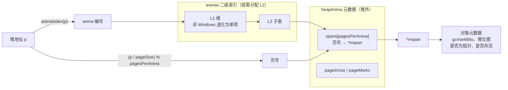
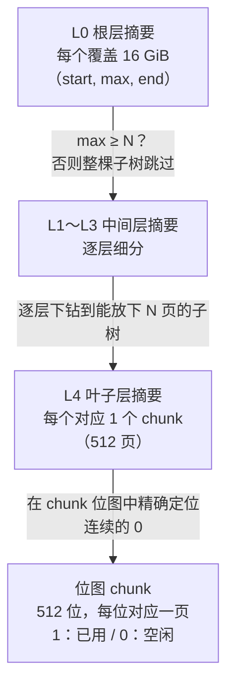

# 12 内存分配器


[mspan,mcache,mcentral,mheap,arena,areaHeap放在哪里？](./mheap,mcache,mcentral,area,mspan放在哪里.md)

## 12.1 设计原则

值此我们已经看清Go程序如何启动，调度器如何把Goroutine摊到操作系统线程上执行。哪些被调度的代码做的最频繁的一件事，是申请内存：每一次new，每一次逃逸到堆上的局部变量，每一次slice扩容，最终
都落到同一个入口`runtime.mallocgc`。本章讲的这个入口背后的分配器，本节先不碰他的零件，而是回答一个更靠前的问题：一个为Go服务的内存分配器，究竟要满足那些互相拉扯的目标，又是依靠那几个判断
把这些目标安顿下来。读懂这套取舍，后面几节的结构与路径就都有了来由。

### 12.1.1 四个相互拉扯的目标

先把范围划分清楚。本章要谈的分配专指堆分配，即runtime.mallocgc经手的那部分。栈上的局部变量随函数返回自然回收，不归分配器管；只有逃逸到堆上的对象才进入这套机制。一个对象是留在栈上还是逃逸到堆，
由编译器分析在编译期判定：

```go
func f() *int {
    y := 2 // y的地址被返回，逃逸到堆 -> 编译器插入newobject
    return &y
}

func g() int {
    x := 2 // x不逃逸，留在栈上 ->  不触发堆分配
    return x
}
```

f中的y会被编译器改为写一次runtime.newobject调用（new 关键字同样落到这里），而newobject只是带上了类型信息调一下mallocgc。换言之，本章讨论的全部分配路径，入口都是这一个函数。逃逸分析的细节属
于编译器（15），这里只需要记住：进入分配器的，是那些编译器判定无法放在栈上的对象。

明确了对象，再看分配器要满足的目标。一个通用内存分配器要同时讨好四方，而这四方彼此并不和睦：

- 快。分配器在热路径上，一个服务每秒可能分配数百万次对象。单次分配若要走一趟加锁，查表，系统调用，整个程序的吞吐就被它拖住。理想的分配应当是几条不加锁的指令。
- 可扩展。Go程序天生多核并发，几十上百个goroutine可能同时申请内存。若所有分配共用一把全局锁，核数越多争用越激烈，加机器反而更慢。分配器必须让并发的分配尽量互不相扰。
- 低碎片。把对象塞进一个比它大的格子会浪费空间（内部碎片）,把堆切的七零八落，留下大量装不下大对象的空隙也是浪费（外部碎片）。一个长期运行的服务，碎片化回随时间累积成实打实的内存膨胀。
- 与GC协作。Go没有显式的free，对象何时回收由垃圾回收器判定。这要求分配器在分配的同时就把回收所需的信息（这块内存是什么类型，含不含指针，是否存活）一并记下，并且让分配的节凑能驱动GC适时启动。

这四者两两冲突。最快的做法是每个线程攥着一大块内存自管自用，但这样每个线程都囤了一份，碎片化就上去了；最省内存的做法是所有对象挤在一个紧凑的全局结构里面按需要切分，但是那必然要全局锁，可扩展性就
没了。分配器的设计，本质上是在这四死角拉锯的网里面找一个工程上的平衡点。Go的答案不是发明一套新机制，而是站在一个成熟设计的肩膀上，再为GC这一角做专门构造。

### 12.1.2 tcmalloc血脉：用线程缓存换掉全局锁

Go的分配器脱胎于Google的tcmalloc(thread-caching malloc)[1]。tcmalloc解决了快与可扩展这对矛盾的核心洞见只有一句：给每个线程一份本地缓存，让绝大多数分配在本地完成，根本不碰全局锁。
线程要分配时候先看自己的缓存，命中就直接返回，是一串无锁操作；只有本地缓存见底，才去摸那把保护全局结构的锁，而那把锁此刻是冷的，因为它很少被碰到。全局争用就这样被分摊到每个线程本地化解掉了。

这正是Go运行时反复使用的统一招式。调度器给每个P一条本地运行队列（9.2）,只有本地队列空了才去全局队列或者别的P那里偷；sync.Pool给每个P一份本地分片（11.6）,也是同一个思路。把全局锁拆分成每
核本地，是高并发运行时最常见的减争手法，读者在本书中回一再遇见它。

Go在继承tcmalloc股价改了两处关键。其一，本地缓存不绑在操作系统线程上，而在帮在P上（9.3）。因为同一时刻一个P只被一个M持有，访问这份换从天然无需加锁，切缓存数量随着GOMAXPROCS而非线程数量增长，
更可控。其二，也是更根本的一处：tcmalloc服务于malloc/free，而Go要服务于精确垃圾回收，于是Go在tcmalloc的每一层结构上都长出了一层GC元数据。可以说，Go的分配器tcmalloc的骨架，加上为GC共生
而生的血肉，这条主线会在13与分配器合流。

把这套思路画成一条代价梯度，就是整个分配器的脊梁：越靠近P本地，命中就越频繁，代价越低；越往全局，望操作系统，代价就越高，命中越稀。绝大多数分配止步于最左端那几条无锁指令，只有逐步落空才向右
付出更大的同步代价。


这张刻画的是代价的量级，12.2会给每一层落实具体的组件（mcache,mcentral,mheap）并画出请求在它们之间的分流路径。本节剩余三小节先把支撑这条梯度的三个判断讲清楚：怎样切分尺寸，怎样按照对象分流，
怎样于GC咬合。

### 12.1.3 尺寸类：用一点内部碎片换来位运算般的分配

把对象一律按其精确大小分配，回收时就会在推上留下大小各异的空洞，下一次分配要在这些空洞里面找一个合适的，即慢又易留下装不下任何对象的外部碎片。tcmalloc与Go采用的对策时尺寸类(size class)：预先
划定一组离散的尺寸档位，分配时把请求向上取整到最近档位，同一档位的对象集中放进段被切分成等大槽位的连续内存(即span,详细见12.2)。

go 1.26划定了68个尺寸类（含一个表示零字节的0号类，实际承载分配的有67个，定义在`internal/runtime/gc/sizeclasses.go`），覆盖8字节到32KB。这样设计带来两个直接好处。其一，分配退化成纯位运
算：同一个span内所有槽位等大，要分配至需要在一张空闲位图里面找一个空位，是几条移位与计数指令，无需比较大小，无需遍历空洞。其二，碎片可控：相邻档位按近似等比的间距排布，一个对象向上取整到下一档，
浪费的比例被这个间距压住。

代价是内部碎片，一个对象要被塞进不小于它的格子。这里要替读者厘清一个常被误传的数字。档位的设计目标是把取整造成相对浪费控制在约1/8=12.5%以为，这是较大档位的间距上界，源码注释里面的max waster
印证了它，例如1024字节档位（第32类）的最坏浪费是12.40%：

```go
// 摘自 sizeclasses.go 的生成注释（节选）
// class  bytes/obj  bytes/span  objects  tail waste  max waste
//     5         48        8192      170          32     31.52%
//    10        128        8192       64           0     11.72%
//    18        256        8192       32           0      5.86%
//    32       1024        8192        8           0     12.40%

```

分配退化成位运算这句话值得落到实处。把请求大小映射到档位，本可以是一次除法或者循环比较，但分配在热路径上，连一次除法都嫌贵。运行时该用查表：预先生成两张索引表，覆盖小区间的按照8字节为步，覆盖
大区间按照128字节为步，把大小->尺寸类压成一次数组下标：

```go
// 大小 -> 尺寸类： 两张预先生成的索引表，无除法，无循环（速写，取自roundupsize)
func sizeToClass(size uintptr) uint8 {
    if size <= smallSizeMax-8 { // <= 1024,按8字节分桶
        return sizeToSizeClass8[divRoundUp(size, smallSizeDiv)]
    }
    return sizeToSizeClass128[divRoundUp(size-smallSizeMax, largeSizeDiv)] // 按照 128 字节分流
}
```

拿到尺寸类后，槽位大小，每span槽数等都是查SizeClassToSize之类的常量表即得；连地址落在span内第几个槽这种本需要除以槽长的计算，运行时也用预存的SizeClassToDivMagic把除法换成一次乘法加位
移。整条小对象快路径上，因此看不到一次真正的除法或者遍历。

回到碎片。这个12.5%不是一个适用于档位的天花板。最小的几个档位位了对齐，相对浪费反而高：1字节的请求要占满8字节的最小档，最坏浪费高达87.5%。这并不矛盾。绝对浪费只有几个字节，对齐换来的是更整齐
的内存布局；max waste列里面还折入了span尾部不满一格的尾部浪费。准确的说法是：尺寸类把较大对象的取整浪费约在12.5%的间距上界，对极小对象则以较高的相对浪费换取对齐槽位均匀，而不是碎片一律不超过
12.%。把这点说清楚，是为了让读者读源码注释时不被那一列87.5%吓到。

### 12.1.4 三条对象路径：按大小与是否含指针分流

确定了按尺寸分配之后，mallocgc把所有请求按照两个维度（大小，是否含指针）分成三条路径。下面是裁剪掉实验开关与边角分支后的分配骨架，保留的正是这三条主干：

```go
// mallocgc的三路分派（速写，省去sanitizer,实验开关等分支）
func mallocgc(size uintptr, typ *_type, needzero bool) unsafe.Pointer {
    if size == 0 {
        return unsafe.Pointer(&zerobase) // 零大小对象共用一个哨兵地址
    }
    noscan := typ == nil || !typ.Pointers() // 不含指针 -> GC无需扫描
    if size <= maxSmallSize-mallocHeaderSize { // 约32KB
        if noscan && size < maxTinySize { // < 16B 且无指针
            return mallocgcTiny(size, typ) // 路径一： 微对象
        }
        return mallocgcSmall(size, typ, noscan) // 路径二：小对象
    }
    return mallocgcLarge(size, typ, needzero) // 路径三: 大对象
}
```

三条路径各自回应一类对象的特点：

- 微对象（小于maxTinySize即16个字节，且不含指针，路径见12.6）。这类对象极小且数量惊人，典型的是单字符的字符串，装箱的小整数。若每个都独占一格，开销主要浪费在格子的取整上。于是分配吧多个微小对
  象拼进同一个16字节块。

- 小对象（16字节至32KB，路径见12.5）。这是分配的主力，走的就是12.1.2与12.1.3描述的快路径：按尺寸类从当前P的本地缓存里面取一个等大的槽位。含指针与不含指针的对象走略有差异的子路径，因为前者
  需要额外的指针位图供GC扫描。

- 大对象（大约32KB,路径见12.4）。这类对象本就稀少，在为它们维护每P缓存与尺寸类得不偿失，缓存里囤一个大对象而占着大内存不放。于是大对象绕过本地缓存，直接向全局推按页申请。它单词代价高，但因为
  频率低，那点加锁被分摊得无足轻重。

这条分界线上有个工程细节：阈值写作maxSmallSize - mallocHeaderSize。Go1.26为含有指针的小对象在槽位前置了8个字节的mallocHeaderSize头部以编码扫描信息，故含有指针对象的实际上限略低于
32768。就设计而言，把分界记成约32kB即可，这层细节留到12.5。

这8个字节头部本身是一处演进。早先Go把对象的指针位图集中存在arean一侧的位图区，扫描对象要先按照地址换算到arean位图里面去查；Go 1.22起改为把小对象的指针信息内联进对象的这8个字节头部（即上面
的mallocHeaderSize），扫描时数据于对象同处同一处缓存行，局部性更好，代价是每个含指针小对象多占8个字节。这类把元数据集中式挪到对象近旁换以缓存局部性的取舍，在12.2与13还会见到。

### 12.1.5 与GC共生：分配即记账

前四目标里面，与GC协作是Go分配器区别与普通malloc的根本所在，它体现在两处。

其一是元数据。每一段被分配出去的内存，分配器都在它所属的span与arena上同步就下回收所需要的信息：这块属于哪个span,是否含有指针（指针位图），是否存活（标记位图）。GC因此能从堆上任意一个地址反复
查出来他是不是指针，指向的对象是否还存活，这是精确垃圾回收（13）得以成立的前提。普通malloc必须操心这些，因为回收由程序员显式下令。正是这层元数据，让12.1.3提到的含指针与不含指针对象要走不通的
路径，也让微对象被强制要求不含指针。

其二是节奏。GC何时启动，不是定时触发，而是由分配的快慢决定：堆每涨到一个目标水平就启动下一轮回收，目标水平又随着上一轮存活量动态调整（13的pacing）。为此每次分配都顺手做一笔账，更新已分配字节
数；当GC正在进行时，分配的goroutine还要按照本次分配的大小就地承担一份标记工作（mark assist）。分得越快，协助越多，以免分配跑赢回收，堆失控的膨胀。换言之，在Go里面分配本身就是GC的节拍器，
这也是为何分配入口叫mallocgc而非malloc，gc这两个字母不是装饰。

把这五节结合起来看。Go分配器的设计可以一句话收尾：它是一套分层缓存，热路径在每个P本地做无锁位运算，把加锁与系统调用挡在越来越冷的后方，同时在每一层都编进GC所需要的元数据与节奏。下一节12.2给
这套分层结构里面的零件命令，定位，把本节的原则落成注意对照源码的具体组件。

## 12.2 组件

12.1说分配器是快路径无锁，慢路径加锁的分层结构。这一节给这套结构里的几个核心组件命名，定位，并落在它们在go1.26中实际形态：每个组件承载什么状态，为何如何设计，以及它们如何串成一条捕获链条。
读懂这几样东西，后面的分配路径（12.4-12.6）就只是在这种图上走一遍。

为避免落回逐字段翻译源码的窠臼，下文给出的结构体都是裁剪后速写：只保留与设计相关的字段，并在注释里面说明它为何存在。完整定义可对照`runtime/mheap.go, mcache.go, mcentral.go`。

### 12.2.1 自由表：一切底层的手法

在认识个组件之前，先认识它们共用的一个底层手法，自由表（free list）。运行时大量“固定大小对象”(mcache, mspan,各类元素数据)都由一个叫做fixalloc的固定大小分配器管理，它的思想及简单：把一批
未分配的内存块用指针串成一条链，每块内存的头部恰好用作指向下一块的指针。分配就是摘下链头，回收就是把快插回链头，都是O(1)的指针操作：

```go
// fixalloc: 固定大小对象的自由表分配器（速写）
type fixalloc struct {
    size uintptr // 每个对象的固定大小
    list *mlink // 自由表：空闲块串成链
    chunk uintptr // 当前向操作系统批发来的大块游标
    nchunk uint32 // 大块中剩余的字节
}

func (f *fixalloc) alloc() unsafe.Pointer {
    if f.list != nil { // 自由表里面有可复用的块
        v := unsafe.Pointer(f.list)
        f.list = f.list.next // 摘下链头
        return v
    }
    // 自由表空了：从批发来的chunk里面切一块；chunk也用尽就向操作系统再批发
    if f.nchunk < f.size {
        f.chunk = uintptr(persistentalloc(_FixAllocChunk, 0, f.stat))
        f.nchunk = _FixAllocChunk
    }
    v := unsafe.Pointer(f.chunk)
    f.chunk += f.size
    f.nckunk -= unit32(f.size)
    return v
}
```

“用空闲块自身的头部存下一块的指针”是自由表的精髓，它不需要额外的元数据数组来记录空闲位置，空闲开销为零。这个手法会在下文中反复出现：mspan内部用它来串空闲对象槽,mcache用它缓存stack,理解了它，
分配器的许多角落叫通了。

### 12.2.2 mspan: 分配的基本单位

mspan是分配器的基本单位，一段连续的内存存页，被切成同一尺寸类（12.1）的若干等大槽位。它既是mcache,mcenter之间流转的货物，也是垃圾回收扫描与清扫单位。裁剪后的速写。

```go
// mspan：一段连续内存页，切成同尺寸的等大槽位（速写）
type mspan struct {
    next, prev *mspan // 串进 mSpanList / mcentral的双向链表

    startAddr uintptr // span手字节地址
    npages uintptr // 占用页数

    freeindex uint16 // 从此处开始扫描下一个空闲槽
    nelems uint16 // 本span的槽位总数

    allocCache uint64 // freeindex处起的空闲位图缓存（取反），加速找空槽
    allocBits *gcBits // 哪些槽已分配
    gcmarkBits *gcBits // GC 标记位:哪些槽存活

    allocCount uint16 // 已分配槽数
    spanclass spanClass // 尺寸类+是否含指针（noscan)
    elemsize uintptr // 每个槽的大小（由spanclass推出）
    state mSpanStateBox // mSpanInUse / mSpanManual / mSpanFree
}
```

几个字段值得点出。freeindex加allocCache是在span内快速找到下一个空槽的关键：allocCache把freeindex附近的空闲位图缓存成一个int64，找空槽推出成一次位扫描（找最低的1位），无需遍历。
allocBits与gcmarkBits这对位图，是分配器与GC共生（12.1）的接口，分配看前者，清扫时候GC用后者覆盖前者，死对象的槽便免清扫地重新变为可分配（13.5）。可见mspan不只是一段内存，它把分配
状态与回收状态编码在了同一段元数据里面。

### 12.2.3 mcache: 每个P的无锁快路径

mcache时每个P一份本地缓存（9.3）,分配器高性能的根基。因为每个P同一时刻只被一个M持有，访问mcache无需加锁，这正是大多数分配走完即止的快路径。

```go
// mcache: 每个P一份本地缓存（速写）
type mcache strcut {
    // 微对象分配器(< 16B无指针，见12.6)：把多个微对象拼进一个块
    tiny uintptr // 当前tiny块起址
    tinyoffset uintptr // 块内已偏移


    // 每个尺寸类各持有一个用于分配的span；按照spanClass索引
    alloc [numSpanClasses]*mspan

    stackcache [_NumStackOrders]stackfreelist // 顺带缓存 goroutine栈
}
```

alloc数组是核心：每个尺寸类（区分含指针/不含指针两种spanClass）各缓存一个mspan，分配小对象就是按照尺寸取出对应的mspan,从中摘一个空槽。tiny/tinyoffset服务于微对象合并（12.6），mstack则
让栈分配（14.6）服用同一套每P缓存思路。mcache自身从非GC内存（经过fixalloc）分配，常驻运行时，P在procresize中创建时拿到自己的mcache,销毁时归坏，因此mcache的生命周期与P绑定，M持有P时候
一并持有它。

### 12.2.4 mcentral:按照尺寸共享的中心仓库

当某个P的mcache里面尺寸类的span用尽，就要向mcentral换一个有空槽的span。mcentral每个尺寸类一个，被所有P共享，故访问需要加锁。它的结构在Go 1.9后是这样：

```go
// mcentral: 某一个尺寸类的中心仓库，全局共享
type mcentral struct {
    spanclass spanClass // 本仓库服务的尺寸类
    partial [2]spanSet // 尚有空槽的span集合
    full [2]spanSet // 已无空槽的span集合
}
```

为何partial与full各是两个集合（[2]spanSet）？这是与清扫（13.5）协同的巧思：两个集合分别对应本轮GC已清扫与尚待清扫，用sweepgen(清扫代)区分。取span时优先从已清扫且有空槽的集合拿；拿到未清扫
的就顺手清扫再用。这套按照清扫代分桶取代了早期单一链表锁的设计，缓解了清扫与分配之间的锁争用，又一处为并发而重构数据结构的例子（对照11.7的演进）。spanSet本身是一个为并发而优化的，分块的无锁
集合，进一步降低了多P同时存取mcentral的开销。

### 12.2.5 mheap与arena:全局堆

补货链的尽头是mheap,全局唯一的堆，管理所有页。mcentral缺span时向它要；大对象（12.4）直接向它按页申请。裁剪后只看几样：

```go
// mheap:全局堆（速写）
type mheap struct {
    lock mutex
    pages pageAlloc // 页分配器，管理哪些页面空闲

    // 地址空间按照arena(64位上每块64MB)组织，arenas是其二级索引
    arenas [1 << arenaL1Bits]*[1 << arenaL2Bits]*heapArena

    // 每个尺寸类一个mcentral，集中放在这里
    central [numSpanClass]struct {
        mcentral mcentral
        - [...]byte // 填充到缓存行,避免false sharing
    }
}
```

mheap之下有两层基础设施。页分派器pages(12.7)回答哪段连续页空闲；arena则是地址空间的组织单位（12.3）,堆按64MB的arena为粒度向操作系统索取，每个arena配一份元数据（指针位图，span索引）,使运行
时能从任意地址反查它属于哪个span，是不是指针，是否存活。注意central数组上的缓存行填充：把不通尺寸类的mcentral对齐到不同缓存行，避免多核同时操作不通尺寸时的伪共享（false sharing），这种
缓存行的斤斤计较，是高并发运行时代码的常见笔法。

### 12.2.6 一次分配如何穿过这层级

把四者串起来，一次小对象分配（12.5）的路径，正是12.1那条补货链的演出：


最快的那一步nextFreeFast，就是当前mspan的allocCache上做一次位扫描：

```go
// 在span内找下一个空闲槽：一次位运算，无锁（速写）
func nextFreeFast(s *mspan) gclinkptr {
    bit := sys.trailingZeros64(s.allocCache) // 找最低空闲位
    if bit < 64 {
        result := s.freeindex + uint16(bit)
        if result < s.nelems {
            s.allocCache >>= uint(bit + 1) // 推进缓存
            s.freeindex = result + 1
            s.allocCount++
            return gclinkptr(uintptr(result)*s.elemsize + s.base())
        }
    }
    return 0
}
```

只有这一步返回0（本地span用尽），才落入加锁的慢路径：向对应mcentral cacheSpan换一个有空槽的span(顺带清扫)，mcentral也没有就想mheap要新页要切出来span,mheap不再向操作系统批发一个arena。
越往下，同步代价越大，命中率越低，这正是分层缓存的全部意义：把最热的路径做成一条无锁位运算，把昂贵的加锁与系统调用挡在越来越冷的后方。

### 12.2.7 设计取舍，演进与谱系

这套结构把12.1的设计原则落成了具体零件，每个零件都对应一处取舍：

- 每P无锁缓存（mcache）消除快路径争用，代价是每个P各占一份缓存内存，且对象在P之间不能直接复用（要经mcentral中转）。这与调度器的本地运行队列（9.2）,sync.Pool的每P分片（11.6）是同一种分层减
  减争的招式，在Go运行时里你会反复遇见它。
- 按照尺寸类组织（mspan）让分配退化成取一个等大槽位的位运算，代价是尺寸不整带来的内部碎片（最坏12.5%）。
- mcentral按照清扫分桶（[2]spanSet）是为了降低分配与清扫的锁争用而做的演进，Go 1.9之前mcentral是单链表加一把锁，高并发下成为瓶颈，重构位spanSet后显著缓解。

放进谱系看，这套层级直接继承自Google的tcmalloc(12.1):thread cache（对应mcache），central free list (对应mcentral),page heap（对应mheap)。Jemalloc的arena+tcache也是同构思路。
Go在其上长出的，tcmalloc没有的东西，是为精确垃圾回收服务的那层元数据，mspan的gcmarkBits,arena的指针位图。换言之，Go的分配器是tcmalloc的骨架+为GC共生而生的血肉，这条主线会在13垃圾回收
与它合流。

## 12.3 初始化

12.2把分配器拆成了mcache,mcentral,mheap,arena几样零件，但那是一张静态图。这些零件并非凭空就位，它们要在程序启动之初就被一次性安放好。本节要回到的问题是：当main还没运行，第一次new还没发生
时，运行时究竟为分配器铺好了哪些基础设施。

读懂初始化，关键不在于逐行复述mallocinit，而在看清楚两件被它确立下来，此后在不更改的事实：其一，地址空间是怎样被组织成arena的，这决定了运行时如何从任意一个推地址反查出它属于哪个span，里面是不
是指针，是否还存活，是垃圾回收（13）赖以工作的地基；其二，预留地址与提交物理内存是两件事，这解释了为何一个Go进程的虚拟内存（VIRT）常常远大于常驻内存（RES），而这里并不是泄漏。

分配器是执行栈外最先完成初始化的子系统之一。由调度器引导阶段调用mallocinit (3.5)。

### 12.3.1 mallocinit:启动时铺好地基

mallocinit做三类事：一批关于常量自检（编译期算出的arena尺寸，位图字数，物理页大小不惜自治），初始化全局堆`mheap_`,以及为64位地址空间播下一组arena增长提示。裁剪后的速写如下：

```go
func mallocinit() {
    // 1. 自检：编译期常量必须自洽。例如堆位图数必须是2的幂（取模寻址要用），
    // 物理页面大小须落在[minPhysPageSize, maxPhypageSize] 且为2的幂
    if heapArenaBitmapWords&(heapArenaBitmapWords-1) != 0 {
        throw("heapArenaBitmapWords not a power of 2")
    }
    if physPageSize == 0 {
        throw("failed to get system page size")
    }
    // ... 更多关于physHugePageSize,size class 边界的检查

    // 2. 初始化全局堆，并为引导线程分配第一个mcache.
    mheap_.init()
    mcache0 = allocmcache()

    // 3. 在64位机器上播下arena增长提示，从地址空间中间开始
    if goarch.PtrSize == 8 {
        for i := 0x7f; i >= 0; i-- {
            var p uintptr
            switch {
            case GOARCH == "arm64" && GOOS == "darwin":
                p = uintptr(i)<<40 | uintptrMask&{0x0013<<28}
            default:
                p = uintptr(i)<<40 | uintptrMask&{0x00c0<<32}
            }
            hint := (*arenaHint)(mheap_.arenaHintAlloc.alloc())
            hint.addr = p
            hint.next, mheap_.arenaHints = mheap_.arenaHints, hint
        }
    }
}
```

那串自检不是仪式。分配器的许多快路径靠位运算寻址，前提是这些尺寸恰好为2的幂，彼此整除；若某次移植或者改尺寸破坏了前提，与其让程序在运行时给出难解的越界，不如在启动时当场throw。这是运行时代码
的一种笔法：把本应该恒真的不变量写成启动期断言，把错误挡在最前面。

第三步的增长提示 arenaHints值得多说一句。Go不在启动时就向操作系统索要整片堆，而是记下一串将来想从这里开始长堆的地址。默认从0x00c0...起来（在小端机上内存呈现为c0 cc, c1 00...,调试时候
一眼可辨），从地址空间中铺开，便于把堆扩展成一段连续区域二不撞上别的映射。真正向操作系统要地址，要等到第一次堆增长时才发生。

`mheap_.init`则把堆里面各种定长的fixalloc(12.2)逐一初始化：mspan, mcache, 各类special记录都有自己的定长分配器。其中一处细节值得点出：

```go
func (h *mheap) init() {
    h.spanalloc.init(unsafe.SizeOf(mspan{}), recordspan, unsafe.Pointer(h), &memstats.mspan_sys)
    h.cachealloc.init(unsafe.SizeOf(mcache{}), nil,  nil, &memstats.mcache_sys)
    h.arenaHintAlloc.init(unsafe.SizeOf(arenaHint{}), nil, nil, &memstats.other_sys)

    // ... 还有十余个special 记录的fixalloc

    // 不对mspan清零：后台清扫会与分配一个span并发地检视它。
    // 故span的sweepgen须在释放后重新分配时存活，以防止后台清扫错误地把它从0 CAS走。
    // 因为mspan不含堆指针，不清零时安全的。

    h.spanalloc.zero = false

    for i := range h.central {
        h.central[i].mcentral.init(spanClass(i))
    }
}
```

h.spanalloc.zero = false时分配器与GC共生（12.2）在初始化阶段就显形的一处证据：mspan的内存被回收后重新分配时不清零，好让sweepgen这个清扫代字段跨越释放，重分配而存活，从而让后台清扫不会
把一个其实正被复用的span误判为可回收。一个看似只是省一次memclr的开关，背后是清扫器与分配器之间的一条并发约束。

### 12.3.2 arena: 地址空间的组织

堆不是一整块，它由许多固定大小的arena拼成。64位Linux上每个arena为64MB（heapArenaBytes = 1 << logheapAreanbytes, logHeapAreanBytes = 26），堆向操作系统索取地址始终以arean为粒度，
切对齐arena边界。为什么要切成arean,而不是把堆当作一段无结构的连续内存？因为运行时需要一种从任意地址O(1)反查元数据的能力，而对其的定长分块让这种反查退化成几次移位与查表。

给顶一个堆地址p，运行时先把它换算成arena编号，再用这个编号查一张二级表arenas:

```go
type mheap struct {
    // ...
    // 地址空间arena组织；arenas时arena编号到heapArean元数据的二级索引。
    // 64位非Windows上arenaL1Bits == 0,于是L1维只有一项，实际退化成一级表
    areans [1 << arenaL1Bits]*[1 << arenaL2Bits]*heapArean
}

// 由推地址算出areana编号（amd64 上先减去areanBaseOffset，把符号位区间折叠掉）
func arenaIndex(p uintptr) arenaIdx {
    return arenaIdx((p - arenaBaseOffset) / heapAreanBytes)
}
```

为何二级而非一级？若用一张平坦数组覆盖整个64位可寻址堆空间（heapAddrBits = 48），单是这张表指针就要占去客观的内存，而绝大部分项永远为空。二级化（arenas[L1][L2]）让L2子表按需分配：只有
真正映射了某个arean，对应的L2表才会被创建。在64位非Windows平台。areanL1Bits = 0, L1维退化成当项，索引实际是一级的；Windoes因地址空间布局不通才启用L1。这又是一处为不常用的情形省内存
的工程选择。

每个arena配一份heapArean元数据，存在推之外。它就是反差的答案所在:

```go
// heapArena: 一个arena的元数据，存在于Go推之外，经mheap_.areans索引（速写）
type heapArena struct {
    // 本arena内页号-> *mspan的映射。已分配span的每一页都指向该span。
    // 用于从任意地址反查它属于哪个span。
    spans [pagePerArean]*mspan

    // 哪些span处于mSpanInUse；按页号索引，只用每个span首页对应的位
    pageInUse [pagesPerArena / 8]uint8

    // 哪些span上有被标记存活的对象。清扫时候用它快速找出整段可释放的span。
    pageMarks [pagesPerArean / 8]uint8

    // 本arean内尚未用过，因而仍为零的手字节水位。用于判断一次分配是否需要清零
    zeroedBase uintptr
}
```

spans数组是反查链的第一环：给定地址p,经arenaIndex取的arena，再用(p/pageSize) % pagesPerArena取得页号，查spans即得&mspan。拿到span后，p是不是指针，p是否存活就能从span的元数据（12.2
的gcmarkBits,以及小对象的堆位图）继续问下去。这条地址->arena->span->对象元数据的链，是垃圾回收能够在O(1)内对指针做扫描决策的根本（13）。把这条反查链画成一张索引图，它的两段拆分就一目了然：
高位选arena，低位选页。



> 关于指针位图的存放，Go 1.22起做过一次重要演进。早先每个arena配一张覆盖整片的指针位图；如今多数小对象的指针/标量信息改为随对象内联或者智于对象span头部（heapBitsInSpan,span的malokc header
> ），仅对要时回退到独立位图。这把元数据从按照地空间均摊改成按照实际对象就近存放，改善了局部性。本书在13展开扫描时候再回到这条线。读者只需要记住：arena这一层提供的是地址到span的快速反查，而指针
> 信息的具体落脚点随版本演进。

### 12.3.3 预留于提交：为何VIRT远大于RES

切好了arena的概念，还要回答一个实际问题：运行时是如何从操作系统拿到这些arena背后的内存的。这里有一组容易混淆，却必须分清的动作。预留地址空间（reserve）与提交物理内存（commit）是两件事。预留
只是向操作系统声明这段虚拟地址归我，不消耗任何物理页，几乎免费；只有当某段地址第一次被真正写入之前，运行时才提交它，让操作系统为其分配物理页面。

运行时把内存区域抽象成四种状态，所有OS层操作都在这四种态之间迁移（见runtime/mem.go）：

- None: 默认状态，即未预留也未映射，访问会出错。
- Reserved: 地址归运行时所有，但是访问会触发缺页错误，不计入程序内存足迹。
- Prepared: 已预留，意在不由物理内存支撑（操作系统可懒惰实现），可高效转入Ready；此时访问的结构才有意义。
- Ready:可安全访问。

理论上只要None, Reserved,Ready三态便足以覆盖所有平台，Prepared时为性能多设的一态。它的价值在POSIX系统上看的最清楚：Reserved通常是一段PORT_NONE的私有匿名mmap,转入Ready本需要把权限
改成PROT_READ|PROT_WRITE;而Prepared的未定义给了运行时余地，用MODV_FREE就能把Ready降回Prepared。于是权限位只在早期设一次，此后运行时随时可以告诉操作系统这些页面你尽管拿去，而无需反复改权
限。

这套抽象落到Linux,就是几个mmap/madvise的薄封装（runtime/mem_linux.go）：

```go
// 预留：占住地址，但是PORT_NONE使其不可访问，也就不占用物理内存
func sysReserveOS(v unsafe.Pointer, n uintptr, name string) unsafe.Pointer {
    p, err := mmap(v, n, _PROT_NONE, _MAP_ANON|_MAP_PRIVATE, -1, 0)
    if err != 0 {
        return nil
    }
    return p
}

// 提交：把已预留的地址改成可读写，操作系统才会按需分配物理页面
func sysMapOS(v unsafe.Pointer, n uintptr, name string) {
    p, err := mmap(v, n, _PROT_READ|_PROT_WRITE, _MAP_ANON|_MAP_FIXED|_MAP_PRIVATE, -1, 0)
    if err == _ENOMEM {
        throw("runtime: out of memory")
    }
    // ...
}

// 交还：MADV_FREE告诉内核这些物理页面可被回收，地址仍然归我
func sysUnusedOS(v unsafe.Pointer, n uintptr) {
    // 优先MADV_FREE，不支持则退回MADV_DONTNEED,再不支持则重映射
    madvise(v, n, _MADV_FREE)
}
```

七个跨平台原语与四态对应关系是：sysReserve取地址（None->Reserved），sysMap划入可提交区（Reserved->Prepared），sysUsed确保可用（Prepared->Ready），sysUnused交还物理页（
Ready->Prepared），sysFree彻底munmap（Ready->None），sysFault设为必然出错（Ready->Reserved,仅调试用），sysAlloc则是一步拿到整块零内存（None->Ready）的捷径。跨平台层(mem.go)只
做内存会计，真正的系统调用落在各OS的`*OS`实现里。

需要说明的是，提交在不通平台的落点并不一致。在Linux这类支持overcommit的系统上，sysMap把权限改为可读写后，物理页面是在首次访问时候由内核惰性缺页补上的，sysUsed（Prepared->Ready）几乎是空
操作；而在Windoes这类由显式提交与硬性额度的系统上，sysUsed才是真正向操作系统提交物理内存的那一步。四态抽象之所以多设一个Prepared,正是为了让两类平台共用同一套上层逻辑。

现在可以回答开头那个实际问题了。一个Go进程的VIRT常常是几个GB乃至上百个GB，远超它实际占用的RES，因为运行时预留了大片arena地址空间（Reserved/Prepared），却只对真正写入过的页提交物理内存
(Ready)。预留不计入物理足迹，所以这不是泄漏，而是上述廉价占地址，按需要付物理页面策略的正常表现。同理，当堆收缩时，运行时用sysUnused(MADV_FREE)把物理页交还内核，
但是地址仍然预留，这也是为何RES的下降有时回滞后堆的实际收缩：MADV_FREE让内核有空再回收，页面要等到内核吃紧时候才真正归还。

### 12.3.4 初始化之后：就位的基础设施

mallocinit返回时，分配器的骨架已成形，尽管此刻堆里面还没有一个arena被真正提交。就位的有这样几样：

- 页分配器`mheap_.pages`(12.7)已初始化，准备在第一次堆增长时回答哪段连续页空闲。
- 每个尺寸类一个mcentral(h.central数组)已就位，各自服务一个spanClass，等待mcache来换span(12.2)。
- arena二级索引arenas已经建好骨架（L2子表尚未分配），arenaHints已播下一串增长提示。
- 第一个mcache(mcache0)已由allocmcache经fixalloc从非GC内存分出，暂挂在引导线程上。它将在procresize(9.3)中转交给某个P,从此mcache的声明周期与P绑定，而非M。

换言之，初始化建立的是容器与索引，而非内容。第一个arena的提交，第一个span的切分，都推迟到第一次分配真正发生时候（12.4-12.6）。这种先搭好查找结构，内容懒加载的安排，与arena二级表按需分配L2,
地址预留空而非物理内存按需要提交，是同一种思路在不通层次上的复用：把昂贵的动作尽量推迟，只在确知必要时才付出代价。

## 12.4 大对象分配

12.2的分配层级是为小而频繁的对象造的：每P一份mcache，按尺寸类共享的mcentral，全局的mheap，三层缓存绝大多数分配收敛成几条无锁位运算。可这套精巧的机器有一个隐含的前提，对象小到能被尺寸类装下。
一旦对象超过maxSmallSize（go 1.26中为32768字节，即32KB）。它就装不进任何尺寸类的槽位，整条捕获链就对它失去了意义。

大对象（large object）走的是另外一条路径：跳过mcache与mcentral。直接向mheap按页申请一段连续内存，为它单独造一个span。这条路在代码上比小对象简短很多，单简短不等于廉价。本节要讲清楚它为何被
设计成绕开缓存，这条路具体怎么走，以及绕开缓存在工程上要付出什么代价。

### 12.4.1 为什么大对象不进缓存

缓存之所以划算，靠的是两个假设：被缓存的东西频繁复用，切尺寸整齐到可以预先按照类备货。小对象两条都满足，于是mcache为每个尺寸常被一个span，命中率高，摊销下来近乎免费。大对象两条都不满足。

它们的低频。一个程序里面32KB以上的分配，数量级远小于小对象，多是大缓冲区，大切片，大哈希表的底层数组。为低频对象维护每个P缓存，备的货大半时间限制，命中率却上不去，缓存反而成了纯粹的内存浪费。

它们尺寸离散。小对象被归进68个尺寸类，是因为这个区间内的尺寸足够密集，量化到固定档位的浪费可控（最坏125.%,见12.1）。大对象的尺寸跨度从32KB到数百MB,若按照尺寸备货，类数回爆炸，每类又难得复用
一次。与其按类缓存，不如来一个算一个，按实际页数切分。

这正是分层分配器一以贯之的取舍：把热路径打磨到极致，让冷路径保持简单。小对象是热路径。值得用三层缓存和位图换速度；大对象是冷路径，多写的缓存逻辑省不下多少时间，却凭空添加了内存雨复杂度。于是Go
1.26干脆为它另开一个入口mallocgcLarge，与小对象mallocgcSmall\*，微对象的mallocgcTiny在mallocgc里面按尺寸分流（见12.5）,各走各的代码，互不拖累。

### 12.4.2 直接向堆要页

大对象分配的主干很短。mallocgcLarge拿到mcache只是为了借用它的统计与采样字段，真正给span的活交给了mcache.allocLarge。后者做两件事情：把字节数向上取整成页数，再向mheap要这么多页面：

```go
// mcache.allocLarge:为一个大对象造一个专属span(速写)
func (c *mcache) allocLarge(size uintptr, noscan bool) *mspan {
    // 把字节数向上取整为页数g(go1.26的页大小为8KB)
    npages := size >> gc.PageShift
    if size&pageMask != 0 {
        npages++
    }

    // 预扣清扫额度： 分配n页前，先帮着清扫回收n页面，移植堆无序增长
    deductSweepCredit(npages*pageSize, npages)

    // 尺寸类0即大对象span的标记；noscan表示对象不含指针
    spc := makeSpanClass(0, noscan)
    s := mheap_.alloc(npages, spc) // 向全局堆按页申请
    if s == nil {
        throw("out of memory")
    }
    // ... 更新largeAlloc统计，推进heapLive，把span挂到清扫列表
    s.limit = s.base() + size // 把limit收紧到对象实际占用处
    return s
}
```

注意makeSpanClass(0, noscan)里面那个0。尺寸类0是一个保留档位，专门标记这个span只装一个大对象。在小对象span里面，elemsize是尺寸类固定槽位的大小，一个span切出几十上百个等大槽；而尺寸
类0的span,elemsize直接等于整个span的字节数，elems为1，整段连续内存就是一个对象。回到mallocgcLarge，拿到span后只需要freeindex = 1, allocCount = 1,宣告这唯一的槽位已被占用，对象的地址
就是span的首地址：

```go
span := c.allocLarge(size, typ == nil || !typ.Pointers())
span.freeindex = 1
span.allocCount = 1
span.largeType = nil // 暂时不让GC扫描，等内存清零，类型写好以后再发布
size = span.elemsize
x := unsafe.Pointer(span.base())
```

向堆要页的mheap.alloc把活推给了allocSpan，并放到系统栈上执行，因为它可能要持有堆锁，而持锁期间不能触发再次申请堆内存的栈增长。allocSpan内部把两条路取得连续页：

```go
// mheap.allocSpan:取得npages连续页，组装成span(速写，省去清扫/对齐细节)
func (h *mheap) allocSpan(npages uintptr,typ spanAllocType, spc spanClass) (s *mspan) {
    pp := getg().m.p.ptr()
    // 页数较小时，先试每P的页缓存（pcache),这条路无需堆锁
    if pp != nil && npages < pageCachePages / 4 {
        base, scav = pp.pcache.alloc(npages)
        if base != 0 {
            s = h.tryAllocMSpan()
            if s != nil {
                goto HaveSpan // 命中页缓存，全程无锁
            }
        }
    }
    // 页面缓存不够，或者要的页太多
    lock(&h.lock)
    base, scav = h.pages.alloc(npages)
    if base == 0 {
        if _, ok := h.grow(npages); !ok { // 堆里面腾不出来，向操作系统增长(见12.7)
            unlock(&h.lock); return nil
        }
        base, scav = h.pages.alloc(npages)
    }
    s = h.allocMSpanLocked()
    unlock(&h.lock)

HaveSpan:
    h.initSpan(s, typ, spc, base, npages, scav)
    return s

}
```

哪一段连续页是空闲的这个问题，由mheap之下的页分配器回答，它的基数树与位图查找是12.7主题，这里这把它当作一个给我n页连续空间的接口。页分配器也腾不出空间的时，grow才向操作系统索取新的arena，这条
更冷的路同样属于12.7。本节止步于h.pages.alloc(npages),专注大对象这一段。

### 12.4.3 绕开缓存的代价

大对象省略了缓存备货的开销，却也丢掉了缓存带来的快路径。逐项看绕开缓存要付出什么。

同步代价更高，但不是必然抢全局锁。go 1.26再allocSpan里面留了一道缓冲：页数较小（npages < pageCachePages / 4,pageCachePages为64，故约小于16页，对应8KB页面平台上约128KB以内）时，先
试每个P的也缓存pcache，命中则全程无锁。所以32KB到约128KB的大对象，常常并不触碰堆锁。真正的差距不在锁着一个字，而在于大对象没有现成缓存span可摘：小对象的快路径是从mcache里面已备好的span上做
一次位扫描取槽（nextFreeFast, 见12.5），而大对象每次都要跑完allocSpan, 预扣清扫额度（deductSweepCredit），向也分配器查找连续页，组装并初始化一个新span，页缓存落空或者页数过大时候还要
落到堆锁。即便命中页缓存，这条路的常数也远比一次位扫描中。

页级内部碎片。大对象按照页面取整，每个对象独占整数页，尾部不足一页的部分白白浪费，一个32769字节的对象（刚过32KB一个字节）,向上取整5页面即40960字节，浪费近8KB。这种碎片化不像小对象的尺寸类
碎片有12.5%的上限，它取决于对象大小于页大小的余数，最坏接近一整页。对频繁分配的，尺寸恰好略过页边界的大对象，这笔浪费值得再设计数据结构时留意。

强烈牵动GC步调。大对象一次就给堆活跃量（heapLive）添上了一大笔。allocLarge里gcController.update即时把这几十上百KB计入heapLive，而GC的触发依据正是heapLive想队上对上轮标记过后活跃量
的增长比例（GOGC,见13）。于是mallocgcLarge结尾专门测一次触发条件，必要时就地启动一轮GC:

```go
// 大对象分配尾声，检查是否改触发GC
if t := (gcTrigger{kind: gctriggerHeap}); t.test(){
    gcStart(t)
}
```

小对象分配也会推进heapLive,但单次增量小，被mcache摊薄；大对象单词增量大，一次几MB的分配可能独立把堆推过触发线，立刻引发一轮GC。换言之，大对象不只是分配慢，它还经由GC步调把成本转嫁给整个程序。

用sync.Pool复用大缓冲区。既然大对象分配贵，又强烈牵动GC，对那些生命周期短，反复申请释放的大缓冲区（如网络读写缓冲，序列化缓冲），最划算的做法是别让它们反复经过分配器，用11.6的sync.Pool把用过的大缓冲存起来重用。这恰好是分配器部位低频大对象建缓存之后，留给应用层自己补上的那块缓存：运行时只为通用的小对象热路径优化，特定的大对象复用模式由最了解它的使用者按需缓存。

### 12.4.4 与小对象路径的快照

把两条路并排放，大对象分配的设计意图就清楚了：


小对象一侧的全部精巧，尺寸类，每P缓存的span，位图于位扫描，与清扫共生的gcmarkBits，都是为了把高频路径压到极限。大对象一侧近乎其反面：一个对象一个span,一次分配一段连续内存，没有缓存可命中，
没有槽位可摘。这不是大对象路径不够用心，而是用心之处不同，因为在这条冷路径上，简单本身就是正确的设计。

放进谱系看。这种大对象绕过thread cache，直接走page heap的分工，与原型tcmalloc（见12.1）如出一辙：tcmalloc同样为大对象绕开线程缓存，直接向page heap按照页面申请；jemalloc把分配分成
small/large/huge三档，huge档直接走chunk级而不入tcache。Go在这套通用骨架上添加的，仍是为精确GC服务的那层东西，大对象span同样带gcmarkBits与类型信息（largeType），同样要发布前过
publication barrier,让GC能正确扫描这块大内存（见13）。大对象分配走的简单，但它从未走出Go分配与回收的那条主线。

## 12.5 小对象分配

小对象尺寸在16B至32KB之间的对象（go 1.26 maxSmallSize = 32768）。它们是Go程序里面最常见的一类分配：一个结构体，一个不算太大的切片底层数组，一条字符串拼接的结果，绝大多数都落在这个区间。
分配器为它们设计的路径，是12.2那套mcache->mcentral->mheap层级的主舞台，也是整套内存分配器快路径无锁的设计（12.1）兑现性能承诺的地方。

### 12.5.1 第一步：把尺寸取整到尺寸类

分配器不会为恰好37个字节单独管理一种内存块。它16B至32KB尺寸空间划成68个尺寸类（size class,12.1），每个尺寸堆应一个固定的对象大小（8，16，24，32......一直到32768），分配时把请求向上
取整到最近的尺寸类。这一步要做到O(1)，靠的是两张预先生成的查找表：

```go
// 把请求尺寸映射到尺寸类，再取出该类的实际对象大小（速写）
var sizeClass uint8
if size <= gc.SmallSizeMax - 8 {
    sizeclass = gc.SizeToSizeClass8[divRountUp(size, gc.SmallSizeDiv)] // 步长 8
} else {
    sizeClass = gc.SizeToSizeClass128[divRoundUp(size-gc.SmallSizeMax, gc.LargeSizeDiv)] // 步长128
}
size := uintptr(gc.SizeClassToSize[sizeclass]) //取整后的真实分配大小
spc := makeSpanClass(sizeclass, noscan) // 尺寸类+是否含有指针=spanClass
```

为何分为两张表？尺寸类再小区间排的密集，大区间排的疏（1024以下按照8字节一档，以上按照128字节一档），用两个不同步长（SmallSizeDiv = 8, LargeSizeDiv = 128）的表，能把映射压成两次数组下标
读取，避免任何循环或者乘法。divRoundUp也只是一次乘加，不走真正的除法指令。

取整必然带来内存碎片：申请33个字节会落到48个字节的尺寸类，浪费15字节。尺寸类的档位都是精心设计的，目标是把最坏浪费（max waste）压在可接受的范围之内。表里面最大一档是class 67，对象和span都是32768字节，整页独占，浪费12.5%。这12.5%不是巧合,而是档位设计可以留守的上限：尺寸类越密碎片越小，单元数据种类越多，分配器在省内存与少种类之间取得折中。

最后那行makeSpanClass值得一提：尺寸类还要再乘以二，区分指针与不含指针（noscan）两种spanClass。后者的span不必被GC扫描（13）,把它们分开存放，能让清扫和标记跳过整段无指针内存。所以mcache里面
按照spanClass而非sizeclass索引，68个尺寸类对应136个spanClass。

### 12.5.2 第二步：从mcache无锁取槽

拿到spc后，分配器直接取出当前P的mcache中位这个spanClass缓存的那个mspan，从中摘一个空槽。因为mcache每个P一份，同一时刻只被一个M持有，这一步无需任何锁：

```go
span := c.alloc[spc] // 取出本地P为该尺寸缓存的span
v := nextFreeFast(span) // 在本span找下一个空槽：一次扫描
if v == 0 {
    v, span, checkGCTrigger = c.nextFree(spc) // 本地span用尽，落入慢路径
}
```

最快的一步在nextFreeFast里面。每个mspan用一个allocCache(一个uint64)缓存freeindex附近64个槽的占用情况，且存的是取反以后的位图（空槽位1）。于是找下一个空槽退化成找最低位的1位，一条
TrailingZeros64（数末尾连续的零，即count trailing zeros）指令就能就位：

```go
// 在span内找下一个空闲槽：一次位运算，无锁（速写）
func nextFreeFast(s *mspan) gclinkptr {
    theBit := sys.TrailingZeros64(s.allocCache) // 找allocCache中最低的空闲位置
    if theBit < 64 {
        result := s.freeindex + uint16(theBit)
        if result < s.nelems {
            freeidx := result + 1
            if freeidx%64 == 0 && freeidx != s.nelems {
                return 0 // 跨过当前64位窗口边界，交给慢路径取刷新缓存
            }
            s.allocCache >>= uint(theBit + 1) // 推进缓存，已分配的位移走
            s.freeindex = freeidx // 推进扫描游标
            s.allocCount++
            return gclinkptr(uintptr(result)*s.elemsize + s.base()) // 槽地址=基址+序号*槽大小
        }
    }
    return 0 // allocCache已经全部位0:本窗口无空槽，需要走慢路径
}
```

整个快路径就这几条指令：一次位扫描，一次移位，一个乘加算地址，全程无锁，不深入函数调用栈。返回0只有两种情形：当前64位窗口扫描完了（theBit == 64或者跨窗口边界），或这个span真的满了。两种
都交给慢路径处理，慢路径会负责刷新allocCache或者换一个新的span。nextFreeFast不刷新缓存，不跨窗口，正是为了把它压到最短，让热路径的那条路径上没有一丝多余动作。

### 12.5.3 第三步：慢路径取货

nextFreeFast返回0，就进入nextFree。它先用nextFreeIndex做一次完整的扫描，这个版本会跨越64位窗口，按需调用refillAllocCache把allocBits的下一段重新装进allocCache，因此能找到
nextFreeFast略过的那些槽。只有当扫描走到s.melems(span确实满了)，才需要真正的补货：

```go
func (c *mcache) nextFree(spc spanClass) (v gclinkptr, s *mspan, checkGCTrigger bool) {
    s = c.alloc[spc]
    freeIndex := s.nextFreeIndex() // 跨窗口的完整扫描，会按照需刷新allocCache
    if freeIndex == s.nelems { // span填满了
        c.refill(spc) // 把满span还给mcentral,换一个有空槽的
        checkGCTrigger = true // 触发一次补货，顺便检查是否该启动GC
        s = c.alloc[spc]
        freeIndex = s.nextFreeIndex()
    }
    v = gclinkptr(uintptr(freeIndex)*s.elemsize + s.base())
    s.allocCount++
    return
}
```

refill时补货链的第一环：把当前这个满了的span交还给对应尺寸类的mcentral(uncacheSpan),再从那里cacheSpan取一个空槽的新的span装回c.alloc[spc]。这里访问mcentral是加锁的,go1.26还会顺手
刷一批统计（已用槽数，heapLive，tiny计数），并把新span的sweepgen标成已缓存状态，防止它在缓存期间被异步清扫器抢走。

mcentral这一层是分配与清扫的交汇点。cacheSpan取span的顺序体现了按照清扫代分桶的设计（12.2）：

```go
// 向mcentral要一个有空槽的span(速写，省去trace统计)
func (c *mcentral) cacheSpan() *mspan {
    deductSweepCredit(spanBytes, 0) // 分配多少就帮忙清扫多少的配额极致

    sg := mheap_.sweepgen
    if s = c.partialSwept(sg).pop(); s != nil { // 1. 优先：已清扫，有空槽
        goto havespan
    }

    // 2. 次之：未清扫但是可能有空槽，就地清扫以后使用(spanBudget限制最多尝试100个)
    for ; spanBudget >= 0; spanBudget-- {
        s = c.partialUnswept(sg).pop()
        if s == nil { break }
        if s, ok := sl.tryAcquire(s); ok {
            s.sweep(true) // 就地清扫，把死对象的槽变回可用
            goto havespan
        }
    }

    // 3. 再次之：扫描未清扫的满span，清扫后若腾出空槽则用（同理，略）
    // 4. 全都没有：向mheap要新的页切出一个span
    s = c.grow()

havespan:
    // 用freeindex处的allocBits 刷新allocCache,调整对齐后交给memcache
    s.refillAllocCache(s.freeindex / 8)
    s.allocCache >>= s.freeindex % 64
    return s
}
```

deductSweepCredit是惰性清扫（13.5）的执行点：GC标记结束以后并不立刻清扫全部span，而是把清扫后摊派到后续的分配里面，谁分配就帮忙清扫一点，避免一次stop-the-workd式的大扫除。所以小对象分配
的慢路径不只是取一块内存，它还顺手推进了垃圾回收。

补货链的尽头是grow：mcentral一个可用的span都没有时，向全局mheap按页申请，切成等大的槽位的心span。这一步又会牵动页分配器（12.7）乃至想操作系统索取arena(12.3),代价最大，命中最罕见，与大对象分配共用mheap.alloc:

```go
func (c *mcentral) grow() *mspan {
    npages := uintptr(gc.SizeClassToNPages[c.spanClass.sizeclass()])
    s := mheap_.alloc(npages, c.spanclass) // 向全局要堆npages页
    if s == nil {
        return nil
    }
    s.initHeapBits() // 初始化该span的GC图
    return s
}
```

### 12.5.4 span内部：用空闲位图找槽

三步路径反复出现的核心动作，是在一个span内找下一个空槽。这件事情完全由两组位图驱动，理解了它，整条路径就练成一气。

每个mspan维护两层位图（12.2）。底层是allocBits,一个`*gcBits`,每位对应一个槽，记录它是否已分配。上层是allocCache，一个uint64, 把freeindex起的64位allocBits取反后缓存进来（空槽1），
让位扫描能直接用TrailingZeros64。refillAllocCache负责在freeindex跨过64位窗口时，从allocBits装入下一段：

```go
// 用allocBits的下一段（8字节）刷新allocCache，取反使空槽位1（速写）
func (s *mspan) refillAllocCache(whichByte uint16) {
    bytes := (*[8]uint8)(unsafe.Pointer(s.allocBits.bytep(uintptr(whichByte))))
    aCache := uint64(0)
    aCache |= uint64(bytes[0])
    aCache |= uint64(bytes[1]) << (1 * 8)
    // ......逐字节拼满8字节 = 64 位 ......
    aCache |= uint64(bytes[7]) << (7 * 8)
    s.allocCache = ^aCache // 取反：allocBits里的0(空)变成allocCache里的1
}
```

freeindex是这套机制的游标：扫描只从freeindex往后走，从不回头看它前面的槽。这把找空槽从遍历整个span降到在一个滑动的64位窗口做位运算，是O(1)摊销的关键。代价是freeindex之前，本轮被释放出来的
槽，要等到下一轮GC清扫重置freeindex后才被重新利用。

那么allocBits里的1是何时变回0,让槽重新可用的？答案在清扫（13.5）。GC标记阶段把存活对象记在gcmarkBits里；清扫时，运行时不去逐个清除死对象allocBits，而是直接让allocBits只想gcmarkBits,
再给gcmarkBits分配一块清零的新位图。一次指针交换，所有死对象的槽就集体变回可分配。这正是12.1所说分配器与GC共生的接口：分配看allocBits，回收写gcmarkBits，两者通过指针交换衔接，分配路径
完全不必知道某个槽是从未用过还是上一轮死了被回收。

### 12.5.5 这样设计为何更快，以及它对性能意味着什么

把三步合起来看，一次落在快路径上的小对象分配，成本是：一次尺寸类查表（O(1)），一次TrailingZeros64位扫描，一次移位，一次算地址，全程无锁。三件设计共同促进了这个近乎免费的常态：

- 尺寸类把定位变成查表：固定档位让该分多大，从哪个span取都退化成数组下标，无需任何搜索。
- 每个P的mcachee取消争用：快路径不碰任何共享状态，多核心并发互不阻塞，代价是每个P各占用一份缓存，且对象在P间不能直接复用（要经过mcentral中转）。这与调度器本地运行队列（9.2）,sync.Pool的每
  分片（11.6）是同一种分层减争的招式。
- 位图把取槽变成位运算：allocBits + allocCache + freeindex把找空槽压缩到一条位扫描指令，却与GC的清扫通过指针交换衔接，回收对分配几乎零成本。

越往下走，同步代价越大，命令频率越低：mcache无锁，mcentral加锁还要顺带清扫，mheap要动页分配器，再往下是系统调用。分层缓存的全部意义，就是把热路径做成几条无锁位运算，把昂贵的加锁与系统调用挡在
越来越冷的后方。

这条结论对写Go程序的人有一个直接推论：单次小对象分配已经快到几乎可以忽略，真正的成本在于分配的次数与它给GC带来的压力。每一个逃逸到堆上的对象，最终都要被标记，被清扫；分配的越多越频繁，GC的工作量
越大，触发越勤。所以优化内存的着力点很少是让单次分配更快，而是让分配更少：靠逃逸分析（15.5）把对象留在栈上，根本不进堆；或用sync.Pool（11.6）复用对象，把分配+回收摊薄成借出+归还。分配器已经把
自己那份做到了极致，剩下能省的，在调用方法手里。

至此小对象的由近及远的补货路径可以完整画出，它正是12.1那条捕获路径的演出：

下面是图中**小对象分配流程**的 Mermaid：


图中越靠下的分支越冷：绝大多数分配在nextFreeFast一步即将返回，refill之后的环节只在本地span用尽的时候才触发，grow与系统调用更是罕见。这雨微对象分配（12.6）和大对象分配（12.4）一道，构成了
Go分配器面对不同尺寸请求的三条主线。

## 12.6 微对象分配

前两节走完了分配器的两端。大对象（12.4）绕开缓存，直接向mheap按照页面要内存；小对象（12.5）按照尺寸从每P mcache里面摘一个等大的槽位。这一节补上最后，也是最不起眼的一类对象，微对象（tiny
object）：小于16 byte且不含指针的那些。它们的数量及其多，单个又及小，若也按照尺寸类占一个槽位，浪费会大的惊人。Go为他们单独设计了一条路径，把多个微对象拼进同个块，用一处简单的碰撞指针
（bump pointer）手法换来客观的内存节省。

### 12.6.1 问题：把一个bool塞进16byte的槽位

回顾小对象分配的代价。尺寸类是离散的，分配n个字节，实际上占用的是不小于n的最近一档尺寸（12.1）。最小的几档尺寸类是8， 16， 24byte。于是一个1 byte的bool逃逸到堆上，要占满一个8byte的槽位。
浪费7/8；一个5byte的字符串片段同样占用8byte。堆单词分配，这点内部碎片无关痛痒；可微对象在真实程序中出奇的常见。

- []byte， string在拼接，切分时产生的短片段。
- 逃逸到堆上的标量零时变量，如interface{}装箱一个小整数。
- for range取地址，必包捕获等场合下被迫上堆的变量。
  这些对象每一个都不到8byte,却各占用一个槽位。把它们累计起来，浪费的就不再是零头。若能把若干微对象并排塞进一个槽位，让它们共享同一段内存，节省立竿见影。这正是微对象分配器要做的事情。

### 12.6.2 微对象分配器：块内的指针碰撞

手法本省朴素。mcache里面为微对象留了两个字段（12.2）：当前正在填充的16byte块的起始地址tiny，以及块内用到的偏移tinyoffset。

```go
type mcache struct {
    tiny uintptr // 当前微对象块的起址（一段16B内存）
    tinyoffset uintptr // 块内下一个可用位置的偏移
    // ...
}
```

一次微对象分配就是在当前块里面碰一下指针：从tinyoffset处对齐，切出size字节，把偏移向前推。若当前块装不下，再去要一个新的16byte块。裁剪后的速写（runtime/malloc.go的mallocgcTiny）：

```go
// 微对象分配:在当前16B块里面碰撞指针，装不下则换新块(速写)
off := c.tinyoffset
// 按照所需对齐保守低对齐偏移：让块内的对象各自落到自然边界上
if size&7 == 0 {
    off = alignUp(off, 8)
} else if size&3 == 0 {
    off = alignUp(off, 4)
} else if size&1 == 0 {
    off = alignUp(off, 2)
}

if off+size <= maxTinySize && c.tiny != 0 { // maxTinySize
    // 当前块装的下：切一块，推进偏移，立即返回（最快路径，无清零）
    x := unsafe.Pointer(c.tiny + off)
    c.tinyoffset = off + size
    c.tinyAllocs++
    return s
}

// 当前块装不下：向更小对象极致要一个新的16B noscan槽位
span := c.alloc[tinySpanClass]
v := nextFreeFast(span)
if v == 0 {
    v, span, _ = c.nextFree(tinySpanClass)
}
x := unsafe.Pointer(v)
(*[2]uint64)(x)[0] = 0 // 整块一次性清除
(*[2]uint64)(x)[1] = 0
// 在新块和旧块之间，保留剩余空间更大的那个作为当前块
if size < c.tinyoffset || c.tiny == 0 {
    c.tiny = uintptr(x)
    c.tinyoffset = size
}
```

几处值得点出。

对齐是保守的。偏移按照对象推断的对齐向上取整：8的倍数对是8，4的倍数对齐到4，一次类推。运行时并不知道这块内存被当成什么类型，只能按大小给出一个不会出错的对齐，让块内每个对象都落在他的自然边界
上。代价是块内可能留下几个字节对齐空洞。这正是不知类型时唯一安全的选择（32位平台上12byte对象还要额外对齐到8，以免其余首个64为字在原子访问时出错。

新块来自小对象机制。换块这一步并不特殊，它就是去`c.alloc[tinySpanClass]`取尺寸类2（16byte），标记为noscan的槽位，先nextFreeFast做一次位扫描，落空后再走nextFree的慢路径。换言之，微对象分配器架在小对象分配器上：小对象机制交付一个普通的16byte槽位，微对象分配器要把它切碎复用。tinySpanClass的取值页印证了这一点，它是tinySizeClass<<1 | 1，即尺寸类2加上noscan标志位。

换块时候保留更空的那块。条件是size < c.tinyoffset读作：新块用掉size，剩余16-size,旧块剩16-tinyoffset；当`size<tinyoffset`新块剩余得更多，便把它立即当作当前块，否则继续使用旧块。
这个小启发式分配总在剩余空间较大的块里面碰撞，提供拼装成功率。被换下的旧块并不丢失，它仍然归属那个span，只是不再是mcache的当前块。

清零的时机变了，但是语义没变。取到新块的时候，那两行uint64写入把整块16byte一次性清零；此后块内的每次碰撞都只是向前推进偏移，从不回头复用已切出的区域。因此每个微对象拿到的都是已经清零的内粗，
只是清零在取块时候批量完成，而非逐个对象进行。这与小对象分配里面按需要清零是同一个目的，省去了每次微小对象分配做一次memclr的开销。

### 12.6.3 为什么不含指针

微小对象直接收noscan（不含指针）的对象，这不是优化，而是正确性的前提。

一个块里面并排塞着好几个逻辑对象，但垃圾回收（13）看到的是整个块的一个分配单位：块的存活与否，取决于是否还有任何指针指向块内任意位置；只要还有一个字对象可达，整块就不会被回收（13.5）。这带来
两个约束。其一，GC扫描以span槽位为粒度，若块内某个字对象含指针，扫描器无法在多个对象共用一槽的布局里面干净地辨认出哪几个字是指针，该从哪里继续追踪；把微对象限制为纯标量数据，扫描器无法在多个
对象共用一槽的布局里面干净地辨认出哪几个字是指针，该从哪里继续追踪；把微对象限制为纯标量数据，扫描器堆一槽位就可以整体跳过，GC的逻辑得以保持简单。其二，多个字对象共享生死，意味着只要有一个活着，
其他即便已死也跟着赖在内存里面。若允许这些搭便车的死对象持有指针，它们指向的对象也会连带保活，浪费会顺着指针不受控地放大。限定为变量数据，把浪费牢牢圈在至多一个块的范围之内。

正因为块是整体的，从微对象分配器拿到的对象不能被显式释放，也不能直接对它设置finalizer；运行时可能来自微对象块的指针在SetFinalizer里面留了特殊处理，允许对多个字节设置finalizer。

### 12.6.4 为什么是16byte：拼接与浪费的权衡

块的大小maxTinySize是可调的，当前定为16byte。这个数字背后是一组清楚的量化权衡，也是这套设计里面最值得推敲的一处。

设块大小为B。最坏的情形是：一个块拼进了若干字对象，随后除了一个之外全部死亡，但那一个仍然存活，于是整块都无法回收。此时真正有用的内存可降低至一个最小字对象，浪费逼近整块。以最小字对象趋于0，
字对象综合趋于B计，相对小对象方案（每个微对象本各占着一档槽位）,最坏放大约为：

$$
W_{\text{worst}}(B) \approx \frac{B}{B/2} = 2 \quad (B = 16)
$$

即最多占用约一倍的内存。源码把这条权衡写得很直白：B = 8时几乎咩呦浪费，但是拼接到一起的机会会变少；B = 32是拼接机会更多，最坏浪费却升到四倍；而无论块多大，最好情形的节省都是约8倍（多个微小
对象各占一槽，如今共用一块）。16byte是在拼得够多于最坏只翻一倍之间取得折中。

收益是实打实的。运行时注释给出一组实测：在一个JSON基准上，微对象分配器把分配次数减少约12%，堆体积减少约29%。考虑到服务只是小于16byte的无指针对象这一窄类，这样的整体收益恰恰说明了这类对象在真
实负载里面有多普遍。

### 12.6.5 三条路径：分配器的因材施教

至此，分配器对三类对象各有一条量身定制的路径，合起来真是12.1设计原则的落地：


三条路径并非平列。大对象于小对象分守内存尺度的两端；微对象则寄生在小对象路径上，它换块时要的就是一个普通16byte noscan槽位，只是在交付给用户之前，先由tiny/tinyoffset把这块槽位切成几份
复用。判定的顺序页对应着热度：绝大多数分配是小对象于微对象，走的是mcache无锁快路径；大对象稀少而且昂贵，落到加锁的mheap。把热度的对象做成几次指针碰撞，把最冷的大对象留给系统调用，这种
按照对象的大小与生命周期分配不同手法的因材施教，是分配器全部巧思的浓缩。

需要一提两处工程化的细节，它们不改变上述主线。其一，新版本运行时在sizeSpecializedMallocEnabled下会为各尺寸生成专门画的分配函数（mallocgcTinySC2等），按大小直接派发以省去分支，逻辑本节
叙述的mallocgcTiny一致。其二，为修正一处安全问题，带有secret标记的分配会绕开微对象分配器，强制单独清零，避免敏感数据与其他对象共快残留。这些都是同一套设计上打的补丁，主干仍是一个块，一个
偏移。

## 12.7 页分配器

mheap（12.2）之下，回答哪些页空闲，哪些已用的，是页分配器。它是整个分配器的根基：mcentral缺少span时候向mheap要新页，大对象（12.4）直接按照页申请，所有span占用的也最总都从这里切出来。页分配
器还有把长期闲置的页交还给操作系统。这两件事情，一头连着分配的速度，一头连着进程的常驻内存，恰是Go内内存系统那条最持久的张力。

本节先把页分配器的问题摆出来，再看早期treap的设计与软肋，然后展开Go 1.14那次把它换成位图加基数树重写，这是换数据结构换性能最干净的一个例子。然后看两条阈值公生的机制：每个P的页缓存，以及把内存
还给操作系统的scavenging，连同GOMEMLIMIT这个软上限。

### 12.7.1 问题：快速找一段连续空闲页

也分配器要回答的核心问题只有一句：在巨大的堆地址空间里面，快速找到一段足够长的连续空闲页面。连续是硬约束，一个span占的是物理上相邻的若干页（12.2）,不能东拼西凑。围绕这一句话，还有几条同样要满足
的要求：

- 分配与归还都要快，且归还的页面要能被后续的分配重新利用；
- 多个P会同事申请页，数据结构不能被一把全局锁锁死；
- 元数据本身的内存开销要可控，堆可以很大（64位上地址空间按TiB计算）

把堆想象成一条极长的纸，每一页是带上的一格。分配是找一段够长的连续空格，涂黑，归还时把某段涂回空白。难点全在够长的连续与快这两个词的合取上：单看某一个格是否空闲很容易，难的是不逐格扫描就知道
从这里往后有没有连着N格的空白。

### 12.7.2 早期的treap与它的软肋

Go 1.14之前，也分配器用一颗treap（树堆）组织空闲的页区间，按照区间的起始地址作二叉搜索树的键，按一个随机优先级维持堆序，从而在期望意义上保持平衡。每个节点是一段连续空闲页面，查找一段长度为
N的空闲区间，分配后区间分裂，归还后的相邻空间合并，都借树的结构完成，单词操作的期望复杂度O(log n)，n为空闲区间的个数。

这套设计能用，但在大堆，高并发下暴露出三处软肋。其一，O(log n)看着不坏，可是树越大常数越沉，每次查找都要从根上走若干层。其二，treap是指针链接的攻台结构，每跳一层就是一次可能为命中缓存的指针
追逐（pointer chasing），在现代CPU上，一次LLC未命中代价抵得上几百条算数指令，数的随机内存不急让韩村几户帮不上忙。其三，也是最致命的，整棵树由一把全局锁保护，任何一个P申请或者归还都要抢到
这把锁，核数一多，锁争用直接成为吞吐瓶颈。换言之，treap的问题不在算法复杂度的渐进阶，而在它的内存访问模式与并发模型，与多核硬件不合。

### 12.7.3 Go 1.14的重写：位图加基数树

Go 1.14把也分配器整个换掉，改用位图（bitmap）加基数树摘要。这次重写出自Michael Knyszek的提案35112，目标正是上一节那三处软肋。

位图：一页一位
底层是一张覆盖整个堆地址空间的位图，每一页对应一位，约定1表示已用，0表示空闲。一页是8Kib,于是找一段连续空闲页就简化为在位图里面找一段连续的0。位图按照chunk分片，每个chunk管理
`pallocChunkPages = 1 << 9 = 512`位，即512页，4MiB内存（Wasm上更小）。chunk之外还附一张等长的scavenged位图，记录了哪些空闲表已经还给了操作系统，供sxavenging用（12.7.5）：

```go
// pallocData: 一个chunk的两张位图（速写,见mpallocbits.go)
type pallocData struct {
    pallocBits // 512位：1 已用，0 未用
    scavenged pageBits // 512 位：1表示改空闲页面已交还操作系统
}
```

位图的好处立竿见影：它是一段连续内存，扫描时缓存友好；按照chunk分片，使锁与归还都能落到chunk粒度，不必在锁住全局。可单凭位图还不够，堆很大时候本就就有几十上百MiB，从头逐位找连续0依然很慢。
真正的加速来自叠加在位图上的那棵树摘要。

摘要：把一段位图压成三个数

堆位图任意一段区域，关于连续空闲页我们其实只需要三个数：开头连着多少个空闲页（start），区域内最长的一段连续空闲页有多长（max），结尾连着多少个空闲页面（end）。这三个数就是这段区域的摘要。Go
把它们打包进一个8字节的pallocSum:

```go
// pallocSum: 把（start，max, end)三个数打包进8字节（速写，见mpagealloc.go)

type pallocSum uint64

func packPallocSum(start, max, end uint) pallocSum { /* 位移拼接，三段各占21位 */ }
func (p pallocSum) start() uint { /**/ }
func (p pallocSum) max() uint { /* 关键：本区域最长的连续空闲段 */ }
func (p pallocSum) end() uint { /* */ }
```

max时查找时最关键的字段：要找长度为N的空闲段，只要某段区域内的max < N，整段就可以跳过，不必看内部。start与end夫妇与另外一种情形：所需要的连续段恰好跨在两段相邻区域的边界上，前一段的end加后一段的start凑够N，也是一个候选。三个数合起来，就能在不下钻位图的前提下判断一段区域能不能放下N，以及大致放在哪里。

基数树：让搜索跳过放不下的子树：

摘要按层组织一颗基数树。叶子层每个摘要对应一个chunk(512页);往上每层，一个摘要概括下一层若干个摘要合并后的结果。64为平台上这棵树有5层，根层每个摘要覆盖16GiB地址空间，逐层细分到叶子节点的一个
chunk。合并的规则很直白：把相邻摘要的(start, max, end)拼接起来，新的max取各段自身的max与相邻两端边界拼出的end+start之中的最大值。



查找N页时，从根层自顶向下走：在当钱层面扫一段相邻摘要，凡事max < B的子树就整片跳过，进入第一个能放下N的子树继续钻，知道叶子层，再到那个chunk的位置里面用位运算精确定出那段连续的0。这是一次
地址有序的最先适配：总是返回满足条件的最低地址，让推尽量向低地址紧实。

一个看似随意，实则精心设计的常数：每层的分叉用symmaryLevelBits = 3位，即一层一次看2的三次方8个相邻摘要。选3的理由是8x8=64个字节，恰好是一条缓存行，每下钻一层只触碰一条缓存行。还有一处省内存
的巧思：这棵树不用动态分配的指针节点，而是每层一个大数组，父子关系有下标的位移隐式表达。于是遍历摘要根本没有指针追逐，全是连续数组上的下标算数，这正是对treap第二出软肋的针对性的回应。

分配与归还：摘要的增量维护

分配定下地址以后，把位图对应的位置1，再沿着基数树向上把受影响的摘要逐层重算（paeAlloc.update）。归还是的镜像：把位图相应的位清0，同样向上回溯更新摘要，相邻的空闲段在max与边界的start/end重
算中自然合并，无需treap那种显式的节点合并与再平衡。由于摘要只在被改动的那条根到页的路径上更新，一次分配或者归还触碰的摘要数也是常数级。一个配套的小优化是searchAddr:它记下了次地址一下的也都已
分配，不值得再搜的水位线，归还后更低地址时候下移，让下次查找多数情况下能从一个接近答案的位置起步，而非每次从根重走。

复杂度与代价

树高是常数（64位上恒为5）,每层纸扫一条缓存行宽的摘要，因此一次查找触碰的缓存行数有常数上界，实际表现接近O(1)摊还，且对缓存极其友好。这里要讲准确：最坏情形下若每层都要在8哥摘要里面反复横扫，
或者所需要区间频繁跨界，仍可能夺走几步，所以严格来说不是真正的O(1)，但是相对于treap那种随机指针布局O(log n),常数与缓存行行为都是数量级的改善。代价也实在：摘要数组按照整个地址空间预留，64位
上保留了相当大的虚拟地址空间（仅保留，按照需要提交，不立即占物理内存），这是用地址空间查找取代速度的一笔交易。把它和11.7的字典树，9.10的四叉堆放在一起看，都是选对数据结构带来质变的同一类范例。

### 12.7.4 每个P的页缓存：无锁快路径

基数树的查找虽然快，仍要持锁mheapLock。为把这把锁也从最热的路径上挪开，Go 1.14同时引入了人每P一份页缓存pageCache。它缓存一小段64页的区域，用一个64位整数当位图，分配也活着少数几页时直接
在这个整数上作位运算，全程无锁：

```go
// pageCache: 每个P一份，缓存64页无锁快路径（速写，见mpagecache.go)
type pageCache struct {
    base uintptr // 这段64页区域的首地址
    cache uint64 // 位图：1表示该页空闲（注意与全局位图相反）
    scav uint64 // 位图：1表示该页已经交给了操作系统
}

func (c *pageCache) alloc(npages uintptr) (uintptr, uintptr) {
    if c.cache == 0 {
        return 0,0 // 缓存完了，回落到加锁的p.alloc
    }
    if npage == 1 {
        i := uintptr(sys.TrailingZeros64(c.cache)) // 找最低的空闲位
        c.cache &^ = 1 << i // 标记已用
        return c.base + i.pageSize /* scav字节数 */ 0
    }
    return c.callocN(npages) // 多页：在64为找连续为1
}
```

缓存空了，才持锁调度allocToCache从基树批一段64页面回来填充。这与mcache（12.2）对小对象。这与mcache(12.2)对小对象,sync.Pool(11.6)对零食对象，调度器本地运行队列对goroutine是同一种
每P分片，把锁挡在冷路径后方的招式，在Go运行时里面反复出现。注意cache里1表示空闲，与全局位图约定相反，这让找空闲页退化成TrailingZeros64,与msapn里面allocCache的手法如出一辙。

### 12.7.5 归还内存给操作系统

页分配器的另一半职责，是把长期空闲的页面交还给操作系统，这一过程叫scavenging。Go不会一空闲就立即归还：归还与重新申请都要陷入内核，频繁来回代价高，刚还掉又要用还会缺页中断，反而拖慢分配。
所以策略是克制而渐进的。

归还的动作落在sysUnused上，平台相关：Linux上默认用madvise(MADV_FREE)，告诉内核这些页内容我不要了，物理页你可在内存吃紧随时回收，比MADV_DONTNEED更省(不立刻产生缺页),必要时可由
GODEBUG-madvdontneed=1切换后者。被归还者的页在chunk的saavenged位图里面置位，若随后又被分配出去，则按需要重新由内核提供物理页。

scavenging分两路。一路是后台scavenger:一个常驻goroutine bgscavenge，软上限只占约1%的mutator时间，平时停留在park，被唤醒以后从高地址往低地址逐渐进地归还，归还一批后就按照工作量
睡一会儿，避免与程序争抢CPU。它的唤醒与节流和sysmon（9.8）这条后台监控线相连。另一路是分配时候的同步scavenger:当一次分配回顶破内存上限制，或者堆不得不增长时，就地归还还一些页，因为
堆要增长本身说明碎片放不下，正好顺手把别处的碎片还掉。

scavenger的目标，是让进程常驻内存（RSS的估计值）逼近一个目标。这个目标怎么定，取决于有没有设内存上限，见下一节。

### 12.7.6 软内存上限GOMEMLIMIT

没有GOMEMLIMIT时候，scavenger的归还目标随着GC的堆目标(heap goal)浮动，并额外保留约retainExtraPercent = 18%的余量当缓冲：多留一点未归还的内存供分配，省去一下缺页开销。这是占着内存
复用更快与坏给系统更省之间的一个偏向复用的折中。

GOMEMLIMIT由Knyszek的提案48409引入（Go 1.19落地，承接Go 1.16起debug.FreeOSMemory等机制的演进），给运行时一个软的内存上限，一旦设置了上限，scavenger的目标修改为盯住已提交内存（memstats.mappedReady）逼近上限，切把缓存方向改过来：目标压到上限之下约reduceExtraPercent = 5%，越接近上限越用力归还，免得真的越界。它在不靠拒绝分配来执行，而是靠着更激进的GC与
scavenging把内存压回去，因此设的过低会让长须陷入持续GC,CPU被吃光的GC抖动，故官方建议留出余地，配合GOGC一起调。

GOMEMLIMIT的价值在于把先前GC那种只认存活推的相对增长（GOGC），不认绝对内存的盲点补充上：容器里面固定内存配额时，可设置一个略低于配额的软上限，让运行时间主动把内存收在配额内，而非等到被
OOM Killer杀掉。归还策略从股东比例渐进归还一路演进到可由绝对上限驱动，正是Go在内存占用与分配速度之间持续调校的缩影，这条张力贯穿整个内存系统，也会在13垃圾回收与GC的步调控制合流。

## 12.8 内存统计

分配器与回收器在工作的同时维护着一组计数：运行时从操作系统映射了多少内存，其中多少存放着对象，多少空闲，多少已经归还，累计分配与释放了多少对象。这些计数有两类读者。一类在运行时之外：程序通过
runtime.ReadmemState，runtime/metrics与剖面了解自生的内存状况，监控系统据此绘制曲线，发出告警。另一类在运行时之内：调步器据此决定下一轮回收何时开始（13.3）,内存限制与scavenger据此决定
是否提前回收，归还多少物理内存。

维护这些计数面临两个相互牵制的要求。分配的快慢路径执行得极为频繁，在其中更新共享的计数器会拖慢每一次分配；读者却需要同一时刻的完整画面，例如各类内存之和恰好等于总量。本节一次说明统计把内存分为
哪些类别，运行时如何在不拖慢分配的前提下更新计数，如何在不停止一切的前提下读出一致的快照，两种读取口径有何差别，以抽样方式记录分配位置的堆剖面如何工作，以及运行时自身读取的是哪些技术。

### 12.8.1 内存的分类

运行时映射的每一个字节都恰好属于一个类别。runtime/metrics把这些类别组织以 /memory/clases为唯一的前缀的一棵树：叶子互不相交，总和为/memory/classes/total:bytes。runtime.MemStats的
字段是其中若干类别之后，对应关系可以从两者的计算代码中读出。

| /memory/classes/下的指标                               | 含义                                             | 对应的MemStats字段                  |
| ------------------------------------------------------ | ------------------------------------------------ | ----------------------------------- |
| heap/objects:bytes                                     | 堆对象，包括不可达但尚未清扫的对象               | HeapAlloc                           |
| heap/unused:bytes                                      | 已划归堆对象，当前却未存放对象的内存             | HeapInuse - HeapAlloc               |
| heap/free:bytes                                        | 空闲且仍有物理内存支撑页                         | HeapIdle - HeapReleased             |
| heap/released:bytes                                    | 空闲且没有物理内存支撑的页                       | HeapReleased                        |
| heap/stacks:bytes                                      | 从堆中分配给goroutine的栈内存                    | StackInuse                          |
| os-stacks:bytes                                        | 直接向操作系统申请的线程栈，非CGO程序为0         | StackSys - StackInuse               |
| metadata/mspan/inuse:bytes,metadata/mspan/free:bytes   | mspan结构                                        | MSpanInuse,MSpanSys - MSpanInuse    |
| metadata/mcache/inuse:bytes,metadata/mcache/free:bytes | mcache结构                                       | McacheInuse,McacheSys - MCacheInuse |
| metadata/other:bytes                                   | 其余的运行时元数据，包括回收器的工工作换缓冲区域 | BuckHashSys                         |
| other:bytes                                            | 执行追踪的缓冲区区，终结构器与剖析特殊记录等     | OtherSys                            |
| total:bytes                                            | 以上个各项目之和                                 | Sys                                 |

HeapAlloc包括已经不可达，但是尚未被清扫的对象。清扫在两轮回之间逐步进行（13.5）,HeapAlloc随分配上升，随着清扫下降，因此文档指出它的变化是平滑的，不同于停止一切的回收器常见的锯齿形状。表中
的两个差值各有含义：HeapInuse - HeapAlloc是已经划分到某个尺寸，却未被使用的内存，是碎片的上界；HeapIdle - HeapReleased是运行时为将来的增长而保留，可以归还却尚未归还的内存，它若明显大于
堆本身，说明存活堆最近有过短暂的峰值。

最容易误读的是Sys与HeapSys。MemStats的文档说Sys measures the virtual address space reserved by the Go runtime，这里的reserved是宽泛的说法。在12.3.4介绍的四种状态，只有经过
sysMap进入Prepared或者Ready的内存才计入统计，仅处于Reserved状态的地址不计入任何字段。`/memory/classes/total:bytes`说的更准确：它是运行时一读写权限映射进进程的全部内存。在64位的Linux
与macOS上，堆以64MiB的区域位单位预留地址，mheap.grow却以4Mib为单位映射：12.3.5所引入的`/proc/<pid>/maps`中，一个区域只有开头4MiB可读写，其余60MiB的权限---p，后者不进入Sys。

新映射的堆内存首先被计入已归还。mheap.grow把预留的地址转换为Prepared时这样记录

```go
// Transtion the space we're going to use from Reserved to Prepared.
//
// The allocation is always aligned to the heap arena
// size which is always > physPageSize, to its safe to
// just add directly to heapReleased.
sysMap(unsafe.Pointer(v), nBase-v, &gcController.heapReleased, "heap")

// The Memory just allocated counts as both released
// and idle, even though it's not yet backed by spans
stats := memstats.heapStats.acquire()
atomic.Xaddint64(&stats.released, int64(nBase-v))
memstats.heapStats.release()
```

这段内存从未被访问，不占用物理内存，在统计上与scavenger归还的页面处于同一状态。HeapSys的文档把它与已归还的内存分开描述，实现中两者都计入HeapReleased。由此得到一个常用的量：Sys -
HeapReleased是处于Ready状态的内存，运行时内部称为mappedReady，readmemstats_m在调试下断言两者相等。GC指南正是用Sys - HeapReleased定义内存限制所约束的内存（13.3.3）。它也是运行时
堆常驻内存的估计，但只是近似：处于Ready而从未写入的页面还不占用物理内存，cgo与syscall.Mmap分配的内存则不在统计值之内。

判断内存是否泄漏，应当每一轮回收后看活堆是否持续上升。即/gc/heap/live:bytes，而不是Sys或者进程的虚拟内存。按文档的说法，HeapSys估计是堆曾经达到的最大规模，它不会因为存活堆变小而下降；
虚拟的内存还包括大量只预留，未映射的地址。

### 12.8.2 以span为单位结算

分配一个小对象，快速路径只修改所用span得allocCount(微对象另计入mache.tinyAllocs)，不触碰任何全局对象。这些分配要等到span离开memcache时才结算：一种情形是refill用新的span替换已经满
的span，另一种是releaseAll清空这个缓存，后者发生在每轮标记终止之后各P得第一次分配之前，ReadMemStats读取之前以及P被销毁时。refill中与统计有关的部分如下：

```go
if s != &emptymspan {
    // ......
    // Count up how many slots were used and record it.
    stats := memstats.heapStats.acquire()
    slotsUsed := int64(s.allocCount) - int64(s.allocCountBeforeCache)
    atomic.Xadd64(&stats.smallAllocCount[spc.sizeclass()], slotsUsed)

    // ......
    memstats.heapStats.release()

    // Count the allocs in inconsistent, internal stats.
    bytesAllocated := slotsUsed * int64(s.elemsize)
    gcController.totalAlloc.Add(bytesAllocated)
    // ...
}
// ...
// Store the current alloc count for accounting later

// Update heapLive and flush scanAlloc.
//
// Wehave not yet allocated anything new into the span,but we
// assume that all of its slots will get used, so this makes
// heapLive an overestimate.
//
usedBytes := uintptr(s.allocCount) * s.elemsize
gcController.update(int64(s.npages*pageSIze)-int64(usedBytes),int64(c.scanAlloc))
```

allocCountBeforeCache记录下span被缓存时已有的对象数量，离开缓存时候两者之差就是这段时间内的分配次数。一个span最多容纳1024个对象（8KiB的span切成8个字节的对象），全局计数上的院子操作因此由
每个对象摊薄为每个span一次。大对象本来要经过堆，在allocLarge中直接计数。释放由清扫器统计，每清扫一个span计一次。

refill的注释提到了不一致的内部统计。统计确实分为两套，allocLarge把它们并排写出:

```go
// Count the alloc in consistent,external stats.
stats := memstats.heapStats.acquire()
atomic.Xadd64(&stats.largeAlloc, int64(npages*pageSize))
atomic.Xadd64(&stats.largeAllocCount, 1)
memstats.heapStats.release()

// Count the alloc in insonsistent, internal stats.
gcController.totalAlloc.Add(int64(npages * pageSize))

// Update heapLive
gcController.update(int64(s.npages*pageSize), 0)

```

一致的外部统计是memstats.heapStats,供ReadMemStats与runtime/metrics读取，其中各项计数必须彼此一致，机制见12.8.3。不一致的内部统计时gcController中的totalAlloc，heapLive等字段，
供运行时自己作决定：每个计数各自原子地更新，读者一次只能读一个，不要求它们彼此一致。

两套统计对未用完的span采用了相反的统计。heapLive在span进入缓存时就把其中的全部空槽算作已分配，离开缓存时在扣除未使用的部分，因而偏高。注释说明了原因：偏低的估计会让调步器以为情况比实际要
好，结果用掉更多内存。这一改动随Go 1.19发布，起因就是性能看板上多项基准测试的内存用量回升。一致的统计则只统计实际用掉的槽位。Go 1.16至1.18中，它也在span进入缓存时按全部空闲槽位计入，离开
缓存时候再回退，于是runtime/metrics中标为单调递增的分配计数偶尔会减少；Go 1.19利用span中16位的填充空间加入allocCountBeforeCache，使计数精确且单调。

下图概括了计数的来源与去向：


### 12.8.3 不停止一切的一致快照

一致性的必要可以从/memory/classes/heap/free:bytes的计算看出。它由已提交的内存减去堆对象所在的span栈与工作缓冲区得出。若读者读到的已提交量来自一次分配以后，另外几项却来自这次分配之前，
或者相反，结果就会偏大或者偏小，甚至为负数。各项计数必须取自同一时刻。

Go 1.15及以前，部分统计暂存在各P的mcache中，每轮回收时候才汇总，ReadmemStats只能停止一切再汇总。Go 1.16引入了consistentHeapStats，目的就是不停止一切也能读出一致的结果。它把统计保存为三
组增量，三组之和是统计的当前值，全局的代数gen指明写者当前写入哪一组；每个P另有一个序号statsSeq。写者在修改之前调用acquire

```go
func (m *consistentHeapStats) acquire() *heapStatsDelta {
    if pp := getg().m.p.ptr(); pp != nil {
        seq := pp.statsSeq.Add(1)
        if seq % 2 == 0 {
            // Should have been incremented to odd
            print("runtime: seq=", seq, "\n")
            throw("bad sequence number")
        }
    } else {
        lock(&m.noPLock)
    }
    gen := m.gen.Load() % 3
    return &m.stats[gen]
}
```

序号为奇数表示该P正在写，release再把它加一，恢复为偶数。没有P得写者很少见，它们改用一把互斥锁。读者调用read，核心步骤如下：

```go
m.gen.Swap((currGen + 1) % 3)

// ......

for _, p := range allp {
    for p.statsSeq.Load()%2 != 0 {

    }
}

// ...
m.stats[currGen].merge(&m.stats[prevGen])
m.stats[prevGen] = heapStatsDelta{}

// Finally, copy out the complete delta.
*out = m.stats[currGen]
```

设读者到来时gen为g。读者先把gen改为g+1，此后开始的写都落在g+1组，这一刻就是快照的时刻。仍在写第g组的写者，其序号必定为奇数，读者逐个等待所有P得序号为偶数，此后第g组不再变化。第g-1组保存
着截止上一次快照的累积值，第g组是此后的增量，读者把前者并入后者，得到截止此刻的完整统计，再把g-1组清零。下一次读取会把写者引入g+2，在模3的意义下就是刚清零这一组。注释总结了需要三组而不是
两组的原因：一组写者写入，一组存放最新的数据，一组保持清空，使写者在gen改变那一刻就有地方可写。

...这一节完全读不懂，先放放

## 12.9 过去，现在与未来

Go的分配器由Cox于2008年以C语言写成，头注释写明它基于TCMalloc。此后十余年，它被改写为Go,堆的元数据数次该换形式，地址空间，页的管理与物理内存的归还也先后重新设计。前面各节介绍组建时候，已
分别交代了各自的来历。本节按照时间把这些变换串联起来，补充其他各节没有涉及的两段历史，即分配器由C改写为Go的过程与推位图的历次改写，最后介绍几项仍在进行的工作。回收器一侧的演进见13.12。

下面按照版本列出分配器的主要变化，以及详细讨论所在的小结：

| 版本    | 主要变化                                                                   |
| ------- | -------------------------------------------------------------------------- |
| 2008年  | 以C写成，基于TCMalloc                                                      |
| Go 1.1  | 本地缓存由M移动到P                                                         |
| Go 1.3  | 页由4KiB增大到8KiB；引入微对象分配                                         |
| Go 1.4  | 删除运行时内部的free;mallocgc改以Go编写                                    |
| Go 1.5  | 分配器整体转换为Go; 堆位图缩减为每字2位；堆的预留增至515GB                 |
| Go 1.7  | span内以分配位图取代自由表                                                 |
| Go 1.8  | 尺寸类表在构建时生成                                                       |
| Go 1.9  | 大span得空闲链表改为treap;不含指针的对象使用单独的span                     |
| Go 1.11 | 堆改为由区域组成的稀疏映射                                                 |
| Go 1.12 | 更积极地归还内存；Linux上改用MADV_FREE                                     |
| Go 1.13 | 后台scavenger;页的分配器改为首次适配                                       |
| Go 1.14 | 页的分配器改为位图与基数数；每个P缓存                                      |
| Go 1.15 | 中心缓存改为spanSet                                                        |
| Go 1.16 | runtime/mertics; Linux上改回MADV_DONTNEED                                  |
| Go 1.19 | 软内存限制                                                                 |
| Go 1.20 | 堆位图缩减为每字1位                                                        |
| Go 1.22 | 分配图                                                                     |
| Go 1.24 | mallocgc拆分为独立的分配路径；删除GC程序                                   |
| Go 1.26 | 堆基址随机化；wasm的区域缩减为512KiB；Green Tea默认启用；runtimefreegc实验 |
| Go 1.27 | 80字节以内的尺寸类默认使用专用的分配函数                                   |

### 12.9.1 从C到Go：Go 1.4到Go 1.5

Go 1.3及以前，运行时主要以C写成，分配器分布在malloc.goc,mheap.c,mcentral,mcache.c等文件中。改写为Go的第一步，第一步去掉Go语言中没有对应物的部分。Go 1.4的开发期间，Vyukov删除了
运行时内部的free，提交说明列出了5条理由：

```text
1. Significantly simplifies runtime.
2. This code proved to be buggy.
3. Free is incompatible with bump-the-pointer allocation.
4. We want to write runtime in Go.Go does not have free
5. Too much code to free env strings on startup.
```

第四条说明了根本的动机：运行时将以Go编写，而Go没有free。第三条指出了另外一层不相容：指针碰撞分配只是向前移动一个指针，单独释放的对象无法被它重新利用。

同月，Randall写出了mallocgc的Go版本gomallocgc;提交说明称,当时只有少数调用改用了它，C代码中大量调用仍然使用原来的C版本。Go 1.4的发布说明结束了迁移的原因：运行时的大量代码翻译为C，回收
器由此能够扫描运行时自身的栈，准确地获知哪些变量仍然存活。不过，Go 1.4发布时，分配器的主体仍然是C：源码树中，malloc.go与malloc.c，mheap.c,mcentral.c,mcache.c并存。

2014年11月，Cox在dev.cc分支上把分配器与回收器整体转换为Go。提交说明称，转换由自动化工具完成，此后只做了使代码能够编译和运行所必需的修改。这一分支随着Go 1.5发布，发布说明宣布，编译器与运行时
已完全以Go（另加少量汇编）写成，C不再参数实现。机械翻译保留了C代码的结构与注释，至今仍能看到当时的痕迹：mcentral.go的头注释仍以c->nonempty与c->empty描述两条早已不存在的链表。

以Go编写Go的分配器，带来了一项C时代不存在的约束：分配器不能依赖它自己管理的堆。C代码不会隐式地分配内存，也不含写屏障；Go代码则可能因逃逸而在堆上分配，写入指针时还能附带上写屏障。运行时的开发
文档因此规定，一部分对象必须分配在受回收器管理的堆之外，即文档所说的非托管内存。

mheap,mspan,mcentral,heapArena等结构或者作为全局变量存在，或者由fixalloc，persistentalloc等分配器在非托管内存中（12.2.5）,并内嵌sys.NotInHeap。对于这样的类型，编译器禁止以new,
make或者隐式的方式在堆上分配，写入指向它们的指针时也可以省去写屏障。NotInHeap的注释称，厚一点才是这一机制真正的用处：调度器与分配器中的一些地方不允许出现写屏障，另一些地方则不值得
为它付出开销。`//go:noewwritebarrierrec`则要求编译器检查，一个函数及其递归调用的所有函数都不出现写屏障。C语言天然满足的条件，在Go中变成了由便器逐项检查的规则。

### 12.9.2 堆元数据的演变：Go 1.0至Go 1.24

精确回收要求分配器为堆上的每个字记录它是否为指针（12.1.5）。这项信息最初与其他几项元数据放在同一张位图中，此后经过多次改写：

| 版本    | 指针信息                                                                                          | 其余元数据                                                                                    |
| ------- | ------------------------------------------------------------------------------------------------- | --------------------------------------------------------------------------------------------- |
| Go 1.0  | 不记录，对象内部保守扫描                                                                          | 位图每字4位：已分配，无指针（未分配时候表示块边界），已标记，特殊记录                         |
| Go 1.1  | 回收器开始依据类型信息扫描，类型记录在span中                                                      | 同上                                                                                          |
| Go 1.4  | 位图每字2位，区分无效，标量，指针与多字值                                                         | 另有边界与已标记各1位，每字3位                                                                |
| Go 1.5  | 位图每字1位                                                                                       | 去掉边界位；另1位在对象手字节为标记位，在第二个字节检查标记位，在其余字表示对象的描述尚未结束 |
| Go 1.7  | 同上                                                                                              | 标记位移出堆位图，改写span中每个对象1位                                                       |
| Go 1.9  | 同上                                                                                              | 不含指针的对象使用单独的span，由于span类区别                                                  |
| Go 1.11 | 同上                                                                                              | 位图按照区域分块，随堆稀疏分布                                                                |
| Go 1.16 | 同上                                                                                              | 检查标记移动单独的位图                                                                        |
| Go 1.20 | 512字节以内的对象使用span末尾的位图；更大的对象在首字节存放类型指针；大对象的类型指针存放在span中 | 不再覆盖整个堆位图                                                                            |
| Go 1.24 | 删除GC程序，大类型的位图由运行时按需要构造                                                        | 同上                                                                                          |

表中前几行依据各个版本的源码。Go 1.1中，Ziak让回收器在扫描时解释类型信息，发布说明称回收器变得更加精确，代价是少量的CPU时间，回来时堆的显著缩小，在32位平台上尤其明显。Go 1.11与Go 1.16的改动
分别使位图随区域稀疏分布，把检查标记移动到单独的位图。Go 1.20中，Randall把指针信息缩减位每字1位，以按字长的操作一次处理最多64位，并另设一张位图表示其后无指针。

逐位对照可以看出，此后的每一次改写，都把某项信息从按字记录的位图移走，存放到与它的变化粒度相符的位置。

对象的边界由所在span得对象大小决定。同一个span中的对象大小相同，边界可以由地址算出，必须逐字记录。Hudson去掉边界位时考虑是，查找边界不再需要读取分散在堆中的位图，可以减少缓存缺失；当时测得
garbage基准变慢2%，但位图由此可以缩减到每字2位。

标记状态与分配状态属于对象不属于字，每个对象1位即可。它们的生命周期与指针信息不同：标记位每轮回收都要清空重建，指针信息在分配时候只写入一次。Go 1.7把标记移入span之后，清扫可以直接把本轮的
标记位图交给分配器，作为下一轮的分配位图，不在构建自由表。

是否含指针由尺寸类与类型共同决定。Go 1.9把它编入span类。Clements指出，此前回收器每标灰一个对象，都要读取它的堆位图才能判断它是否无须扫描；含指针与不含指针的对象混在一起，还降低了每页面中
可扫描对象的密度，加重了TLB的负担。

指针布局由类型决定。同一类型的所有对象共享一份类型描述符，堆位图却要在每次分配时为每个对象展开写入一份副本。Go1.22让大与512字节的对象只保存一个只想类型描述的指针，即分配头，回收器扫描时再
一次类型展开。较小的对象仍使用位图，因为对它们而言，每个对象多出8字节比位图更贵。Go1.24又删除了GC程序，即编译器位大类型生成压缩形式的指针信息，改由运行时按需要构造位图。

分配头使Go与Java虚拟机等运行时更为接近。按HotSpot术语表的描述，每个对象都带有两个字的对象头，其中第二个字指向描述符对象布局与行为的元对象。区域在于，Go只为较大的含指针对象付出一个字，不含
指针的对象和512字节以内的对象都不带头部。

分配头的位置页经过一次反复。头部放在对象开头，对象的起始地址便只保留8字节对齐，而分配器以往在事实上提供16字节对齐。为了保留这一性质，Knyszek一度把分配头移到槽位的末尾，代价是扫描时局部性稍差。
随后，性能面板上出现了持续的退化，原因正是放在末尾的头部：先前的基准测试所用机器的三级缓存足够大，掩盖了由此多出的缓存缺失。分配头于是在Go 1.22发布之前移回对象开头，提交说明承认，16字节对齐大
体上只是实现的副产品，从未写入任何文档。

### 12.9.3 地址空间，页与归还： Go 1.11至Go 1.19

早期的分配器预留大片地址空间，很少归还内存。Go 1.0在64位平台上位推预留一段连续的地址，Go 1.5起增至512GB（12.3.2）；空闲的内存只由一个周期性的scvenger归还。Go 1.13的发布说明回顾，此前
堆在一次峰值之后可能把内存保留五分钟以上；新版本之所以更积极地归还内存，是为了让同一台机器上的其他应用能够使用这部分内存。

此后几个版本的改动，大体可以归结为关注点的两次转移 。第一次是由地址空间专项物理内存。Go 1.11把堆改为稀疏的区域，取消了堆大小的上限。Go1.12更积极地向操作系统归还内存，尤其是大分配无法重用现有
堆空间时；Go1.13加入了后台scavenger(12.7.7)。Go 1.14重写了页分配器，使它在GOMAXPROCS较大时的所争用显著减少。设计文档还指出，有了按页记录的位图,scavenger的工作在概念上简单得多：结合分配
位图与记录归还状态的位图，即可找出连续的，空闲而为归还的页面，以一次系统调用归还。

第二次是把内存的用量交由部署者观测与约束。Go 1.16引入 runtime/metrics，以稳定的接口取代runtime.ReadMemStats等函数；Go 1.19加入软内存限制，scavenger以这一限制为目标归还内存。

Linux上归还方式的一次反复说明，可观测性与效率同样重要。Go 1.12该用MADV_FREE，它比MADV_DONTNEED高效，代价是进程的常驻内存在内核真正回收之前不会下降。以常驻内存监控进程的系统会因此高估Go
程序的内存用量，一些用户不得不设置GODEBUG=madvdontneed=1。Go 1.16改回MADV_DONTNEED,发布说明称，常驻内存等进程级的统计由此更能准确反映Go进程实际使用的物理内存，位改善监控而设置的这一项
的系统不再需要它。两种方式在各平台上的差别见12.3.4。

### 12.9.4 减少分配与回收的工作： Go 1.24至今

近几个版本的改动，着眼点由内存的布局转向分配与回收本身的开销。Go 1.24中，Knyszek把mallocgc拆分出按照大小是否含指针分的独立路径。提交说明称，原来的mallocgc分支繁多，状态复杂，在实际程序中，
相当一部分分配时间耗费在它自身；连同此前的几项改动，几个分配基准的耗时几户平均缩减了11.58%。在此基础上，Go 1.27默认位80字节内的尺寸类启动专用的分配函数，在这些函数中尺寸类是编译期常量。

回收一侧，Green Tea以span位单位累积并扫描对象，它要求分配器在单页span得末尾位标记预留空间，span中槽位数因此少于尺寸类表中的数目。分配器摆放的对象的方式，直接影响回收器能否利用局部性。

还有一项尝试让free以另外一种形式回到运行时。Go 1.26加入了runtime.freegc，由GOEXPERIMENT=runtimefreegc控制，默认关闭。它的调用者只能是编译器。

与Go 1.4删除的free不同，freegc不由运行时的代码手工调用，而由编译器依据静态分析插入：只有能够证明某个指针是对象的最后一个引用时，才会释放。目前唯一的使用者是逃逸分析中的别名分析：在循环中
以 s = append(s, ...)扩充的局部切片，若能证明它的底层数组没有别名，编译器便改为调用growsliceNoAlias，在扩容之后立即释放旧的底层数组；Go 1.26只对不含之争的元素类型这样做。

被释放的对象并不交还给清扫器，而是串进本地缓存中按照span索引的链表reusableNoScan，链表的指针存放对象的一个字中。分配不含之争的小对象时，分配器先检查这张链表：

```go
// First,check for a reusable object.
if runtimeFreegcEnable && c.hasResuableNoscan(spc) {
    // We have a reusable object,use it.
    x := mallocgcSamllNoscanReuse(c, span, spc, size, needzero)
    mp.mallocing = 0
    releasem(mp)
    return x, size
}
```

Go 1.7在span内以位图取代了自由表，以本地缓存中一张旁路链表的形式重新出现；allocBits仍然只由清扫器改写。对象一经释放即可重用，无需等待写一轮回收。提交说明报告，试验性的让string.Builder
在扩容之后释放旧的缓存区，写入次数越多，收益越大，最多快了一倍；同时声明，标准库不会显示调用freegc，用户代码也永远无法调用它。Go 1.26中，freegc只处理了16字节至32KiB见去分配头大小之间的
不含指针的对象，含指针的对象留待后续的提交。

### 12.9.5 展望

上述几项工作都在推进之中。专用的分配器函数在Go 1.27中默认启用之后，主分支已为Go 1.28删除了对于的实验开关。runtimefreegc的跟踪问题仍然开放，含指针对象的支持尚未合入：Go 1.26中，以含指针的
对象调用freegc会直接报错。由程序员显式管理一部分内存的尝试，即Go 1.20起的arena实验与2024年提出的内存区域设计，见13.12.5与13.12.7;内存区域的设计文档把arena的问题总结为两点，一是为了发挥作
用需要大量API增加参数，而是逃逸......
