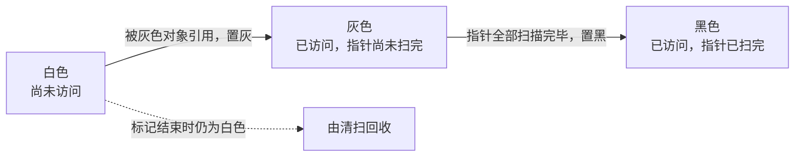
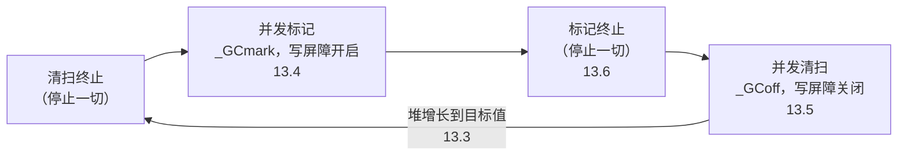

# 13 垃圾回收器

Hudson在GopherCon 2015的演讲中，紧接着回收延迟是首要障碍一页提出这个问题。玩笑之后的两页给出了另外两种办法：一是弹出一个等待网络的图标，二是以吞吐量换取更低的回收延迟。Go 1.5选择了正是最后一
种：回收器与层序并发运行，占用一部分CPU时间，以换取更短的停顿。此后十年，回收器的演进大体围绕同一个问题展开：在停顿，CPU开销与内存占用之间，怎么取得更好的平衡。

本章讨论Go的回收器如何实现这一取舍。13.1介绍可达性，标记清扫与三色抽象，以及Go在各类回收器中的定位；13.2讨论并发标记的写屏障，以及Go采用的混合写屏障。13.3至13.7一次讨论回收的各个环节：调步器
如何一句GOGC与软内存限制决定何时启动回收，标记工作与标记辅助如何分担标记的工作，清扫如何回收死去的对象，标记终止阶段如何判断标记已经完成，以及回收器如何借助栈映射到栈上的指针。13.8与13.9谈论
两种尝试而未被采用的方案，即分代回收与请求制导回收；13.10讨论终结器的演进，13.13以追踪与引用计数的同意理论回看Go的回收器，对象如何分配看12章。

## 13.1 垃圾回收的基本想法

垃圾回收使程序必须现实释放内存，代价是运行时必须自行判断哪些内存还会被用到，哪些可以收回。本节建立全章的基本概念：以可达性近似存活性，以标记清扫找出并收回垃圾，以三色不变式刻画并发标记的正确性条
件。最后说明Go的回收器在这些选择中的位置以及理由。

Dijkstra等人把一个带有垃圾回收的程序分为两个角色。赋值器（mutator）即用户程序；就回收而言，它所做的只是修改对象之间的引用，也就是在对象图上增删有向边。回收器（collector）是运行时中负责找出并
收回垃圾部分。本章的主要困难都源自二者同时运行。

### 13.1.1 可达性与存活性

对象的存活性（liveness）是指程序今后是否还会访问它。这一性质依赖程序未来的执行路径，一般而言无法判定。回收器因此采用一个保守近似，即可达性（reachability）：从一组（root）出发，凡是能沿着指针
到达的对象都视为存活，其余对象都是垃圾。从根无法到达的对象，程序不可能再访问到，回收它们是安全的；相反，可达的对象未必还会被用到，例如一个不再被读取，却仍然留在全局map中的条目。回收器只收回不可达
的对象；仍然可达却不再使用的对象，属于程序自生的内存泄露。

Go的根由运行时再每轮标记开始时列出。mgc.go对根标记的描述是：扫描所有goroutine的栈，将全局变量以及运行时堆外的堆指针置为灰。具体到markroot的任务划分，根包括数据段与BSS段中的全局变量，每个
goroutine的栈，终结器与清理函数的队列，以及挂在span上的终结器，弱指针与清理函数记录（13.10）。寄存器不单独构成一类根：goroutine停在安全点时，仍然存活的指针都已经保存
在栈上，随栈一并扫描。

可达性的一个直接推论是，环状结构不妨碍回收。下面的程序构造两个环，每个环由两个相互引用的节点组成，其中一个挂在全局变量上，两一个与根之间没有任何路径。程序用weak.Pointer观察到是否已被回收：弱
指针不使对象保持存活，对象被回收后，Value返回nil。root = a使用第一个环可经过全局变量到达，第二个则在cycle返回后不再有任何强引用指向它：

```go
package main

import (
    "fmt"
    "runtime"
    "weak"
)

type node struct {
    next *node
    data [64]byte
}

var root *node // 全局变量是根的一部分

// cycly构造两个互相引用的节点，返回指向它们的弱指针。
// keep为真时，把环挂到全局变量root上。
func cycle(keep bool) (weak.Pointer[node], weak.Pointer[node]) {
    a, b := new(node), new(node)
    a.next, b.next = b, a

    if keep {
        root = a
    }
    return weak.Make(a), weak.Make(b)
}

func main() {
    la, lb := cycle(true)
    da, db := cycle(false)

    runtime.GC()
    fmt.Println("从根可达的环:", la.Value() != nil, la.Value() != nil)
    fmt.Println("不可达的环:", da.Value() != nil, db.Value() != nil)
}
```

不可达的环中，每个节点都被另一个节点引用着，但这无关紧要：回收器只关心能否从根到达。基于引用计数的回收则恰恰在这里失效，13.1.2将回到这一点。

判断可达的前提是认得出指针。Go的回收器是精确的（precise, 亦称type-accurate）：借助编译器生成的类型信息与栈映射，运行时能够分辨出一个字是指针还是整数，不会把一个恰好像地址的整数当作指针，从而
误留本该回收的内存。这种精确是逐步实现的。Go 1.1的发布说明称回收器变得更精确；Go 1.3起，扫描栈时也做到了更精确；Go 1.4将运行时的大部分代码由C改写为Go之后，回收器完全精确。Go 1.14引入异步抢占
之后，又留下了一处例外：goroutine可能停在任意指令处，此处没有栈映射，运行时只能保守地扫描被中断函数的栈帧以及保存起寄存器的栈帧，把其中每个指向已分配对象的字都当作指针。保守扫描的细节见13.7。

### 13.1.2 标记清除

最早的垃圾回收出现在McCarthy 1960年描述Lisp实现的论文中。程序在自由存储表耗尽时启动一个回收周期：先从基址寄存器出发，沿car与cdr链找出所有可访问的单元，将它们的符号未被改变的单元放回自由表存
储表，并将可访问单元的符号恢复为正。这就是标记清扫（mark-sweep）：标记阶段从根出发遍历对象图，记录所有可达对象；清扫阶段遍历整个堆，回收未被记录的对象。以伪代码表示如下：

```go
// 标记：从根出发遍历对象图
func mark(roots []*object) {
    var work []*object // 已标记，尚未扫描的对象
    for _, r := range roots {
        shade(r, &work)
    }
    for len(work) > 0 {
        obj := work[len(work)-1]
        work = work[:len(work)-1]
        for _, child := range obj.pointers() {
            shade(child, &work)
        }
    }
}

func shade(obj *object, work *[]*object) {
    if obj != nil && !obj.marked {
        obj.marked = true
        *work = append(*work, obj)
    }
}

// 清扫：回收未标记的对象，并清除存活对象的标记，位下一轮做准备
func sweep(heap []*object) {
    for _, obj := range heap {
        if obj.marked {
            obj.marked = false
        } else {
            free(obj)
        }
    }
}
```

另外两类经典方法是复制式回收与引用计数。复制式回收（copying）把存活对象搬到一块新的空间，旧空间整体释放，因此没有碎片，分配也只需移动一个指针；代价是必须移动对象并更新所有指向它们的指针，经典
的半空间（semispace）做法还要预留一半的堆。引用计数（referece counting）位每个对象记录指向它们的指针数，计数归零即可回收，回收工作分散在程序运行之中；但每次指针写入都要更新计数，开销落在
赋值器最频繁的执行的路径上，而且如上一个例子所示，环中的对象计数用不归零，需要另行处理。

Go采用标记清扫，回收器既不移动对象，也不分代。mgc.go开头的注释概括了这些选择：回收器与赋值器并发执行，类型精确，允许多个回收线程并行；它是使用写屏障的并发标记清扫回收器，不分代，不压缩；分配
在按P划分，按尺寸隔离的分配空间中进行，以减少碎片，并在常用情形下免去加锁。

不移动对象的理由，Hudson在2018年的ISMM主题演讲中做了说明。Go是面向值的语言，结构体的字段直接内嵌，内部指针（指向对象中间的指针）很常见，回收器必须由内部指针高效地找到对象的起始地址；按尺寸
隔离的span恰好满足这一点，因为同一额span中对象大小相同，将地址向下取整即得对象的起始。其次，团队此前在TCMalloc，Hoard以及Interal的可扩展分配器上的经验表明，非移动分配器的碎片问题并不严重。
最后，Go需要与C和C++代码直接交互，对象不移动，就不必为传给C的对象实现固定（pinning）或者增加间接层。非移动带来的碎片由分配器的尺寸来限制：同一尺寸类的对象在同一个span中等大排布，外部堆片转为
又上界的取整与尾部浪费。其分析见12.1.3。

### 13.1.3 三色抽象

标记要与赋值器并行进行，就需要一种方式描述标记进行到一半时的状态。Dikkstra等人为此提出了三色抽象（tricolour abstraction），从回收器的视角把对象分为三种颜色：

- 白色：回收器尚未访问的到的对象。标记开始时所有对象都是白色，标记结束时仍然为白色的对象不可达，即为垃圾。
- 灰色：已被访问到，但其中的指针尚未全部扫描，因而可能还指向白色对象；
- 黑色：已被访问到，且其中的指针已全部扫描。

标记从将根置灰开始，随后重复同一个动作：取一个灰色对象，将它引用的白色对象置灰，再将它自身置为黑色，直到不再有灰色对象。灰色对象构成褐色区域与白色区域之间的边界，标记的过程就是这条边界不断向前
推进的过程；边界消失的时候，所有可达对象都已成为黑色。



下面的交互演示这一过程：根先被置灰，灰色边界不断将白色邻居置灰色，自生转黑，直到灰色集合为空，随后清扫阶段仍为白色的对象。读者可以单步执行，观察边界的推进。

颜色只是对标记进度的描述，对象本身并没有颜色字段。在Go中，颜色由标记位与工作队列共同决定，mgcwork.go的注释写道：

```text
// For objects in workbufs, a grey object is one that is marked and
// on a work queue.A black object is marked and not on a work queue.
//
// For objects in the sapn queue, a grey object is one that is marked
// and has an unset scan bit. A black object is marked and has its scan
// bit set. (Green Tea GC only.)
```

白色对象即未标记的对象。第二段注释描述的span队列属于Go 1.26默认启用的Green Tea回收器，它以span而非单个对象位单位排队扫描。

### 13.1.4 并发标记与三色不变式

如果标记期间暂停全部赋值器，回收对用户程序而言是一步原子操作，正确性无须论证，但停顿时随堆的大小线形增长。若要缩短停顿，就必须让标记与赋值器并发，这立即带来一个正确性问题。设想标记进行到一半的
时候，赋值器把一个白色对象C的指针写入黑色对象A,随后又删除了灰色对象B指向C得指针。

黑色对象不会被再次扫描，B也不再指向C,于是C虽然仍可经过A到达，却永远不会被置灰。标记结束时它仍然是白色，被当作垃圾回收，程序随后通过A访问到一块已经被回收的内存。这种错误的发生需要两个条件同时
成立：赋值器将指向白色对象的指针写入黑色对象；并且从任何灰色对象出发，经由白色对象到达该对象的路径都已经被破坏。只要破坏其中任意一个条件，就不会遗漏可达对象。

与这两个条件相对应，有两种三色不变式（tricolour invariant）。强三色不变式要求黑色对象不得包含指向白色对象的指针，从而排除第一个条件。弱三色不变式允许黑色对象指向白色对象，单要求该白色对象
收到灰色对象的保护，即能从某个灰色对象出发，经由一串白色对象到达，从而排除第二个条件。维持不变式的手段是写屏障（write barrier）：编译器在指针写入处插入一小段代码，在写入发生时候坐必要着色。
不同写屏障维持不同的不变式，Go 1.8起使用的混合写屏障维持的是弱不变式。详见13.2。

写屏障只需要在需要时候开启。运行时设置回收阶段的函数同时决定写屏障的开关：

```go
func setGCPhase(x uint32) {
    atomic.Store(&gcphase, x)
    writeBarrier.enabled = gcphase == _GCmark || pcphase == _GCmarktermination
}
```

只有在标记与标志终止两个阶段中，写屏障才处于开启状态；其余时间，指针写入只需要检查一次全局标志，开销很小。

### 13.1.5 一轮回收的过程

mgc.go开头的注释把一轮回收分为四个阶段。下图概括了这一过程在本章中对应的小节：



一轮回收开始时，运行时先端暂停所有goroutine，这一步操作称为停止一切（stop the world,STW）。在这段短暂的暂定中，运行时完成上一轮遗留的清扫，开启写屏障，并将根标记任务放入队列。随后赋值器恢复
运行，标记由后台的标记工作者与分配时的标记辅助共同完成，新分配的对象直接标为黑色。灰色对象耗尽以后，第二次停止一切进入标记终止，完成收尾工作后再关闭写屏障，进入清扫阶段。清扫与赋值器并发进行，
既有后台的清扫goroutine完成，也由分配内存的goroutine在需要时完成。堆再次增长到调步器设定的目标时，下一轮回收开始；调步器的设计开始与Go 1.5。

这些阶段可以直接观察到。设置GODEBUG=gctrace=1后，每轮回收结束时运行时向标准错误输入一行摘要，运行时的文档说明这一个格式可能变化。下面的程序分配50000个越1KiB的对象，只保留其中十分之一：

```go
package main

import "fmt"

type item struct {
    next *item
    buf [1 << 10]byte
}

func main() {
    var keep *item
    for i := 0; i < 50000; i++ {
        it := &item{}
        if i%10 == 0 { // 保留十分之一,其余成为垃圾
            it.next = keep
            keep = it
        }
    }
    n := 0
    for p := keep; p != nil; p = p.next {
        n++
    }
    fmt.Println("存活对象:", n)
}
```

在Apple M5 Pro上运行，截取第7至9轮回收摘要的前一部分：

```sh
$ GODEBUG=gctrace=1 ./gcdemo 2>&1 | sed -n 7,9p | cut -d, -f1
gc 7 @0.004s 5%: 0.032+0.23+0.005 ms clock
gc 8 @0.004s 5%: 0.038+0.26+0.018 ms clock
gc 9 @0.005s 5%: 0.051+0.48+0.007 ms clock
```

gc 7是回收的序号，@0.004s是程序启动后经过的时间，5%是启动以来回收所占用的时间比例。以加号连接的是那个数一次是清扫终止，并发标记与标记终止所经过的墙钟时间。两次停止一切各在数微秒至数十微秒之间，
耗时约为其十倍的标记则与程序并发进行。摘要中其余的字段记录堆的大小与目标值，留待13.3解释。

### 13.1.6 Go的取舍与定位

Go的回收器直接继承了上述理论脉络。mgc.go的注释把它的思想渊源追溯到Dijkstra等人的on-the-fly算法，并指出这些步骤完备，正确，可终止的证明见Hudson与Moss 2003年的论文。对于垃圾回收的一般知识，它推荐以Jones等人的垃圾回收手册为起点。Go 1.5首次实现并发标记，Go 1.8以混合写屏障消除了标记终止时重新扫描栈的需要，演进过程见13.12。

这些选择的背后的目标数是延迟。Hudson在Go 1.5发布时写道，Go的回收器是三色并发标记清除回收器，这是有意偏离当今大多企业级回收器的选择：它被设计优先保证延迟，只提供GOGC一个调节参数，而Go 1.5的
回收停顿已远低于一年前设定的10毫秒的目标。Hudson在2018年的演讲中解释了延迟为何如此重要：一次会话弱包含100个请求，即便99%的回收停顿都低于10毫秒，整个会话都不受更长停顿影响的用户只有37%，因此
真正需要约束的是99.99%分位的延迟。同一个演讲给出了2018年的新目标：每轮回收的停顿不超过500微秒。

主流Java虚拟机大多采用移动式，分代的回收器，依靠移动对象消除碎片，依靠分代假设把精力都集中在新生对象上。Go不分代的理由同样来自它语言的特性。按Hudson的说法，并不是分代假设在Go中不成立，而是新
生代往往生于栈上，死于栈上：逃逸分析将大量短命对象分配在栈上，它们随着函数返回而释放，根本不进入堆，分代回收能起的作用因此比其他托管语言小得多。Go团队曾经尝试过面向请求的回收器与非移动分代回收
器，两者都因为写屏障常开的开销而被放弃。见13.8与13.9。

### 13.1.7 小结

回收器可达性近似存活性，从根本上找出所有可达对象，其余皆为垃圾。标记清扫分两步完成这一工作，Go在此基础上选择不移动，不分代，以尺寸类限制碎片，以逃逸分析承担新生对象。三色抽象描述了并发标记的中间
状态，三色不变式给出了赋值器与回收器并发时不遗漏可达对象的条件，写屏障负责在赋值器修改指针时维持这一条件。本章随后几节一次讨论写屏障，回收的触发与调步，标记，清扫与标记终止。

## 13.2 写屏障技术

13.1.4说明了并发标记的风险：赋值器把一个白色对象的执行写入黑色对象，同时破坏了从灰色对象通往它的所有路径，回收器便会漏掉这个仍然可达的对象。写屏障（write barrier）是防止这种情况的手段，编译器
在可能指向堆的指向写入处插入一小段代码，在写入发生时候把必要的信息告诉回收器。本节先介绍两类经典的写屏障和各自的代价，仔讨论Go 1.8起使用混合写屏障，最后说明他在编译器与运行时的实现。

这里的写屏障是垃圾回收意义上的概念，指赋值器执行的一段软件逻辑，与处理器层面的约束访存的内存障碍（memory barrier,见11.9）不是一回事。两者在Go的实现中有一处交集，13.2.4将会提到。

### 13.2.1 两类写屏障

漏标的两个条件同时处：赋值器把指向白色对象的指针写入黑色对象；并且从灰色对象通往白色对象的原有路径被破坏，回收器来来不及看到他。一次指针写入 *slot = ptr涉及两个指针涉及两个指针：写入的新值
ptr与被覆盖的旧值`*slot`。写屏障可以监视其中任意一个，由此分为两类，各自排除一个条件。

插入写屏障（insertion barrier）监视新值，又称为增量更新（incremental update）屏障。它在写入之前把新值指向的对象置灰，确保写入的黑色对象不会指向白色对象，从而排除第一个条件，维持强三色不变
式。这一思路来自Dijsktra等人，Go 1.7使用的正是一种粗化的Kijkstra屏障，它不检查slot所在对象的颜色，一律置灰色。

```go
// Dijkstra 插入写屏障
writePointer(slot, ptr):
    shade(ptr)
    *slot = ptr
```

删除写屏障（deletion barrier）监视旧值，又称为快速快照（snapshot-at-the-beginning）屏障。它在旧值被覆盖之前将其置灰，于是任何通往白色对象的路径被破坏时。回收器都会得到另一条路径，维持的是
弱三色不变式。其中最知名的形式来自Yuasa:

```go
// Yuasa 删除快照（伪代码）
writePointer(slot, ptr):
    shade(*slot)
    *slot = ptr
```

其实快照这个名字说明了它的效果：标记开始时可达的对象，本轮都不会被回收，即使它们标记期间变的不可达。这样保留下来，要到下一轮才能回收的对象称为浮动垃圾（floting garbage）。插入屏障同样会产生浮动
垃圾，因为被置灰的新值可能随即又被覆盖。

两类屏障都只把白色对象置灰，对象的颜色单调地由白变灰，由灰变黑，标记的总工作量因此以堆的大小为上界。Steele的屏障则相反，它把褐色对象退回灰色，同一对象可能被反复扫描。Pirinen一句赋值器自生的颜色，对各种屏障做了系统分类。

赋值器的颜色指它的根，主要是goroutine的栈，在回收器看来处于什么状态。栈已被扫描，回收器不再需要回头看它的赋值器是黑色的；栈尚未被扫描，或者扫描后有可能藏有白色指针，需要重新扫描的组织器是灰色
的。灰色赋值器意味着标记结束前必须重新扫描它的栈。

### 13.2.2 两类屏障在Go中的代价

对于Go而言，问题的关键在于栈。goroutine栈上的指针写入及为频繁，挼每次栈写入都执行写屏障，开销难以接受，因此两类屏障都需要堆栈做特殊处理，而每种处理都伴随一次停止一切。

Go 1.5至1.7使用插入屏障，栈上的写入不设屏障。代价是栈只能处于永久灰色的状态：回收开始是扫描过的栈，只在其goroutine再次运行之前保持黑色，此后就可能藏有白色对象的指针，必须视为灰色。标记结束前，
回收器要停止一切的状态下重新扫描所有灰色的栈。设计文档指出，在goroutine数量众多的程序中，这次重新扫描可能耗时数十乃至数百毫秒，是Go 1.7中最后一个与程序规模相关，没有上界的停顿来源。

删除屏障能使扫描过的栈保持黑色，但栈上的写入同样不设屏障，起始快照必须包含所有栈，因此要求标记开始停止一切，一次性扫描或者复制全部栈。Yuasa提出这一算法时，针对的是只有一个线程，栈很小的系统；Go
程序常有成千上万个栈，在停止一切的状态下处理它们同样代价高昂。若改为要求所有栈都扫描完毕之后才能扫描堆对象，又会在栈扫描与堆扫描之间形成并行的瓶颈。设计文档还引用Pirinen的结论：对于黑色赋值器，
除Yuasa屏障之外的所有屏障都需要读屏障，而指针读取的频率比写入高出一个数量级以上，这在性能上无法接受。

### 13.2.3 混合写屏障

Go 1.8将两类屏障结合起来，得到混合写屏障（hybrid write barrier）。mbarrier.go开头的注释先说明，它结合了置灰被覆盖对象的Yuasa式删除屏障与置灰被写入对象的Dijkstra式插入屏障，插入部分只在调
用者的栈为灰色时候才需要；随后给出伪代码，并说明两次置灰与其中的条件如何共同阻止赋值器藏匿对象：

赋值器藏匿一个对象只有两种途径：把指向它唯一指针从堆到栈上，或从栈上移动到堆中的黑色对象。删除部分 `shade(*slot)`堵在前者，因为从堆上摘下指针就是覆盖它，被覆盖的对象随即置灰；插入部分
`shade(ptr)`堵在后者。第三点说明了插入部分为何只在栈置灰时才需要：要把对象从栈移到堆，它必须先藏在栈上；而一个刚扫描完的栈只能指向已置灰的对象，删除部分又阻止它此后再从堆上藏匿新的指针。

由此得到混合写屏障最重要的性质：栈一旦被扫描黑，就始终保持黑色，不在需要重新扫描。各个goroutine的栈可以再标记开始后逐个并发扫描，扫描时只需要暂定被扫描的那一个goroutine，标记终止时也不必
再停止一切去重新扫栈。混合写屏障维持的是弱三色不变式：已扫描的黑色栈可能持有白色对象的指针，但这个白色对象一定受到灰色对象保护。设计文档还指出，这一层屏障要求新分配的对象直接标为黑色，而Go
原本就是这样做的；它与IBM实时Java中所用Metronome回收器双重写屏障等价。后者是增量而非并发回收器，但同样要把停止一切的时间严格限制在很小的范围之内。

效果十分显著。Clements在关闭栈重扫的提价报告中：GOMAXPROCS=12时，不计停止一切本省所需的时间，标记终止的最坏耗时稳定在100微妙以内；在一个专门制造大量脏栈的基准中，50万个脏时停止一切95%分位
耗时从150毫秒下降到150微妙，接近三个数量级。Go 1.8的发布说明称，回收停顿通常低于100微秒，常常低至10微秒。

### 13.2.4 Go的实现：无条件的混合屏障

Go的世纪实现的混合屏障省去了当前栈是否为灰色这个条件，总是同时置灰旧值与新值。Clements在实现它的提交中说明了原因：channel操作会在两个goroutine的栈之间直接复制数据，屏障需要同时检查源栈与目标
栈的颜色，而当时没有办法把这些信息传给写屏障。设计文档也讨论过这种无条件变体：它的正确性更容易论证，因为推中根本不存在由黑色对象指向白色对象的指针；代价是在标记阶段大部分时间里开销约为有条件版本
的两倍。知道Go 1.26，屏障依然是无条件的，wbBufFlush1中仍然留着一条TODO,设想在栈已被扫描时跳过新值。

mbarrier.go中还有一段关于访存顺序的说明，讨论的是另一个条件：两类屏障本都可以只在slot所载的对象为黑色时才执行。设想赋值器先写入slot，在读取slot所在对象的标记位，而回收器线程同时先设置该标记
位，再读取slot。若两条线程的写与读之间没有昂贵的内存屏障，在包括386与amd64在内的多数硬件上，两者都可能读到旧值，赋值器以为对象仍为白色而跳过屏障，回收器则没有看到新写入的指针。这正是Peterson与
Dekker互斥锁要避免的重排。Go宁可无条件置灰，也不再每次指针写入时候付出内存屏障的代价。这就是本届开头所说的写屏障与内存屏障的交集。

编译器插入的屏障

写屏障由编译器在SSA的writebarrier阶段插入。该阶段的注释描述了生成的代码形态。

writeBarrier.enabled只在标记与标记终止阶段为真，其余时间一次指针写入的额外开销只是一次加载与一次条件跳转。屏障开启时，gcWriteBarrier2在当前P得写屏障中预留了两个槽位并返回其地址，生成
的代码把新值与旧值一次存入，然后才执行真正的写入。下面的函数把一个指针写入结构体的字段：

```go
package wb

type T struct { p *int }

func set(t *T, v *int) {
    t.p = v
}
```

用-gcflags=-S 查看amd64上第6行生成的指令：

```sh
$ GOARCH=amd64 go build -gcflags=-S . 2>&1 | grep 'wb.go:6)' | grep -v PCDATA | sed 's/.*)\t//'
TESTB	AL, (AX)
CMPL	runtime.writeBarrier(SB), $0
JEQ	36
MOVQ	(AX), CX
CALL	runtime.gcWriteBarrier2(SB)
MOVQ	BX, (R11)
MOVQ	CX, 8(R11)
MOVQ	BX, (AX)
```

t在AX中，v在BX中。第一条指令以一次读取探测t是否为空指针。writeBarrier为零时直接转到最后一条指令完成写入；否则先把旧值t.p读入CX，调用gcWriteBarrier2取得缓冲地址R11,把新值与旧值存入缓冲，
在执行写入。这正是上面注释所描述的形态。
