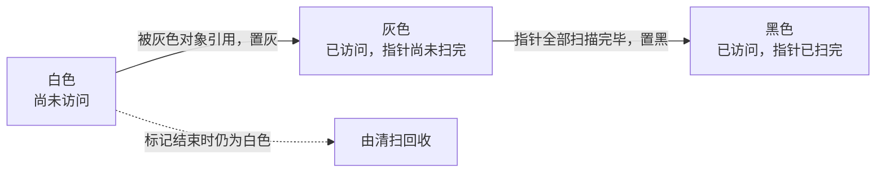
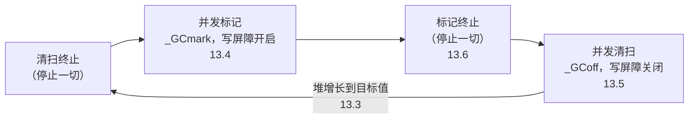
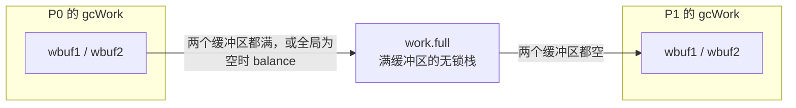
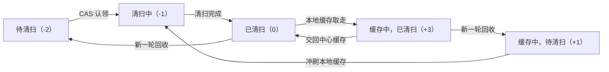
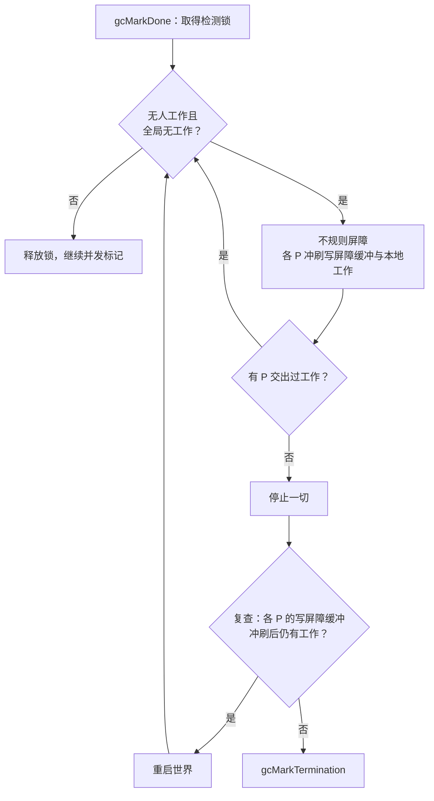

# 13 垃圾回收器

Hudson在GopherCon 2015的演讲中，紧接着回收延迟是首要障碍一页提出这个问题。玩笑之后的两页给出了另外两种办法：一是弹出一个等待网络的图标，二是以吞吐量换取更低的回收延迟。Go 1.5选择了正是最后一
种：回收器与层序并发运行，占用一部分CPU时间，以换取更短的停顿。此后十年，回收器的演进大体围绕同一个问题展开：在停顿，CPU开销与内存占用之间，怎么取得更好的平衡。

本章讨论Go的回收器如何实现这一取舍。13.1介绍可达性，标记清扫与三色抽象，以及Go在各类回收器中的定位；13.2讨论并发标记的写屏障，以及Go采用的混合写屏障。13.3至13.7一次讨论回收的各个环节：调步器
如何一句GOGC与软内存限制决定何时启动回收，标记工作与标记辅助如何分担标记的工作，清扫如何回收死去的对象，标记终止阶段如何判断标记已经完成，以及回收器如何借助栈映射到栈上的指针。13.8与13.9谈论
两种尝试而未被采用的方案，即分代回收与请求制导回收；13.10讨论终结器的演进，13.13以追踪与引用计数的同意理论回看Go的回收器，对象如何分配看12章。

## 13.1 垃圾回收的基本想法

垃圾回收使程序必须现实释放内存，代价是运行时必须自行判断哪些内存还会被用到，哪些可以收回。本节建立全章的基本概念：以可达性近似存活性，以标记清扫找出并收回垃圾，以三色不变式刻画并发标记的正确性条
件。最后说明Go的回收器在这些选择中的位置以及理由。

Dijkstra等人把一个带有垃圾回收的程序分为两个角色。赋值器（mutator）即用户程序；就回收而言，它所做的只是修改对象之间的引用，也就是在对象图上增删有向边。回收器（collector）是运行时中负责找出并
收回垃圾部分。本章的主要困难都源自二者同时运行。

### 13.1.1 可达性与存活性

对象的存活性（liveness）是指程序今后是否还会访问它。这一性质依赖程序未来的执行路径，一般而言无法判定。回收器因此采用一个保守近似，即可达性（reachability）：从一组（root）出发，凡是能沿着指针
到达的对象都视为存活，其余对象都是垃圾。从根无法到达的对象，程序不可能再访问到，回收它们是安全的；相反，可达的对象未必还会被用到，例如一个不再被读取，却仍然留在全局map中的条目。回收器只收回不可达
的对象；仍然可达却不再使用的对象，属于程序自生的内存泄露。

Go的根由运行时再每轮标记开始时列出。mgc.go对根标记的描述是：扫描所有goroutine的栈，将全局变量以及运行时堆外的堆指针置为灰。具体到markroot的任务划分，根包括数据段与BSS段中的全局变量，每个
goroutine的栈，终结器与清理函数的队列，以及挂在span上的终结器，弱指针与清理函数记录（13.10）。寄存器不单独构成一类根：goroutine停在安全点时，仍然存活的指针都已经保存
在栈上，随栈一并扫描。

可达性的一个直接推论是，环状结构不妨碍回收。下面的程序构造两个环，每个环由两个相互引用的节点组成，其中一个挂在全局变量上，两一个与根之间没有任何路径。程序用weak.Pointer观察到是否已被回收：弱
指针不使对象保持存活，对象被回收后，Value返回nil。root = a使用第一个环可经过全局变量到达，第二个则在cycle返回后不再有任何强引用指向它：

```go
package main

import (
    "fmt"
    "runtime"
    "weak"
)

type node struct {
    next *node
    data [64]byte
}

var root *node // 全局变量是根的一部分

// cycly构造两个互相引用的节点，返回指向它们的弱指针。
// keep为真时，把环挂到全局变量root上。
func cycle(keep bool) (weak.Pointer[node], weak.Pointer[node]) {
    a, b := new(node), new(node)
    a.next, b.next = b, a

    if keep {
        root = a
    }
    return weak.Make(a), weak.Make(b)
}

func main() {
    la, lb := cycle(true)
    da, db := cycle(false)

    runtime.GC()
    fmt.Println("从根可达的环:", la.Value() != nil, la.Value() != nil)
    fmt.Println("不可达的环:", da.Value() != nil, db.Value() != nil)
}
```

不可达的环中，每个节点都被另一个节点引用着，但这无关紧要：回收器只关心能否从根到达。基于引用计数的回收则恰恰在这里失效，13.1.2将回到这一点。

判断可达的前提是认得出指针。Go的回收器是精确的（precise, 亦称type-accurate）：借助编译器生成的类型信息与栈映射，运行时能够分辨出一个字是指针还是整数，不会把一个恰好像地址的整数当作指针，从而
误留本该回收的内存。这种精确是逐步实现的。Go 1.1的发布说明称回收器变得更精确；Go 1.3起，扫描栈时也做到了更精确；Go 1.4将运行时的大部分代码由C改写为Go之后，回收器完全精确。Go 1.14引入异步抢占
之后，又留下了一处例外：goroutine可能停在任意指令处，此处没有栈映射，运行时只能保守地扫描被中断函数的栈帧以及保存起寄存器的栈帧，把其中每个指向已分配对象的字都当作指针。保守扫描的细节见13.7。

### 13.1.2 标记清除

最早的垃圾回收出现在McCarthy 1960年描述Lisp实现的论文中。程序在自由存储表耗尽时启动一个回收周期：先从基址寄存器出发，沿car与cdr链找出所有可访问的单元，将它们的符号未被改变的单元放回自由表存
储表，并将可访问单元的符号恢复为正。这就是标记清扫（mark-sweep）：标记阶段从根出发遍历对象图，记录所有可达对象；清扫阶段遍历整个堆，回收未被记录的对象。以伪代码表示如下：

```go
// 标记：从根出发遍历对象图
func mark(roots []*object) {
    var work []*object // 已标记，尚未扫描的对象
    for _, r := range roots {
        shade(r, &work)
    }
    for len(work) > 0 {
        obj := work[len(work)-1]
        work = work[:len(work)-1]
        for _, child := range obj.pointers() {
            shade(child, &work)
        }
    }
}

func shade(obj *object, work *[]*object) {
    if obj != nil && !obj.marked {
        obj.marked = true
        *work = append(*work, obj)
    }
}

// 清扫：回收未标记的对象，并清除存活对象的标记，位下一轮做准备
func sweep(heap []*object) {
    for _, obj := range heap {
        if obj.marked {
            obj.marked = false
        } else {
            free(obj)
        }
    }
}
```

另外两类经典方法是复制式回收与引用计数。复制式回收（copying）把存活对象搬到一块新的空间，旧空间整体释放，因此没有碎片，分配也只需移动一个指针；代价是必须移动对象并更新所有指向它们的指针，经典
的半空间（semispace）做法还要预留一半的堆。引用计数（referece counting）位每个对象记录指向它们的指针数，计数归零即可回收，回收工作分散在程序运行之中；但每次指针写入都要更新计数，开销落在
赋值器最频繁的执行的路径上，而且如上一个例子所示，环中的对象计数用不归零，需要另行处理。

Go采用标记清扫，回收器既不移动对象，也不分代。mgc.go开头的注释概括了这些选择：回收器与赋值器并发执行，类型精确，允许多个回收线程并行；它是使用写屏障的并发标记清扫回收器，不分代，不压缩；分配
在按P划分，按尺寸隔离的分配空间中进行，以减少碎片，并在常用情形下免去加锁。

不移动对象的理由，Hudson在2018年的ISMM主题演讲中做了说明。Go是面向值的语言，结构体的字段直接内嵌，内部指针（指向对象中间的指针）很常见，回收器必须由内部指针高效地找到对象的起始地址；按尺寸
隔离的span恰好满足这一点，因为同一额span中对象大小相同，将地址向下取整即得对象的起始。其次，团队此前在TCMalloc，Hoard以及Interal的可扩展分配器上的经验表明，非移动分配器的碎片问题并不严重。
最后，Go需要与C和C++代码直接交互，对象不移动，就不必为传给C的对象实现固定（pinning）或者增加间接层。非移动带来的碎片由分配器的尺寸来限制：同一尺寸类的对象在同一个span中等大排布，外部堆片转为
又上界的取整与尾部浪费。其分析见12.1.3。

### 13.1.3 三色抽象

标记要与赋值器并行进行，就需要一种方式描述标记进行到一半时的状态。Dikkstra等人为此提出了三色抽象（tricolour abstraction），从回收器的视角把对象分为三种颜色：

- 白色：回收器尚未访问的到的对象。标记开始时所有对象都是白色，标记结束时仍然为白色的对象不可达，即为垃圾。
- 灰色：已被访问到，但其中的指针尚未全部扫描，因而可能还指向白色对象；
- 黑色：已被访问到，且其中的指针已全部扫描。

标记从将根置灰开始，随后重复同一个动作：取一个灰色对象，将它引用的白色对象置灰，再将它自身置为黑色，直到不再有灰色对象。灰色对象构成褐色区域与白色区域之间的边界，标记的过程就是这条边界不断向前
推进的过程；边界消失的时候，所有可达对象都已成为黑色。



下面的交互演示这一过程：根先被置灰，灰色边界不断将白色邻居置灰色，自生转黑，直到灰色集合为空，随后清扫阶段仍为白色的对象。读者可以单步执行，观察边界的推进。

颜色只是对标记进度的描述，对象本身并没有颜色字段。在Go中，颜色由标记位与工作队列共同决定，mgcwork.go的注释写道：

```text
// For objects in workbufs, a grey object is one that is marked and
// on a work queue.A black object is marked and not on a work queue.
//
// For objects in the sapn queue, a grey object is one that is marked
// and has an unset scan bit. A black object is marked and has its scan
// bit set. (Green Tea GC only.)
```

白色对象即未标记的对象。第二段注释描述的span队列属于Go 1.26默认启用的Green Tea回收器，它以span而非单个对象位单位排队扫描。

### 13.1.4 并发标记与三色不变式

如果标记期间暂停全部赋值器，回收对用户程序而言是一步原子操作，正确性无须论证，但停顿时随堆的大小线形增长。若要缩短停顿，就必须让标记与赋值器并发，这立即带来一个正确性问题。设想标记进行到一半的
时候，赋值器把一个白色对象C的指针写入黑色对象A,随后又删除了灰色对象B指向C得指针。

黑色对象不会被再次扫描，B也不再指向C,于是C虽然仍可经过A到达，却永远不会被置灰。标记结束时它仍然是白色，被当作垃圾回收，程序随后通过A访问到一块已经被回收的内存。这种错误的发生需要两个条件同时
成立：赋值器将指向白色对象的指针写入黑色对象；并且从任何灰色对象出发，经由白色对象到达该对象的路径都已经被破坏。只要破坏其中任意一个条件，就不会遗漏可达对象。

与这两个条件相对应，有两种三色不变式（tricolour invariant）。强三色不变式要求黑色对象不得包含指向白色对象的指针，从而排除第一个条件。弱三色不变式允许黑色对象指向白色对象，单要求该白色对象
收到灰色对象的保护，即能从某个灰色对象出发，经由一串白色对象到达，从而排除第二个条件。维持不变式的手段是写屏障（write barrier）：编译器在指针写入处插入一小段代码，在写入发生时候坐必要着色。
不同写屏障维持不同的不变式，Go 1.8起使用的混合写屏障维持的是弱不变式。详见13.2。

写屏障只需要在需要时候开启。运行时设置回收阶段的函数同时决定写屏障的开关：

```go
func setGCPhase(x uint32) {
    atomic.Store(&gcphase, x)
    writeBarrier.enabled = gcphase == _GCmark || pcphase == _GCmarktermination
}
```

只有在标记与标志终止两个阶段中，写屏障才处于开启状态；其余时间，指针写入只需要检查一次全局标志，开销很小。

### 13.1.5 一轮回收的过程

mgc.go开头的注释把一轮回收分为四个阶段。下图概括了这一过程在本章中对应的小节：



一轮回收开始时，运行时先端暂停所有goroutine，这一步操作称为停止一切（stop the world,STW）。在这段短暂的暂定中，运行时完成上一轮遗留的清扫，开启写屏障，并将根标记任务放入队列。随后赋值器恢复
运行，标记由后台的标记工作者与分配时的标记辅助共同完成，新分配的对象直接标为黑色。灰色对象耗尽以后，第二次停止一切进入标记终止，完成收尾工作后再关闭写屏障，进入清扫阶段。清扫与赋值器并发进行，
既有后台的清扫goroutine完成，也由分配内存的goroutine在需要时完成。堆再次增长到调步器设定的目标时，下一轮回收开始；调步器的设计开始与Go 1.5。

这些阶段可以直接观察到。设置GODEBUG=gctrace=1后，每轮回收结束时运行时向标准错误输入一行摘要，运行时的文档说明这一个格式可能变化。下面的程序分配50000个越1KiB的对象，只保留其中十分之一：

```go
package main

import "fmt"

type item struct {
    next *item
    buf [1 << 10]byte
}

func main() {
    var keep *item
    for i := 0; i < 50000; i++ {
        it := &item{}
        if i%10 == 0 { // 保留十分之一,其余成为垃圾
            it.next = keep
            keep = it
        }
    }
    n := 0
    for p := keep; p != nil; p = p.next {
        n++
    }
    fmt.Println("存活对象:", n)
}
```

在Apple M5 Pro上运行，截取第7至9轮回收摘要的前一部分：

```sh
$ GODEBUG=gctrace=1 ./gcdemo 2>&1 | sed -n 7,9p | cut -d, -f1
gc 7 @0.004s 5%: 0.032+0.23+0.005 ms clock
gc 8 @0.004s 5%: 0.038+0.26+0.018 ms clock
gc 9 @0.005s 5%: 0.051+0.48+0.007 ms clock
```

gc 7是回收的序号，@0.004s是程序启动后经过的时间，5%是启动以来回收所占用的时间比例。以加号连接的是那个数一次是清扫终止，并发标记与标记终止所经过的墙钟时间。两次停止一切各在数微秒至数十微秒之间，
耗时约为其十倍的标记则与程序并发进行。摘要中其余的字段记录堆的大小与目标值，留待13.3解释。

### 13.1.6 Go的取舍与定位

Go的回收器直接继承了上述理论脉络。mgc.go的注释把它的思想渊源追溯到Dijkstra等人的on-the-fly算法，并指出这些步骤完备，正确，可终止的证明见Hudson与Moss 2003年的论文。对于垃圾回收的一般知识，它推荐以Jones等人的垃圾回收手册为起点。Go 1.5首次实现并发标记，Go 1.8以混合写屏障消除了标记终止时重新扫描栈的需要，演进过程见13.12。

这些选择的背后的目标数是延迟。Hudson在Go 1.5发布时写道，Go的回收器是三色并发标记清除回收器，这是有意偏离当今大多企业级回收器的选择：它被设计优先保证延迟，只提供GOGC一个调节参数，而Go 1.5的
回收停顿已远低于一年前设定的10毫秒的目标。Hudson在2018年的演讲中解释了延迟为何如此重要：一次会话弱包含100个请求，即便99%的回收停顿都低于10毫秒，整个会话都不受更长停顿影响的用户只有37%，因此
真正需要约束的是99.99%分位的延迟。同一个演讲给出了2018年的新目标：每轮回收的停顿不超过500微秒。

主流Java虚拟机大多采用移动式，分代的回收器，依靠移动对象消除碎片，依靠分代假设把精力都集中在新生对象上。Go不分代的理由同样来自它语言的特性。按Hudson的说法，并不是分代假设在Go中不成立，而是新
生代往往生于栈上，死于栈上：逃逸分析将大量短命对象分配在栈上，它们随着函数返回而释放，根本不进入堆，分代回收能起的作用因此比其他托管语言小得多。Go团队曾经尝试过面向请求的回收器与非移动分代回收
器，两者都因为写屏障常开的开销而被放弃。见13.8与13.9。

### 13.1.7 小结

回收器可达性近似存活性，从根本上找出所有可达对象，其余皆为垃圾。标记清扫分两步完成这一工作，Go在此基础上选择不移动，不分代，以尺寸类限制碎片，以逃逸分析承担新生对象。三色抽象描述了并发标记的中间
状态，三色不变式给出了赋值器与回收器并发时不遗漏可达对象的条件，写屏障负责在赋值器修改指针时维持这一条件。本章随后几节一次讨论写屏障，回收的触发与调步，标记，清扫与标记终止。

## 13.2 写屏障技术

13.1.4说明了并发标记的风险：赋值器把一个白色对象的执行写入黑色对象，同时破坏了从灰色对象通往它的所有路径，回收器便会漏掉这个仍然可达的对象。写屏障（write barrier）是防止这种情况的手段，编译器
在可能指向堆的指向写入处插入一小段代码，在写入发生时候把必要的信息告诉回收器。本节先介绍两类经典的写屏障和各自的代价，仔讨论Go 1.8起使用混合写屏障，最后说明他在编译器与运行时的实现。

这里的写屏障是垃圾回收意义上的概念，指赋值器执行的一段软件逻辑，与处理器层面的约束访存的内存障碍（memory barrier,见11.9）不是一回事。两者在Go的实现中有一处交集，13.2.4将会提到。

### 13.2.1 两类写屏障

漏标的两个条件同时处：赋值器把指向白色对象的指针写入黑色对象；并且从灰色对象通往白色对象的原有路径被破坏，回收器来来不及看到他。一次指针写入 *slot = ptr涉及两个指针涉及两个指针：写入的新值
ptr与被覆盖的旧值`*slot`。写屏障可以监视其中任意一个，由此分为两类，各自排除一个条件。

插入写屏障（insertion barrier）监视新值，又称为增量更新（incremental update）屏障。它在写入之前把新值指向的对象置灰，确保写入的黑色对象不会指向白色对象，从而排除第一个条件，维持强三色不变
式。这一思路来自Dijsktra等人，Go 1.7使用的正是一种粗化的Kijkstra屏障，它不检查slot所在对象的颜色，一律置灰色。

```go
// Dijkstra 插入写屏障
writePointer(slot, ptr):
    shade(ptr)
    *slot = ptr
```

删除写屏障（deletion barrier）监视旧值，又称为快速快照（snapshot-at-the-beginning）屏障。它在旧值被覆盖之前将其置灰，于是任何通往白色对象的路径被破坏时。回收器都会得到另一条路径，维持的是
弱三色不变式。其中最知名的形式来自Yuasa:

```go
// Yuasa 删除快照（伪代码）
writePointer(slot, ptr):
    shade(*slot)
    *slot = ptr
```

其实快照这个名字说明了它的效果：标记开始时可达的对象，本轮都不会被回收，即使它们标记期间变的不可达。这样保留下来，要到下一轮才能回收的对象称为浮动垃圾（floting garbage）。插入屏障同样会产生浮动
垃圾，因为被置灰的新值可能随即又被覆盖。

两类屏障都只把白色对象置灰，对象的颜色单调地由白变灰，由灰变黑，标记的总工作量因此以堆的大小为上界。Steele的屏障则相反，它把褐色对象退回灰色，同一对象可能被反复扫描。Pirinen一句赋值器自生的颜色，对各种屏障做了系统分类。

赋值器的颜色指它的根，主要是goroutine的栈，在回收器看来处于什么状态。栈已被扫描，回收器不再需要回头看它的赋值器是黑色的；栈尚未被扫描，或者扫描后有可能藏有白色指针，需要重新扫描的组织器是灰色
的。灰色赋值器意味着标记结束前必须重新扫描它的栈。

### 13.2.2 两类屏障在Go中的代价

对于Go而言，问题的关键在于栈。goroutine栈上的指针写入及为频繁，挼每次栈写入都执行写屏障，开销难以接受，因此两类屏障都需要堆栈做特殊处理，而每种处理都伴随一次停止一切。

Go 1.5至1.7使用插入屏障，栈上的写入不设屏障。代价是栈只能处于永久灰色的状态：回收开始是扫描过的栈，只在其goroutine再次运行之前保持黑色，此后就可能藏有白色对象的指针，必须视为灰色。标记结束前，
回收器要停止一切的状态下重新扫描所有灰色的栈。设计文档指出，在goroutine数量众多的程序中，这次重新扫描可能耗时数十乃至数百毫秒，是Go 1.7中最后一个与程序规模相关，没有上界的停顿来源。

删除屏障能使扫描过的栈保持黑色，但栈上的写入同样不设屏障，起始快照必须包含所有栈，因此要求标记开始停止一切，一次性扫描或者复制全部栈。Yuasa提出这一算法时，针对的是只有一个线程，栈很小的系统；Go
程序常有成千上万个栈，在停止一切的状态下处理它们同样代价高昂。若改为要求所有栈都扫描完毕之后才能扫描堆对象，又会在栈扫描与堆扫描之间形成并行的瓶颈。设计文档还引用Pirinen的结论：对于黑色赋值器，
除Yuasa屏障之外的所有屏障都需要读屏障，而指针读取的频率比写入高出一个数量级以上，这在性能上无法接受。

### 13.2.3 混合写屏障

Go 1.8将两类屏障结合起来，得到混合写屏障（hybrid write barrier）。mbarrier.go开头的注释先说明，它结合了置灰被覆盖对象的Yuasa式删除屏障与置灰被写入对象的Dijkstra式插入屏障，插入部分只在调
用者的栈为灰色时候才需要；随后给出伪代码，并说明两次置灰与其中的条件如何共同阻止赋值器藏匿对象：

赋值器藏匿一个对象只有两种途径：把指向它唯一指针从堆到栈上，或从栈上移动到堆中的黑色对象。删除部分 `shade(*slot)`堵在前者，因为从堆上摘下指针就是覆盖它，被覆盖的对象随即置灰；插入部分
`shade(ptr)`堵在后者。第三点说明了插入部分为何只在栈置灰时才需要：要把对象从栈移到堆，它必须先藏在栈上；而一个刚扫描完的栈只能指向已置灰的对象，删除部分又阻止它此后再从堆上藏匿新的指针。

由此得到混合写屏障最重要的性质：栈一旦被扫描黑，就始终保持黑色，不在需要重新扫描。各个goroutine的栈可以再标记开始后逐个并发扫描，扫描时只需要暂定被扫描的那一个goroutine，标记终止时也不必
再停止一切去重新扫栈。混合写屏障维持的是弱三色不变式：已扫描的黑色栈可能持有白色对象的指针，但这个白色对象一定受到灰色对象保护。设计文档还指出，这一层屏障要求新分配的对象直接标为黑色，而Go
原本就是这样做的；它与IBM实时Java中所用Metronome回收器双重写屏障等价。后者是增量而非并发回收器，但同样要把停止一切的时间严格限制在很小的范围之内。

效果十分显著。Clements在关闭栈重扫的提价报告中：GOMAXPROCS=12时，不计停止一切本省所需的时间，标记终止的最坏耗时稳定在100微妙以内；在一个专门制造大量脏栈的基准中，50万个脏时停止一切95%分位
耗时从150毫秒下降到150微妙，接近三个数量级。Go 1.8的发布说明称，回收停顿通常低于100微秒，常常低至10微秒。

### 13.2.4 Go的实现：无条件的混合屏障

Go的世纪实现的混合屏障省去了当前栈是否为灰色这个条件，总是同时置灰旧值与新值。Clements在实现它的提交中说明了原因：channel操作会在两个goroutine的栈之间直接复制数据，屏障需要同时检查源栈与目标
栈的颜色，而当时没有办法把这些信息传给写屏障。设计文档也讨论过这种无条件变体：它的正确性更容易论证，因为推中根本不存在由黑色对象指向白色对象的指针；代价是在标记阶段大部分时间里开销约为有条件版本
的两倍。知道Go 1.26，屏障依然是无条件的，wbBufFlush1中仍然留着一条TODO,设想在栈已被扫描时跳过新值。

mbarrier.go中还有一段关于访存顺序的说明，讨论的是另一个条件：两类屏障本都可以只在slot所载的对象为黑色时才执行。设想赋值器先写入slot，在读取slot所在对象的标记位，而回收器线程同时先设置该标记
位，再读取slot。若两条线程的写与读之间没有昂贵的内存屏障，在包括386与amd64在内的多数硬件上，两者都可能读到旧值，赋值器以为对象仍为白色而跳过屏障，回收器则没有看到新写入的指针。这正是Peterson与
Dekker互斥锁要避免的重排。Go宁可无条件置灰，也不再每次指针写入时候付出内存屏障的代价。这就是本届开头所说的写屏障与内存屏障的交集。

编译器插入的屏障

写屏障由编译器在SSA的writebarrier阶段插入。该阶段的注释描述了生成的代码形态。

writeBarrier.enabled只在标记与标记终止阶段为真，其余时间一次指针写入的额外开销只是一次加载与一次条件跳转。屏障开启时，gcWriteBarrier2在当前P得写屏障中预留了两个槽位并返回其地址，生成
的代码把新值与旧值一次存入，然后才执行真正的写入。下面的函数把一个指针写入结构体的字段：

```go
package wb

type T struct { p *int }

func set(t *T, v *int) {
    t.p = v
}
```

用-gcflags=-S 查看amd64上第6行生成的指令：

```sh
$ GOARCH=amd64 go build -gcflags=-S . 2>&1 | grep 'wb.go:6)' | grep -v PCDATA | sed 's/.*)\t//'
TESTB	AL, (AX)
CMPL	runtime.writeBarrier(SB), $0
JEQ	36
MOVQ	(AX), CX
CALL	runtime.gcWriteBarrier2(SB)
MOVQ	BX, (R11)
MOVQ	CX, 8(R11)
MOVQ	BX, (AX)
```

t在AX中，v在BX中。第一条指令以一次读取探测t是否为空指针。writeBarrier为零时直接转到最后一条指令完成写入；否则先把旧值t.p读入CX，调用gcWriteBarrier2取得缓冲地址R11,把新值与旧值存入缓冲，
在执行写入。这正是上面注释所描述的形态。

编译器只在必要时插入屏障。写入目标是当前栈帧中的地址时不需要屏障；目标若已知是刚分配，尚为零值的内存，则必须记录旧值；写入的值若是nil或者全局变量的地址，不可能指向堆，则不必记录新值。只有新旧
两个值都不需记录时，屏障才会整个省去。但如果一个指向栈的指针被传给了被调函数，经由它写入仍会带有屏障，因为编译器无法确定它不指向堆。写入全局变量同样需要屏障：mbarrier.go解释说，许多回收器忽略
堆全局变量的写入，改在标记终止时重新扫描全局区，但这会增加停顿，Go因此堆全局变量的写入也执行屏障，以免在标记终止时重新扫描。整块赋值或者清零含指针的内存时，如typedmemmove与wbZero，运行时用
bulkBarrierPreWrite一次处理其中所有指针槽位。

写屏障缓冲

置灰并不在屏障的快速路径中立即完成。Go 1.10起，屏障只把指针存入每个P私有的缓存wbBuf，缓冲有512个槽位，写满时候才调用wbBufFlush同意处理。快速路径用汇编实现，不破环任何通用寄存器。因而免去了
普通Go函数调用保存寄存器的开销：慢路径则保全全部寄存器，并且不允许出现任何可能观察到这一栈帧的安全点。Clements在引入缓冲的提交报告中，写屏障的平均开销因此降低为原来的约四分之一。此前，对同一类
型多个指针字段的一组写入已经共用一次分支，但每个指针各自调用一次屏障；Go 1.21改由屏障调用返回缓冲中的空间，由生成的代码自行存入指针，一次调用最多可为8个指针预留空间。上面汇编中的
gcWriteBarrier2即为两个指针预留空间。

刷新缓冲时候，wbBufFlush1逐个处理缓冲中的指针：跳过空指针等明显不指向堆的值，找到指针所在的对象，若对象尚未标记则设置其标记位；不含指针的对象标记后即为黑色，其余对象放回回收器的工作队列，成为
灰色。Green Tea回收器下，适合按照span扫描的小对象为让其所在的span排队。

### 13.2.5 小结

写屏障在赋值修改指针维持三色不变式。插入屏障位置强不变式，删除屏障维持弱不变式；在Go中，前者要求在标记终止停止时一切以重扫栈，后者要求在标记开始时停止一切以扫描全部栈。Go 1.8的混合屏障结合二者，
使扫描过的栈永远保持黑色，消除了栈重扫的这一重大停顿来源。实际实现无条件地同时置灰于旧值，以简化channel等跨栈写入的处理；其开销由编译器的按照需插入，仅在标记期开启的全局开关以每个P得写屏障缓冲
共同压低。

## 13.3 出发频率及调步算法

并发标记（13.2）让回收于赋值同时进行，随之而来的问题：下一轮回收应当在什么时候开始。开始得太晚，标记尚未完成，堆已经超出了预期的大小；开始的太早，回收过于频繁，耗费不必要的CPU。运行时负责这一决
策的部分称为调步器（pacer）。它为每一轮回收确定一个堆目标（heap goal），即希望标记结束时堆所达到的大小；在根据赋值器分配于回收器扫描的相对速度，推算出一个比目标更早的出触发点，使标记恰好
在堆增长到目标时完成。本节依次谈论回收的触发条件，GOGC与内存限制如何决定堆目标，触发点如何对酸，标记期间如何修正，正是借助gctrace观察步调器的实际行为。

### 13.3.1 回收的触发条件

runtime.gcTrigger列出了结束\_GCoff阶段，开始新一轮回收的三种条件：

- gcTriggerHeap: 堆的大小达到调步器的触发点。绝大多数回收由此开始。
- gcTriggerTime: 距离上一次回收已经超过2分钟（forcegcperiod）。系统监控线程定期检查这一条件（9.8），GOGC=pff时它不起作用。
- gcTriggerCycle：程序调用runtime.GC()，显式要求一轮回收。

第一种条件中的堆大小时上一轮标记的存活字节数加上此后新分配的字节数，运行时记为heapLive。为了减少争用，它只在本地缓存从中心缓存取得新span或者分配大对象的时候更新；前一种情况下，span中尚未分配的
槽也一并计入，因此略高于实际值。源码注释说明了这样做的理由：高估值会让回收提前开始，而不会使它来的太晚。与此对应，触发条件只在分配的慢路径上检查：小对象分配在需要更换span时候检查一次，大对象分配
每次都检查。

### 13.3.2 GOGC与堆目标

环境变量GOGC（或runtime/debug.SetGCPercent）给出一个百分比p,默认100%。每轮标记终止时，调步器commit方法据此计算下一轮的堆目标：

```go
gcPercentHeapGoal := ^uint64(0)
if gcPercent := c.gcPercent.Load(); gcPercent >= 0 {
    gcPercentHeapGoal = c.heapMarked + (c.heapMarked+c.lastStackScan.Load()+c.globalsScan().Load())*uint64(gcPercent)/100
}

// Apply the minimum heap size here.It's defined in terms of gcPercent
// and is only updated by functions that call commit.
if gcPercentHeapGoal < c.heapMinimum {
    gcPercentHeapGoal = c.heapMinimum
}
```

写成公式：

\[
H\_{\text{goal}} = H_m + (H_m + S + G)\cdot \frac{p}{100}
\]

其中Hm是上一轮标记的存活堆（heapmarked），S是上一轮实际扫描的栈字节数,G是可扫描的全局变量字节数。按照默认值，两轮回收之间允许新分配的内存等于存活堆与根之和。Go 1.18之前的公式之后
Hm(1+p/100)。栈与全局变量同样是回收的工作量，忽略了它们在goroutine很多或者全局变量很大时候评估回收的代价；把它们计入目标，是1.18调步器重新设计的第一项内容。Go 1.18的发布说明也提醒，部分程序
因此会比以前多用或者少用一些内存，必需时可以调整GOGC。

GOGC是在内存与CPU之间的取舍参数。GC指南给出了一个简单的推倒：每轮回收的CPU开销大致正比于扫描的Hm+S+G;大分配的速率不变的稳态下，回收频率反比于两轮之间新分配的（Hm+S+G）\*p/100。两者相乘，堆
足够大的时候，回收的总开销约正比于分配速率除以p/100，与存活堆的大小无关。因此，GOGC加倍，堆的额外内存加倍，回收的CPU开销约减半；反之亦然。GOGC=off时P为负，公式给出的目标为无穷大，只有内存限制
或者显式调用runtime.GC()才会引发回放。

堆目标还有一个下限heapMinimum，等于4MiB乘以p/100。存活堆很小时，按照比例算出的目标会使回收过于频繁，每轮的固定开销无法摊薄。1.18的重新设计曾把默认下降为512KiB，理由是运行时自生有200KiB可扫
描的全局变量，据计入目标以后，小堆上的回收也能合理摊销。这一改动随后被移入默认关闭实验HeapMinimum512KiB。Go 1.26的默认下限仍是4MB。

下面的程序保留的约64MiB的存活数据，每次调用runtime.GC()之后通过runtime/mertrics读取调步器的输入与堆目标，并与上面的公式比较：

```go
package main

import (
    "fmt"
    "runtime"
    "runtime/debug"
    "runtime/mertrics"
)

var keep [][]byte // 约64MiB的存活数据

func report(label string) {
    runtime.GC()
    s := []mertrics.Sample{
        {Name: "/gc/heap/live:bytes"}, // 上一轮标记的存活堆
        {Name: "/gc/scan/stack:bytes"}, // 上一轮扫描的栈
        {Name: "/gc/scan/globals:bytes"}, // 可扫描的全局变量
        {Name: "/gc/gogc:percent"},
        {Name: "/gc/heap/goal:bytes"}
    }

    metrics.Read(s)

    live, stack, globals := s[0].Value.Uint64(), s[1].Value.Uint64(), s[2].Value.Uint64()
	gogc, goal := s[3].Value.Uint64(), s[4].Value.Uint64()
	formula := live + (live+stack+globals)*gogc/100
	fmt.Printf("%s：存活 %.1f MiB，目标 %.1f MiB，等于公式：%t\n",
		label, mib(live), mib(goal), goal == formula)

}

func mib(b uint64) float64 { return float64(b) / (1 << 20) }

func main() {
    for i := 0; i < 64; i++ {
        keep = append(keep, make([]byte, 1<<20))
    }
    report("GOGC=100")
    debug.SetGCPercent(50)
    report("GOGC=50")
    debug.SetGCPercent(200)
    report("GOGC=200")
    debug.SetMemoryLimit(100<<20)
    report("GOGC=200,限制100MiB")
}

```

```text
GOGC=100：存活 64.3 MiB，目标 128.9 MiB，等于公式：true
GOGC=50：存活 64.4 MiB，目标 96.6 MiB，等于公式：true
GOGC=200：存活 64.4 MiB，目标 193.4 MiB，等于公式：true
GOGC=200，限制 100 MiB：存活 64.4 MiB，目标 91.5 MiB，等于公式：false
```

前三行中，堆目标与公式的结果逐字节相等；SetGCPercent会立即重新计算目标，无需等到下一次回收。具体的数值随平台略有出入。最后一样设置了100MB的内存限制，目标不再由GOGC决定，下一节讨论这种情形。

### 13.3.3 软内存限制

GOGC只规定堆的相对增长，不允许内存的绝对用量，存活堆为1GiB时，GOGC=100意味着堆的峰值接近2GiB；在内存配额的容器中,存活堆的一次短暂上涨可能导致内存耗尽（out of memory,OOM）。为了既不调低
GOGC,又避免OOM,社区发展出一些不受支持的做法，例如堆压舱物（heap ballast）：分配一大块从不使用的内存，使回收器以为存活堆比实际更大。Go 1.19为此引入环境变量GOMEMLIMIT与函数
debug.SetMemoryLimit，为运行时设定软内存限制（soft memory limit）。限制的对象时运行时映射尚未归还操作系统的全部内存，相当于runtime.MemStats中的Svs减去HeapReleased；Go二进制文件本
身，C代码分配的内存以及syscall.Mmap映射的内存都不在其内。

堆目标只计堆对象，内存限制却涵盖各类内存，两者之间需要换算。memoryLimitHeapGoal的注释写出了换算公式：

```go
goal := memoryLimit - ((mappedReady - heapFree - heapAlloc) + max(mappedReady - memoryLimit, 0))
goal -= goal / 100 * memoryLimitHeapGoalHeadroomPercent
```

其中mappedReady时已映射且尚未归还的内存，heapFree时空闲但尚未归还的页，heapAlloc时堆对象占用的字节。第一项时无法用来存放堆对象的非堆开销，如栈与运行时的元数据；空闲页不算在内，因为它们时今后
分配的储备，在其中分配不会增加内存的总用量。第2项时已经超出限制的部分，从目标扣除它，回收就会更早开始，腾出空间。第3不再留出余量，用来吸收调步的误差，同时给分配器保留一下未归还的内存。余量取目标
的3%，且不少于1MiB;

...

## 13.4 扫描标记与标记辅助

标记时回收的主体工作：从根出发（13.1）,沿着指针找到所有可达的对象，把它们由白色变为黑色。Go 1.5起，标记与赋值器并发进行，还带来三个问题。第一，由谁来标记，占用多少CPU;第二，多个标记者如何分享
待扫描的灰色对象，而不在共享的数据结构上互相争抢；第三，赋值器在标记期间不断分配，凭什么保障标记能赶在堆增长到目标之前完成。本节讨论标记工作者与CPU预算，灰色对象的队列，扫描一个对象的过程，以及
让分配者分担标记的标记辅助。

### 13.4.1 标记工作者与25%的预算

标记的主力时一组后台goroutine，称为标记工作者（mark worker），入口为gcBgMarkWorker。每轮回收开始时，运行时确保每个P都有一个标记工作者；它们平时停在一个池中，只在标记阶段被调度运行。调步器
把标记期间后台标记的CPU占用定为GOMAXPROCS的25%（13.3）,startCycly把这一预算换算成工作者的数目：

```go
// Compute the background mark untilization goal.In general,
// this may not come out exactly.We round the number of
// dedicated workeers so that the utilization is closest to
// 25%.For samll GOMAXPROCS,this would introduce too much
// error,so we add fractional workers in that case.
totalUtilicationGoal := float64(procs) * gcBackgroundUtilization
dedicatedMarkWorkersNeeded := int64(totalUtilizationGoal + 0.5)
utilError := float64(dedicatedmarkWorkersNeeded) / totalUtilizationGoal - 1
const maxUtilError = 0.3
if utilError < -maxUtilError || utilError > maxUtilError {
    // Rounding put us more than 30% off our goal.With
    // gcBackgroundUtilization of 25%,thi happens for
    // GOMAXPROCS <= 3 or GOMAXPROCS=6.Enable fractional
    // workers to compensate.
}
```

GOMAXPROCS 的四分之一四舍五入，得到专用(dedicated)工作者的数目：GOMAXPROCS为8时是2个，为5时是1个（实际占用20%，误差在30%以内）。误差超过30%时，改分用时（fractional）工作者补足，其余的
0.5个P由各自P分时承担，每个P约8.3%的时间；GOMAXPROCS不超过3时没有专用工作者，全部由分时工作者承担，三种工作模式定义如下：

```go
// gcMarkerDedicatedMode indicates that the P of a mark
// worker is dedicated to running that mark worker. The mark
// worker should run without preemption.
gcMarkWorkerdedicatedMode

// gcMarkWorkerFractionalMode indicates that a P is currently
// running the "fractional" mark worker.The fraction worker
// is necessary when GOMAXPROCS*gcBackgroundUtilization is not
// an integer and using only dedicated workers would result in
// utilization too far from the target of gcBackgroundUtilization.
// The fractional worker should run until it is preempted and
// will be scheduled to pick up the fractional part of
// GOMAXPROCS*gcBackgroundutilization.
gcMarkWorkerFractionMode

// gcMarkWorkerIdleMode indicates that a P is running the mark
// worker because it has nothing else to do. The idle worker
// should run until it is preempted and account its time
// against gcController.IdlemarkTime.
gcMarkWorkerIdleMode
```

专用工作者在标记开始，重启世界时就被分配给P,此后整个标记阶段占据这个P。它先运行到第一次被抢占，借这次抢占把P本地运行队列中的goroutine移到全局队列，让其他P去运行；此后便不再为普通的抢占让出P，
一直标记到没有工作为止，只停止一切或者forEachP（13.6）的请求能使它中途停下。分时工作者由调度器在P落后于分时目标时选中运行，超过目标的1.2倍就主动退出。空闲（idle）工作则在P找到不可运行的
goroutine时由findRunnable启动（9.4）,它计入25%的预算，只利用原本空闲的CPU；其数目上限为GOMAXPROCS减去专用工作者的数目，由两分钟定时触发的回收则把它降低到0或者1.因为此时程序本就空闲，
无须全力回收。

这一安排可以追溯到Go 1.5。Clements最初设想按CPU占用的测量值动态调度后台标记，最终实现为直接把GOMAXPROCS的25%交给后台标记：一部分P专用于标记，余下的部分在其他P之间分时，因为这样不需要
细粒度地测量与控制CPU占用。

### 13.4.2 灰色对象的队列

标记天然适合并行，难点在于多个工作者如何分享待扫描的灰色对象，每个P持有一个gcWork，作为灰色对象的本地缓存；全局则有一个由满缓冲区组成的列表work.full，它是无锁栈。gcWork中有两个缓冲区，源码注
释解释了这样设计的原因：

```go
// wbuf1 and wbuf2 are the primary and secondary work buffers.
//
// This can be thought of as a stack of both work buffers'
// pointers concatenated.When we pop the last pointer,we
// shift the stack up by one work buffer by bringing in a new
// full buffer and discarding an empty one. When we fill both
// buffers, we shift the stack down by one work buffer by
// bringing in a new empty buffer and discarding a full one.
// This way we have one buffer's worth of bysteresis,which
// amortizes the cost of getting or putting a work buffer over
// at least one buffer of work and reduces contention on the
// global work lists.
//
// wbuf1 is always the buffer we're currently pushing to and
// popping from and wbuf2 is the buffer that will be discarded
// next.
```

两个缓冲区都弹空时候才向全局表要一个满的，都填满时才交出一个，每次访问全局列表之间至少隔着一层缓冲区（2Kib）的本地操作。这与本地缓存中心缓存批量取还span得思路相同（12.2）。工作在P之间的流动方向
也值得注意：它不靠窃取，而靠分享。工作者每处理一个对象之前，若发现全局列表为空，就调用balance主动把一个缓冲区交到全局列表上；本地工作耗尽的工作者只从全局列表取，不会去拿其他P的gcWork。

工作者的主循环是gcDrain。它先领取根标记任务（markroot），再反复取出灰色对象，扫描，把发现的堆色对象置灰入队，知道没有工作为止。下面是裁剪后的速写：

```go
// gcDrain的主干(速写，省略Green Tea的span队列与各种退出条件)
for !(gp.preempt && preemptible) {
    if work.full == 0 {
        gcw.balance() // 全局列表为空，交出一部分本地工作
    }
    b := gcw.tryGetObjFast() // 本地缓存区
    if b == 0 {
        b = gcw.tryGetObj() // 必需时与全局列表交换缓冲区
    }
    if b == 0 {
        wbbufFlush() // 写屏障缓冲中可能还有灰色对象
        b = gcw.tryGetObj()
    }
    if b == 0 {
        break // 暂时没有工作
    }
    scanObject(b, gcw)
    if gcw.heapScanWork >= gcCreditSlack {
        // 每完成2000字节的扫描工作，就把它计入调步器
        // 并未扫描信用供标记辅助支取(13.4.4)
    }
}
```

本地队列空了以后，工作者还会清空写屏障缓冲，因为缓冲中的指针也是灰色的对象来源。下图概括了工作的流动：



Go 1.26默认启用了的Green Tea回收器在此之外增加了一个按span组织的队列，把同一span中的待扫描对象攒在一起批量处理，span队列之间允许窃取。它是这套队列的扩充，灰色对象的含义不变。

### 13.4.3 扫描一个对象

一个对象被发现可达时，greyobject在它所属span得标记位图中置位。若对象所在span不含指针（noscan），对象没有需要跟踪的字段，便直接称为黑色，不进入队列；否则对象称为灰色，进入本地队列，等待
扫描。关闭Green Tea时，所有对象都走这条路径；Go 1.26默认启用Green Tea后，这条路径只用于其余对象：16至512字节的小对象在改为在所在span内部的标记位中置位，再以span为单位进入span队列，批量
扫描。

扫描一个灰色对象，需要知道它的那些字是指针。这些信息在分配时已经按类型记录下来了（12.5）。Go 1.22起，记录方式分为三种：不超过512字节的对象，指针位图放在所属span得末尾，每个字对应一位，更大的
对象在开头放一个字长的分配头，指向对象的类型描述符，扫描时按照类型中的指针掩码逐字查找；独占一个span的大对象，类型记录在span中。在此之前，Go 1.20把每个arena的堆位图由每字两位改为每字一位；
Go 1.22的分配头省去了在分配时候展开位图的工作，发布说明称这一变化使程序的CPU性能提高了1%至3%,内存开销减少约1%。

有了指针位置，scanObject逐个读取指针字段：跳过nil与指向对象自生内部的指针，查找所指向的堆对象，再交给greyobject；在Green Tea下，指向小对象的指针交给了span队列。两个细节ing想扫描的代价。
其一，计入扫描工作量的字节数只算到对象最后一个指针字段为止，指针之后的纯数据部分不计；不含指针的对象根本不被扫描。其二，超过128KiB的大对象被切成若干128KiB的片段（oblet），每次只扫描一段，其余
的片段放回队列。这一做法开始与Go 1.8，把单词扫描的时间限制在约100微秒：此前，执行标记辅助的goroutine一旦领到大对象，可能被阻塞很久，后台工作者在扫完整个大对象之前也无法交出扫描信用。

下面的程序分别保留了16MiB不含指针的[]int64与16MiB元素全为nil的`[]*int64`,在每次回收之后读取存储堆与可扫描的堆：

```go
package main

import (
    "fmt"
    "runtime"
    "runtime/metrics"
)

var (
    ints []int64 // 不含指针
    ptrs []*int64 // 含指针，元素全部为nil
)

func report(label string) {
    runtime.GC()
    s := []mertrics.Sample{
        {Name: "gc/heap/live:bytes"}, // 上一轮的存活标记
        {Name: "gc/scan/heap:bytes"}, // 可扫描的堆
    }
    metrics.Read(s)
    fmt.Printf("%-14s 存活  堆 %4.1f MiB,可扫描的堆 %4.1f MiB\n", label, mib(s[0].Value.Uint64)), mib(s[1].Value.Uint64()))

    func mib(b uint64) float64 { return float64(b) / (1 << 20) }

    func main() {
        report("初始")
        ints = make([]int64, 2<<20) // 16 MiB
        report("加入 []int64")
        ptrs = make([]*int64, 2<<20)
        report("加入 []*int64")
    }
}
```

运行结果如下：

```text
初始             存活堆  0.3 MiB，可扫描的堆  0.3 MiB
加入 []int64     存活堆 16.3 MiB，可扫描的堆  0.3 MiB
加入 []*int64    存活堆 32.4 MiB，可扫描的堆 16.3 MiB
```

回收刚结束时，可扫描的堆等于这一轮实际完成的堆扫描的工作量。两个切片使存活增加了16MiB，只有含指针的那个增加了扫描工作量：[]int64位不含指针的span中，被标记后直接成为黑色；`[]*int64`虽然全是
nil，每个指针字段仍要逐一读取，它被切成了128个片段扫描。初始的数值随平台而异，在浏览器的WebAssembly环境中更小，值得关注的是两次增加的量。这也是13.3中提前量只按照可扫描的内存计算的原因。

栈不在堆中，扫描方式也不同。栈帧的布局随函数与执行位置变化，指针信息由编译器生成，称为栈映射；扫描一个goroutine的栈，就是按它停下的位置查出各帧的栈映射，再把其中的活指针所指的对象置灰。Go 1.14
起，被异步抢占的帧没有精确的栈映射，需要保守扫描。栈映射与保守扫面都在13.7讨论。

### 13.4.4 辅助标记

25%的首台预算按稳态估计。若赋值器分配得比预期快，堆可能在标记完成之前就超过了目标。辅助标记（mark assist）为此兜底：标记期间，分配内存的goroutine要按分配量承担相应的标记工作。

每个goroutine有一个以字节的辅助额度gcAssistBytes。标记期间，mallocgc每次分配都从中扣除分配的大小；额度变为负数，即欠下标记负债时。gcAssistAlloc在分配之前偿还。下面是裁剪后的源码，省略了
跟踪与synctest相关的部分：

```go
retry:
    if gcCPULimiter.limiting() {
        // If the CPU limiter is enabled, intentionally don't
        // assist to reduce the amount of CPU time spent in the GC.
        return
    }
    // Compute the amount of scan work we need to do to make the
    // balance positive.When the required amount of work is low,
    // we over-assist to build up credit for future allocations
    // and amortize the cost of assisting.
    assistWorkPerByte := gcController.assistWorkPerByte.Load()
    ...
```

...

## 13.5 清扫与位图

标记结束，仍然为白色的对象就是垃圾（13.4）。清扫（sweep）把它们占用的槽位交换给分配器，并为下一轮回收准备清零的标记位图。Go的清扫以span为单位，不逐个访问死对象：本轮的标记位图直接成为新的
分配位图，未被标记的槽位随之变为空闲（12.5）。这一做法始于Go 1.7；此前，清扫要根据标记位为每个span重新建立自由表（12.2）,Clements 2015年的设计文档提出直接以标记位图分配，省去这一步。

清扫与用户程序并发执行，没有专门的停顿。标记终止时，运行时只把堆中所有的span一并标为待清扫；此后，后台的清扫goroutine，需要span得分配路径与需要页的堆分配都可能接收清扫某个span。本节先说明
清扫一个span时候做了什么，在说明多个清扫者如何协调，清扫由谁推送，如和保证在下一轮标记之前完成，最后讨论不移动对象这一取舍。

### 13.5.1 清扫一个span

清扫单个span函数是mspan.sweep，所有清扫路径最终都调用它。它依次完成五项工作。

第一，处理特殊记录。终结器，清理函数，若指针句柄与堆剖析的采样等，都以特殊记录的形式挂在对象所在的span上。对于未被标记，带有特殊记录的对象，若它带有终结器，清扫置位它的标记位，使它复活，把终结器
放入队列，并把弱指针句柄清零。这些语义及其后果见。

第二，合并Green Tea的标记位。Go 1.26默认启用Green Tea回收器把16至512字节的对象的标记位记在span内部（13.4）。清扫先把这些标记位合并进gcmarkBits，再将span内部的标记位复位
（moveInlineMarks, 13.11）。

第三，检查一致性。一倍标记却未分配的槽称为僵尸（zombie）。清扫逐字节标记位图与分配位图，一旦发现僵尸，就打印该span中每个槽的状态并终止程序。源码注释列出了三种成因：

```go
// reportZombies reports any marked but free objects in s and throws.
//
// This generally means one of the following:
//
// 1. User code converted a pointer to a uintptr and then back
// unsafely, and a GC ran while the uintptr was the only reference to
// an object.
//
// 2. User code (or a compiler bug) constructed a bad pointer that
// pointers to a free slot, offten a past-the-end pointer.
//
// 3. The GC two cyclyes ago missed a pointer and freed a live object,
// but it was still live in the last cycle, so this GC cyle found a
// pointer to that object and marked it.
```

这一精确的检查始于Go 1.15。此前清扫只比较两个位图中置位的总数，标记数多于分配数才报错，几乎提供不了调试所需要的信息。

第四，交换位图。countAlloc统计gcmarkBits中置位的槽数，即存活对象的数目；随后gcmarkBits称为新的allocBits，另换一份清零的位图作为下一轮的gcmarkBits,freeindex归零，代码见12.5。死对象
占用的内存在清扫中不被触碰：只要有对象被释放，span就被标记为需要清零（needzero），被释放的槽在下次分配书去时清零。清扫一个span得开销因此于对象的数目无关，主要取决于位图的长度。

第五，决定span得去向。清扫者先把span标为已清扫，再交出它，因为分配路径假定它能取得的span都已清扫。参数preserve为真时，调用着（分配路径）要直接使用这个span，清扫不把它放回任何列表；否则，小对
象span按照存活对象的数目处理。

```go
if !preserve {
    // ......
    if nalloc == 0 {
        // Free totally free span directly back to the heap.
        mheap_.freeSpan(s)
        return true
    }
    // Return span back to the right mcentral list.
    if nalloc == s.nelems {
        mheap_.central[spc].mcentral.fullSwept(sweepgen).push(s)
    } else {
        mehap_.central[spc].mcentral.partialSwept(sweepgen).push(s)
    }
}
```

没有存活对象的span整体还给页分配器，这些页此后可以组成任意尺寸的span，空间的页还可能被scavenger归还操作系统（12.7）。仍有存活对象的span只留在尺寸类，按有无空槽放入中心缓存的两个已清扫集合之
一。大对象独占一个span:对象死亡则释放整个span，否则把span放入已清扫且满的集合。

### 13.5.2 清扫代

清扫代并发进行，同一个span可能同时被后台的清扫者于某个分配者选中，也可能正缓存在某个P得本地缓存中供分配使用。运行时用一堆计数器区分这些状态：堆有一个全局的清扫代（sweep generation）mheap\_.
sweepgen,每轮回收在标记终止时把它加2；每个span也有一个sweepgen字段，span得状态由二者之差表示。

全局的清扫代加2时，各span的字段本身不变，状态却一起平移：已清扫的变为待清扫，缓存中已清扫的变为待清扫。标记终止因此只需要一次加法，就让整个堆进入待清扫的状态。

认领一个待清扫的span，用一次比较并交换（CAS）把它的清扫代由2改为差1：

```go
// Attempt to acquir sweep ownership of s.
if !atomic.Cas(&s.sweepgen, l.sweepGen-2, l.sweepGen-1)  {
    return sweepLocked{}, false
}
```

成功者负责清扫，失败者跳过这个span。清扫完成时，sweep先原子地把span得清扫代写为当前值，再把span放回列表或者还给堆，源码注释称为串行优点。

差1和差3这两个缓存状态来自Go 1.12的惰性冲刷。此前，标记终止的停顿所有P得本地缓存，把缓存的span交回中心缓存，因为清扫开始之前，每个span都必须处于清扫者预期的状态。Clements与Hudson 2016年
的设计文档提出，可以在清扫阶段开始惰性地冲刷。Clements在Go 1.12中实现了这一设想：每个本地缓存记录下自己上次冲刷时的清扫代，P在被获取，开始分配之前发现缓存已过时，便先行冲刷，空闲的P则在标记
终止之后统一冲刷。于是缓存中的span会在一段时间处于过时状态，清扫代为此扩展出两个状态，并规定异步的清扫者不碰缓存中的span，由冲刷缓存的一方清扫过时的span。

下图是一个span在相邻两轮回收之间的状态变化，括号中是span的清扫代与mheap\_.sweepgen之差。标有新一轮回收的边并不改写span，只是全局的清扫代加2带来的平移：



还需要判断清扫代何时结束。只看待清扫的列表是否为空并不够：列表空了，可能还有清扫者在处理最后几个span。runtime.GC要等清扫真正结束才能返回并更新堆剖析，这一判断先后在Go 1.17与Go 1.18中修复过
竞争。现在的activeSweep把列表是否已取空与仍在工作的清扫者数目合并在一个原子变量中：每个清扫者开始之前登记，结束后注销，列表已空切没有清扫者时候，清扫才算完成。

### 13.5.3 谁来清扫

清扫由三条路径推动。

后台清扫者bgsweep是运行时启动时创建的goroutine，平时停放，标记终止时被唤醒，逐个清扫剩余的span。它力求只使用空闲的CPU：每清扫10个span检查一次，若没有空闲的P,就让出处理器。源码注释解释了按
批让出的原因：清扫一个span往往只需要20纳秒，每清扫一次就进入一次调度器，开销过大，产生的跟踪事件有时可占全部事件的一半。扫完之后，它还释放标记阶段分配的工作缓冲区，以及Green Tea的span队列
不再使用的环形缓冲区。

分配路径在本地缓冲需要新的span时清扫。mcentral.cacheSpan先取已清扫且有空槽的span;没有时，从未清扫的集合中认领一个，清扫之后直接使用，即上文preserve为真的情形；全满的未清扫span清扫后若仍
无空槽，就放入已清扫的集合。再找下一个。位了限制分配的延迟，这一搜索有预算：

```go
// If we sweep spanBudget spans without finding any free
// space, just allocate a fresh span.This limits the amount
// of time we can spend trying to find free spce and
// amortizes the cost of small object sweeping over the
// benefit of having a full free span to allocate from. By
// setting this to 100, we limit the space overhead to 1%。
```

堆分配在需要新的页时候清扫。清扫尚未完成时，mheap.alloc在分配n页之前先回收至少n页，以免堆不必要的增长。逐个清扫span，期望其中某个恰好全空，代价难以预料；Go 1.12起，这一回收改为查位图：标记
阶段每标记一个对象，就在所在arena的pageMarks中记下其span的首页，回收时把pageInUse与pagemarks按位比较，直接找出正在使用却没有任何对象标记的span，将其释放掉。提交说明称，这样每毫秒可以检查
300GB的堆。

后两条路径可以追溯到Go 1.3。Vyukov把清扫移出停顿时规定：每从中心缓存中取一个span，就清扫该中心缓存的一个span；每从堆中分配n页，就清扫至少n页回到堆中为止。

### 13.5.4 比例清扫

标记开始之前，清扫必须完成：为清扫的span的标记位图中仍是上一轮的标记，而greyobject遇到标记位已置位的对象回直接返回，这些对象便不会清扫。Go 1.3的一比一规则配合停止一切式的标记，通常能在下一轮
回收之前扫描完。Go 1.5的并发回收要提前触发（13.3）,清扫因此常常来不及完成，新一轮收回开始时候要先补完清扫，此间赋值器继续分配，又扰乱了调步器的统计。Clements于是把一比一规则改为比例清扫（
proportional sweep）：标记结束时，运行时已经知道距下一个触发点还能触发多少字节，也知道有多少页待清扫，二者之比就是每分配一个字节应该清扫的页数。gcPaceSweeper计算这一比值：

```go
// Concurrent sweep needs to sweep allof the in-use
// pages by the time the allocated heap reaches the GC
// trigger.Compute the ratio of in-use pages to sweep
// per byte allocated, accunting for the fact that
// some meight already be swept.
heapLiveBasis := gcController.heapLive.Load()
heapDistance := int64(trigger) - int64(heapLiveBasis)
// Add a little margin so rounding errors and
// concurrent sweep are less likely to leave pages
// unswept when GC starts.
heapDistance -= 1024 * 1024
//...
sweepDistancePages := int64(pagesInUse) - int64(pagesSwept)
// ...
mheap_.sweepPagesPerByte = float64(sweepDistancePages) / float64(heapDistance)
```

即每字节应清扫的页数等于尚未清扫的页数除以距触点的字节数，后者预留1MiB的余量。调步参数更新时，包括每轮标记终止时，这一比值都重新计算。分配路径在取得span之前调用deductSweepCredit偿还清扫
的欠账：

```go
pagesTarget := int64(mheap_.sweepPagesPerByte*float64(newHeapLive)) - int64(callerSweepPages)
for pagesTarget > int64(mheap_.pagesSwept.Load()-sweptBasis){
    fif sweepone() == ^uintptr(0) {
        mheap_.sweepPagesPerByte = 0
        break
    }
    if mheap_.pagesSweptBasis.Load() != sweptBasis {
        // Sweep pacing changed. Recompute debt.
        goto retry
    }
}
```

newHeapLive是比值设定以来新分配的字节数，加上即将取得span得全部字节；pagesTarget时这些字节应当对应的已清扫页数，进度落后就地调用sweepone补足。扣除发生在取得span之前，并按span得全部字节
计算，这样系统始终略有盈余，而不是先分配，后欠账，这是Clements在Go 1.5发布之前做的修正。分配大对象时，调用着通过callerSweepPages少扣出大对象等量的页面，因为随后mheap.alloc的页回收至少
会清扫那么多页。

若下一轮回收在清扫完成之前开始，例如程序调用了runtime.GC,触发回收的goroutine先在gcStart中并发地清扫剩余的span，停止一切之后再finishsweep_m扫完可能的残余，这就是13.1所说的完成上一轮
遗留的清扫。源码注释写道：

```go
// Sweeping must be complete before marking commences,so
// sweep any unswept spans. If this is a concurrent GC, there
// shouldn't be any spans left to sweep, so this should finish
// instantly. If GC was forced bfore the concurrent sweep
// finished, there may be spans to sweep.
```

清扫完成以后，堆中对出了可以归还操作系统的空闲页。发现列表已经取空的清扫者调用scavenger.ready(),请求监控唤醒scavenger(9.8);finishsweep_m则直接唤醒它。

```go
package main

type node [8]*node // 64字节，含指针
var live []*node

func main() {
    live = make([]*node, 1<<18) // 约16 MiB的存活对象
    for i := range live {
        live[i] = new(node)
    }
    for i := 0; i < 1 << 23; i++ {
        live[i%len(live)] = new(node) // 新对象替换旧对象，旧对象称为垃圾
    }
}

```

打开gctrace与gcpacetrace，保留每轮的摘要与清扫结束时的报告，截取第4至6轮，并删除时间字段等与此处无关部分。先只给程序一个P:

```bash
$ go build -o sweepdemo
$ GOMAXPROCS=1 GODEBUG=gctrace=1,gcpacertrace=1 ./sweepdemo 2>&1 | grep -E '^gc |sweep done' >trace.txt
$ sed -E -n '7,11{s/ @.* ms cpu,//; s/, [0-9]+ MB stacks.*//; s/ at [0-9.]+ pages.*//; p;}' trace.txt
gc 4 39->45->23 MB, 46 MB goal
pacer: sweep done at heap size 39MB; allocated 15MB during sweep; swept 5913 pages
gc 5 40->47->24 MB, 47 MB goal
pacer: sweep done at heap size 41MB; allocated 16MB during sweep; swept 6195 pages
gc 6 42->49->25 MB, 49 MB goal
```

gctrace各字段的含义见13.3。清扫结束的报告由最后一个注销清扫的输出，依次是此刻的heapLive，清扫期间新分配的字节数与本轮清扫的页数。第4轮结束时存活堆为23M,清扫在堆增长到39MB时才结束，期间分配
了15M；第5轮在约40MB时候开始。只有一个P时，后台清扫者很少有机会运行，清扫主要是分配路径按比例完成，于是正好在触发点之前约1MB处结束，这1MB就是gcPaceSweeper预留的余量。

给程序8个P，重复同样的步骤：

```bash
$ GOMAXPROCS=8 GODEBUG=gctrace=1,gcpacertrace=1 ./sweepdemo 2>&1 | grep -E '^gc |sweep done' >trace.txt
$ sed -E -n '7,11{s/ @.* ms cpu,//; s/, [0-9]+ MB stacks.*//; s/ at [0-9.]+ pages.*//; p;}' trace.txt
gc 4 34->41->25 MB, 40 MB goal
pacer: sweep done at heap size 26MB; allocated 1MB during sweep; swept 5421 pages
gc 5 42->47->22 MB, 50 MB goal
pacer: sweep done at heap size 28MB; allocated 5MB during sweep; swept 6203 pages
gc 6 38->42->22 MB, 45 MB goal
```

这一次，后台清扫者在空闲的P上运行，清扫器期间只分配了1至5MB，远在下一个触发点之前就已完成，分配路径因此很少需要自己清扫。各数在多次运行之间有所出入，但是两种情形的差别就是稳定的。

### 13.5.6 不移动对象

清扫只改位图，不移动存活对象。一个span中死对象腾出的槽，只能由同一个尺寸类的新对象填补；只要还有一个对象存活，span就不能整体归还。尺寸类的设计限制了舍入造成的浪费（12.1），但这里的浪费是另外
一回事：存活对象稀疏地分布在许多span中时，这些span的空槽只能等待同一尺寸类的分配，这部分空间没有确定的上界。移动式的回收器把存活对象搬到一起，可以消除这种碎片，还能以指针碰撞的方式分配。标记
清扫与标记整理的讨论，见Jones等人所著手册的第2 3章。

Hudson在2018年的主题中交代了Go不移动对象的理由。按尺寸组织的span可以由地址直接算出对象的起点，便于内部指针；TCMalloc，Hoard与Intel的Scalable Malloc的经验使用团队相信，碎片不会称为非移动
分配器的问题；分配也许不及指针碰撞块，但是与C相当；不移动对象，也就不必在与C交互时固定对象，在C与Go对象直接键入间接层，从而避免随之而来的一长串权限。演讲还提到，Go最初的长期计划是无读屏障的并发
复制回收，2014年为了尽快交付并发回收，就放弃了复制的部分。

不移动对象是实现上的选择，而不是语言的保证，文档也有义为移动留有余地。unsafe包的文档写道，即使一个uintptr保留着某个对象的地址，对象移动时回收器也不会更新它。cgo要求传给C的Go指针已固定
（pinned）的内存：作为参数传入时，内存在调用期间隐式固定；需要固定得更久的时，使用Go 1.21引入的runtime.Pinner，其文档固定可以防止对象被回收器移动或释放。goroutine的栈本身就会移动。分代
与移动式回收的讨论见13.8。

### 13.5.7 小结

清扫以span为单位，把标记位图换做分配位图，开销与死对象的数目无关。span的清扫代与痊愈清扫代之差编码了待清扫，清扫中，已清扫与两个缓存状态，标记终止只需要把全局清扫代加2，各清扫代以一次CAS认领
span。后台清扫者利用空闲的CPU，分配路径与页回收在需要时候就地清扫，比例清扫按分配量摊派清扫工作，使清扫在写一个触发点之前完成；仍未完车鞥的那部分，由写一轮回收开始补完。清扫不移动对象，Go以
容忍碎片为代价，换取实现的简单以及与C交互的便利。

## 13.6 标记终止阶段

并发标记（13.4）总要结束：灰色对象耗尽之后，回收关闭写屏障，转入清扫（13.5）。这一转换包含两个问题。其一，如何判定标记已确认完成：待扫描的工作分散在各个P得本地缓存中，赋值器还在运行，写屏障
还可能产生新的灰色对象。其二，转换本身要在一次停止一切中完成，这次停顿做了什么，又为何做的很短。本节一次讨论终止的判定，停顿中的收尾，停顿时间的演变，以及一轮回收中两次停顿各自的作用。

### 13.6.1 判断标记完成的难点

标记工作分布在几处：全局的满缓冲区列表work.full，尚未领取的根标记任务，每个P得gcWork本地缓存（13.4），以及每个P的写屏障缓冲（13.2）。全局的部分对所有P可见，本地的部分只有所属的P自己看的到。

运行时要一对计数器记录由多少goroutine正在做标记工作。work.nproc被设为一个极大的数，work.nwait初值与之相等；后台标记工作或者标记辅助开始工作时把nwait减一，结束时工作时的检查如下：

```go
func gcEndWork() (last bool) {
    incnwait := atimic.Xadd(&work.nwait, +1)
    if incnwait > work.nproc {
        println("runtime: work.nwait=", incnwait, "work.nproc=", work.nproc)
        throw("work.nwait > work.nproc")
    }
    return incnwait == work.nproc && !gcmarkWorkAvailable()
}
```

返回真的一方负责调用gcMarkDone,尝试结束标记。Go 1.6起，这类阶段转换不再交给一个专门的协调goroutine，而由发现条件满足的goroutine直接执行，以免转换受调度延迟的拖累。

但是没有人在工作，全局没有工作并不意味着标记已完成。空闲的可能还缓存着本地工作，只有让它们叫出来，其他人才能看见。计数与全局队列也不是在同一个时刻读取的：一个工作者刚把缓冲区交还给全局列表，将
计数一并检查队列，另一个工作者可能恰在两次读取之间领走了这个缓冲区，并开始新的工作。Clements与Hudson在2016年的设计文档中记录了这种交错，它回收可能在仍有标记工作时进入标记终止。

判断终止所依赖的前提是：标记工作不能凭空产生，一个P必须消耗一项标记任务才能产生新的任务，因此终止一旦成立便不会失效。写屏障是一个例外：它只能记录指针写入，即便所指的对象早已是黑色，缓冲也会继续
增长。13.6.2将说明运行时如何处理这个例外以及另一个后来发现的例外。

### 13.6.2 分布式终止检测

Go 1.5 把并发标记分为mark 1与mark 2两个子阶段：mark 1耗尽全局工作时，冲刷并禁用所有P得本地缓存，进入mark 2;mark 2再次耗尽全局工作时，进入标记终止。禁用本地缓存与使标与写屏障变慢，这一算法
又只能检测到工作暂时的短缺，可能在一轮回收的早期进入mark 2,而且仍不能完全避免过早进入标记终止。Go 1.12以一个基于分布式终止检测思想的算法取代了mark 2，设计文档援引的事Matocha与Camp对这类算
法的综述。

每个P维护着一个标记flushedWork，只要把本地工作交到全局，就置位它。本地缓存再多工作也不置位，这个标记表示的是可能与其他P共享过工作。当某个P的本地与全局工作都耗尽，它执行以下检测：

1. 取得全局检测所，同一时刻只有一个P执行检测。
2. 检测全局队列，不为空则放弃。
3. 执行一到屏障，让每个P在到达安全点时冲刷写屏障缓冲（这可能把对象置灰，放入本地队列），在冲刷本地工作（这可能置位flushedWork），然后读取并清除自己的flushedWork.
4. 若有P得标志被置位，放弃并重新检测；否则进入标记终止。

不规则屏障（ragged barrier）由forEachP实现，它不要去所有P同时停下，只要求每个P各自在某个安全点执行一次给定的函数。专用工作者平时不响应抢占，但见到forEachP的请求也会退出标记循环，屏障因此能
够到达每个P：

```go
// forEachP calls fn(p) for every P p when reaches a GC safe point.
// If a P is currently executing code, this will bring the P to a GC
// safe point and execute fn on that P。 If the P is not executing code
// (it is idle or in a syscall), this will call fn(p) directly while
// preventing the P from exiting its state. This does not ensure that
// fn will run on every CPU executing Go code, but it acts as a global
// memory barrier. GC uses this as a "ragged barrier."
```

正在运行的P由抢占促使其到达安全点（9.7）。gcMarkDone中对应的代码如下：

```go
// Flush all local buffers and collect flushWork flags.
gcMarkDoneFlushed = 0
forEach(waitReasonGCMarkTermination, func(pp *p) {
    // Flush the write barrier buffer, since this may add
    // work to the gcWork
    wbBufFlush1(pp)

    // Flush the gcWork, since this may create global work
    // and set the flushedWork flag.
    //
    // TODO(austin): Break up these workbufs to
    // better distribute work.
    pp.gcw.dispose()

    // Collect the flushedWork flag.
    if pp.gcw.flushedWork {
        atomic.Xadd(&gcMarkDoneFlushed, 1)
        pp.gcw.flushedWork = false
    }
})

if gcMarkDoneFlushed != 0 {
    // More grey objects were discovered since the
    // previous termination check, so there amy be more
    // work to do. Keep going. It's possible the
    // transition condition became true again during the
    // ragged barrier, so re-check it.
    semrelease(&worldsema)
    goto top
}
```

全局队列必须在屏障之前检查：否则某个P通过屏障之后，仍可能从全局领到工作。13.6.1所说的交错并未消失，但不再有害：被另外一个工作者领走的工作留在它的本地缓存中，必然在屏障中被交出，从而使这一轮检测
失败。设计文档指出，与许多同类算法不同，它检测的不是上一道屏障依赖没有人做过工作，而是没有人交流过工作，并且所有对立在某一时刻是空的。因此许多同类算法至少需要两轮才能判定终止，它一轮就够；堆较小
的时候，各P可能完全靠本地缓存完成工作，标记在一轮屏障之后就能结束。若有P交出过工作，检测便重来；这些交出的工作同时也在P之间重新分配了负载。

Green Tea的span队列可以被其他队列窃取，看似违背了P看不到其他P得本地工作这一前提。实际上，每个P只有自己的本地环是私有的；本地环溢出，转入可能窃取的链时会置位flushedWork;冲刷本地缓存时，本地
环同样转入链中，并在位图spanqMask中登记，而判断是否仍有全局工作时，位图中有登记即为有。可窃取的链因此相当于全局队列的一部分，上述论证仍然成立。

两个例外需要单独处理。写屏障缓冲在检测通过之后仍可能增长，但此时所有可达对象都已标记，缓冲中的指针必然指向黑色对象，标记终止时直接丢弃即可：

```go
// The write barrier may have buffered pointers since
// the gcMarkDone barrier。However, since the barrier
// ensured all reachable objects where marked, akk of
// these must be pointers to black objects. Hence we
// can just discard the write barrier buffer.
```

两一个例外时弱指针转换为强指针(13.10)。标记期间的转换要把结果置灰，因为它可能是指向该对象的唯一指针，而这个对象仍是白色；与写屏障不同，这一来源产生的工作不会随标记推进而自然消失。Go 1.24起，
gcMarkDone在不同规则之前置位一个全局标志，此后的转换一律阻塞，直到标记终止时才被唤醒，这一修复也移植到Go 1.23.4。



### 13.6.3 停止一切之后

检测通过以后，gcMarkDone停止一切。按照上述论证，此时不再有标记工作，但是实际运行中偶尔仍会发现残留，于是停顿之后先复查一次：

```go
// There is sometimes work left over when we enter mark termination due
// to write barriers performed after the completion barrier above.
// Detect this and resume concurrent mark. this is obviously
// unfortunate.
//
// See issue #27993 for details.
```

这一问题以P has cached GC work at end of mark termination的报错形式出现。Clements在Go 1.12发布前加入这一复查，提交说明坦言仍不清楚残留从何而来，复查灰停顿增加少量与GOMAXPROCS成
正比的时间，但修复了一个严重的正确性问题。复查发现残留时，运行时重启世界，回到检测起点。Go 1.26以实验实行提供的goroutine剖析也借用这一路：标记到达不动点之后，阻塞在不可达的同步原语上的
goroutine被判定为泄漏；若又发现了可能运行的goroutine，就重启世界继续标记。这一剖析的原理见发布说明。

复查通过后，运行时停止标记辅助与后台标记，唤醒挂起来的标记辅助（它们在时间重启后运行）,记录本轮的调步数据，然后调用gcmarkTermination。下面是这段收尾的速写：

```go
// 停止一切之后的主要步骤
atomic.Store(&gcBlackendEnabled, 0) // 停止标记辅助与后台标记
gcWakeAllAssists() // 挂起的辅助在世界重启后运行
gcController.enCycle(now, int(gomaxprocs), work.userForced) // 标记调步数据（13.3）

// gcMarkTermination:
setGCPhase(_GCmarketermination) // 写屏障仍然开启
gcMark(startTime) // 核对没有剩余工作，丢弃写屏障缓冲
setGCPhase(_GCoff) // 关闭写屏障
gcSweep(work.mode) // 全局清扫代加2，唤醒后台清扫者（13.5）
gcControllerCommit() // 为下一轮计算触发点与堆目标
mProf_NextCycle() // 结束本轮剖析的周期
startTheWorldWithSema(now, stw)

// 世界重启之后：冲刷堆剖析，准备释放工作缓冲区，释放栈所在的span
// 并用forEachP 冲刷各 P 的本地缓存
```

写屏障是否开启，由回收所处阶段决定：

```go
func setGCPhase(x uint32) {
    atomic.Store(&gcphase, x)
    writeBarrier.enabled = gcphase == _GCmark || gcphase == _GCmarktermination
}
```

gcMarkDone的注释强调，写屏障必须保持开启，知道全部标记完成，包括回收器自身的写入。2018年的设计文档曾设想标记终止期间不需要写屏障。现在的实现仍在进入`_GCoff`时才关闭它。gcMark已不做任何标记，
只核对个处理没有剩余的工作，丢弃了写屏障缓冲，并把调步器的存活堆重置为本轮标记的字节数。

### 13.6.4 停顿时间的演变

标记终止的停顿曾经很长。Go 1.5至1.7使用Dijkstra式插入屏障，栈上的写入不经过写屏障，标记终止时必须重新扫描标记期间运行过的goroutine的栈。Go 1.只重新扫描脏栈，使这一步不再与goroutine的总数
成正比；提交索命给出的数据是：处理一个干净的栈约需要34纳秒，goroutine达到约30万个时，仅检查这些栈就会超出10毫秒停顿目标。Go 1.8的混合写屏障使重新扫描不再必须。关闭重新扫描之后，在
GOMAXPROCS为12的机器上，标记终止停顿的最坏情况在所有测试中都稳定低于100微秒，95分位约为50微秒；这些数字不含停止一切本身所需要的时间，后者通常再增加约20微秒，个别goroutine迟迟不到安全点时候
可达约150微秒。作为后备而保留的GODEBUG=gcrescanstacks=1在Go1.12中删除。Huson在2018年的主题演讲中回顾，Go 1.8去掉了周期末尾停止一切的栈扫描，停顿由此进入亚毫秒级；2018年的目标定为不超过
500微秒。

下面的程序分别让1000，1万余10万个goroutine递归若干层后阻塞，再强制回收。为了只观察runtime.GC触发的回收，程序关闭了自动回放：

```go
package main

import (
    "fmt"
    "os"
    "runtime"
    "runtime/debug"
    "sync"
)

// park递归depth层后阻塞，使每个goroutine都有一段需要扫描的栈
func park(depth int, ready *sync.WaitGroup, ch chan struct{}) int {
    var frame [8]int
    if depth > 0 {
        return park(depth-1, ready, ch) + frame[depth%8]
    }
    ready.Done()
    <-ch
    return frame[0]
}

func main() {
    debug.SetGCPercent(-1) // 只观察 runtime.GC 触发的回收
    for _, n := range []int{1_1000, 10_100, 100_000} {
        var ready, done, sync.WaitGroup
        ch := make(chan struct{})
        ready.Add(n)
        for range n {
            done.Go(func() { park(16, &ready, ch) })
        }
        ready.Wait() // 所有goroutine都已阻塞
        fmt.Fprintf(os.Stderr, "%d 个goroutine\n",n)
        for range 2 {
            runtime.GC()
        }
        close(ch)
        done.Wait()
    }
}
```

gctrace的输出与程序打印的标签都写到标准错误。在本机编译运行，并用send只保留每轮的时钟时间：

```bash
$ go build -o marktermdemo
$ GODEBUG=gctrace=1 ./marktermdemo 2>&1 | sed -E 's/ @[^:]*: / /; s/ ms clock.*/ ms clock/'
1000 个 goroutine
gc 1 0.072+0.71+0.006 ms clock
gc 2 0.076+0.54+0.006 ms clock
10000 个 goroutine
gc 3 0.042+6.7+0.005 ms clock
gc 4 0.031+4.3+0.006 ms clock
100000 个 goroutine
gc 5 0.052+59+0.006 ms clock
gc 6 0.26+42+0.006 ms clock
```

三个数一次是清扫终止的停顿，并发标记与标记终止的停顿，停顿的时间包含停止一切本身所需的时间。goroutine增加到100倍，并发标记的时间随栈的总量从不到1毫秒增长到数十毫秒，标记终止的停顿始终约为6
微秒。第一个数在多次运行之间波动较大，与goroutine的数目没有对应关系。在浏览器中运行，并发标记要慢得多，但标记终止的停顿同样不随goroutine的数目变化。

### 13.6.5 两次停止一切

一轮回收两次停止一切。第一次在开始时，称为清扫终止：补完上一轮遗留的清扫，清空sync.Pool与运行时内部的几个缓冲池，开始新一轮的调步，把节点切换到`_GCmark`以开启写屏障，准备根标记任务，把各P
正在使用的微对象标为黑色，最后允许标记辅助与后台标记。它并不扫描根，根的扫描在世界重启之后并发进行。之所以要停止一切，源码注释给出的理由是在写屏障必须在任何话对象标记之前对所有P生效。

```go
// Enter concurrent mark phase and enable
// write barriers.
//
// Because the world is stopped, all Ps will
// observe that write barriers are enabled by
// the time we start the world and begin
// scanning.
```

第二次即本节讨论的标记终止。两次停顿中的工作通常都与堆和栈的大小无关。即便上一轮的清扫尚未完成就开始新的一轮（例如调用runtime.GC），剩余的span也会停止一切之前并发地清扫，留给第一次停顿的只是
可能的残余。剩下的开销主要是停止一切本身：它要等每个正在运行的goroutine到达安全点，Go 1.14引入异步抢占缩短了这段等待。

两次停顿并非原理上不可去除。2016年的设计文档爱展望部分提出：开启写屏障所需要的全部内存屏障可以改用不规则屏障或者Linux的membarrier系统调用实现，标记终止中余下的任务也各有消除的办法。此后，标记
终止中已不再有任何标记工作，本地缓存与剖析的冲刷也移动到了世界重启之后，但截止Go 1.26，两次停止一切仍然保留，回收器演进整体脉络见13.12。

### 16.6.6 小结

判定标记完成，需要确认所有P的本地缓存与写屏障中都没有剩余的工作。Go 1.12起，gcMarkDone用一到不规则屏障让每个P冲刷本地状态，并检查是否有P交出过工作；没有，则一轮之内即可判断终止。写屏障缓冲中
的残余指针必须指向黑色对象，可以丢弃；弱指针的转换则在终止期间被终止。停止一切之后的复查时对一个至今未查明的问题扑救。混合写屏障消除了栈的重新扫描，标记终止的停顿因而与堆和栈的大小无关，只剩约数
微秒的收尾与停止一切的本身等待。

## 13.7 安全点分析

标记阶段要扫描每个goroutine的栈。栈上的一个字可能是指向堆的指针，也可能只是一个整数，回收器必须分辨二者：把整数误当作指针。只会让本应回收的对象多存活一段时间；把指针误当作整数，则会回收仍在
使用的对象。Go的回收器是精确的（precise），它不凭数值猜想：堆对象的指针布局来自编译器为每个类型生成的位图（12.2）,栈帧的布局则来自编译器为每个函数生成的栈映射。

栈映射只在函数的调用处存在，回收器因此只能在goroutine停在这些位置时精确地扫描它的栈。9.7从调用的角度讨论了安全点的分配，以及如何让goroutine停在安全点上；本节冲回收器的角度讨论在安全点上
能读到什么：编译器如何生成栈映射，运行时如何依赖它扫描一个栈，被取了地址的局部变量如何处理，以及异步抢占留下的两栈如何保守扫描。

### 13.7.1 栈映射

栈映射由编译器的活跃性分析(liveness analysis)生成。它只跟踪分配在栈上，且类型含有指针的局部变量与参数，对每个函数做一次后向数据分析流分析：先求出每个基本块中先使用后定义的变量与被重新定义的变
量。最后在栈内逐条指令向后推进，在需要栈映射的指令处记下当时活跃的变量。需要栈映射的指令只有调用：

```go
// Returns true for instructions that must have a stack map.
//
// This does not necessarily mean the instruction is a safe-point. In
// particular, call Values can have a stack map in case the callee
// grows the stack, but not themselves be a safe-ppint
func (lv *Liveness) hasStackMap(v *ssa.Value) bool {
    if !v.Op.IsCall() {
        return false
    }
    // WbZero and wbCopy are write barriers and
    // deeply non-preemptible. They are unsafe points and
    // hence should not have livenes maps
    if sym, ok := v.Aux.(*ssa.AuxCall); ok && (sym.Fn == ir.Syms.WBZero || sys.Fn == ir.Sys.WBMote) {
        return false
    }
    return true
}
```

调用处之所以足够，是因为需要精确扫描的每一帧都停在调用处：栈顶的帧停在对运行时的调用（例如进入调度器，或者函数序言中对morestack的调用）上，其余帧都在等待被调用者返回。注释中区分有栈映射与是安全
点，原因也在这里：一次调用即使本身不是安全点，被调用者也可能扩栈，而栈拷贝同样要依据栈映射调整指针。Go 1.15起，栈映射只在调用处生成；此前编译器几乎每条指令处记录栈映射与寄存器映射，原本是为非
协作式抢占准备的。

一个函数在调用处的位图去重之后组成一张表，存入函数的元数据。局部变量与参数各有一张表，分别是FUNCDATA_LocalsPointerMaps与FUNCDATA_ArgsPointerMaps；另有一张按照PC编码的表
PCDATA_StackMapIndex,给出每条调用指令使用表中的第几张位图，函数入口处的位图总是0张。运行时回头看到的表头是stackmap:

```go
type stackmap struct {
    n int32 // number of bitmaps
    nbit int32 // number of bits in each bitmap
    bytedata [1]byte // bitmaps, each starting on a byte boundary
}
```

位图的第i位对应帧中相应区域的第i个字。

活跃性按调用处逐一计算，一个变量在最后一次使用之后就不再出现在栈的映射中，即使它在源码中仍处于作用域内，它曾指向的对象因此可能在函数返回之前就会被回收。下面的程序用弱指针观察这一点：弱指针不阻止
对象回收，对象被回收以后，Value返回nil。

```go
package main

import (
    "fmt"
    "runtime"
    "weak"
)

type bufer struct { data [4096]byte }

// collected 触发一次回收，报告弱指针所指向的对象是否已被回收。
//
// go:noinline
func collected(w weak.Pointer[buffer]) bool {
    runtime.GC()
    return w.Value() == nil
}

func main() {
    p := new(buffer)
    fmt.Println("p 已被回收：", collected(weak.Make(p)))

    q := new(buffer)
    fmt.Println("q 已被回收：", collected(weak.Make(q)))
    runtime.KeepAlive(q)
}
```

运行结果如下：

```text
p 已被回收： true
q 已被回收： false
```

两次new(buffer)都分配到堆上：得到的指针传给了weak.Make，而它的参数会逃逸（-fcflags=-m 报告 new(buffer) escapes to heap）。p传给了weak.Make之后不再使用，调用collected时候已不再栈
映射中。它所指的对象不再可达，在这次回收中被回收；q之后还要传给runtime.KeepAlive，调用collected时候仍然活跃。编译器-live在每个调用处报告栈映射中的变量，集合为空时不输出：

```bash
$ go build -gcflags=-live 2>&1 | grep 'call to collected'
./main.go:24:44: live at call to collected: q
```

第21行的调用没有输出，说明那里的栈映射为空。collected标注了`//go:noinline`，以免它被内联之后，报告的位置随之改变。

```go
// KeepAlive marks its argument as currently reachable.
// This ensures that the object is not freed,and its finalizer is not run,
// before the point in the program where KeepLive is called.
```

编译器把对它的调用替换为一个不生成机器指令的SSA操作OpKeepAlive，其定义注明 arg[0] is a value that must be kept alive until this mark,作用只是把参数的活跃区间延伸到定义处。文档
同时提醒，KeepAlive只应用于防止终结器过早运行；终结器与清理函数的语义见13.10。

### 13.7.2 扫描一个栈

栈是标记的根之一。在混合写屏障下，每个栈在一轮标记中只需要扫描一次。领到某个goroutine的根任务之后（13.4）,markroot先调用suspendG让它停留在安全点，扫描完毕再调用resumeG让它继续执行
（9.7）。执行扫描的goroutine也可能恰好就是被扫描的那一个；这时它先把自己置为`_Gwaiting`，以免等待自己停下而死锁，扫描在系统栈上进行。scanstack开头的检查把这些事事情提前写成断言：

```go
switch readgstatus(gp) &^ _Gscan {
	default:
		print("runtime: gp=", gp, ", goid=", gp.goid, ", gp->atomicstatus=", readgstatus(gp), "\n")
		throw("mark - bad status")
	case _Gdead, _Gdeadextra:
		return 0
	case _Grunning:
		print("runtime: gp=", gp, ", goid=", gp.goid, ", gp->atomicstatus=", readgstatus(gp), "\n")
		throw("scanstack: goroutine not stopped")
	case _Grunnable, _Gsyscall, _Gwaiting, _Gleaked:
		// ok
	}

	if gp == getg() {
		throw("can't scan our own stack")
	}
```

其中，`_Gleaked`是Go 1.26的goroutine泄漏剖析实验引入的状态。随后scanstack累计扫描过的栈大小，供确定新goroutine的初始栈大小，并在安全时顺带收缩这个栈，再用nwinder从栈顶逐帧展开，对每一
个帧调用scanframeworker。精确地扫描一帧之前，getStackMap先确定该用哪一张位图：

```go
func (frame *stkframe) getStackMap(debug bool) (locals, args bitvector, objs []stackObjectRecord) {
    targetpc := frame.continpc
    if targetpc == 0 {
        // Frame is dead. Return empty bitvectors.
        return
    }
    f := frame.fn
    pcdata := int32(-1)
    if targetpc != f.entry() {
        // Back up to the CALL. If we're at the function entry
        // point, we want to use the entry map (-1),even if
        // the first instruction of the function changes the
        // stack map.
        targetpc--
        pcdata = pcdatavalue(f, abi.PCDATA_StackMapIndex, targetpc)
    }
    if pcdata == -1 {
        // We do not have a valid pcdata value but there might be a
        // stackmap for this function. It is likely that we are looking
        // at the function prologue, assume so and hope for the bese.
        pcdata = 0
    }
}
```

continpc是这一帧将要继续执行的位置，通常就是调用的返回地址：帧若不再执行，它为0，帧中没有需要保留的内容。返回地址指向调用指令的下一条指令，那里可能已属于另一张图的范围，因此先退回一个字节，落在调用指令本身。停在函数入口的帧，例如尚未开始运行的goroutine，使用入口处的第0张图。

getStackMap用同一个序号分别从局部变量表与参数表中取出位图，再取出本函数登记的栈对象（13.7.3），scanframework把两张图交给scanblock:

```go
locals, args, objs := frame.getStackmap(false)
// Scan local variables if stack frame has been allocated
if locals.n > 0 {
    size := uintptr(locals.n) * goarch.PtrSize
    scanblock(frame.varp-size, size, locals.bytedata, gcw, state)
}

// Scan arguments.
if args.n > 0 {
    scanblock(frame.argp, uintptr(args.n)*goarch.PtrSize, args.bytedata, gcw, state)
}
```

varp与argp分别是局部变量的顶端与参数区的起点，帧中区域的位置见14.4引用的布局图。scanblock依位图逐字检查：

```go
    for i := uintptr(0); i < n; {
        // Find bits for the next word
        bits := uint32(*addb(ptrmask, i/(goarch.PtrSize*8)))
        if bits == 0 {
            i += goarch.PtrSize * 8
            continue
        }

        for j := 0; j < 8 && i < n; j++ {
			if bits&1 != 0 {
				// Same work as in scanObject; see comments there.
				p := *(*uintptr)(unsafe.Pointer(b + i))
				if p != 0 {
					if stk != nil && p >= stk.stack.lo && p < stk.stack.hi {
						stk.putPtr(p, false)
					} else {
						if !tryDeferToSpanScan(p, gcw) {
							if obj, span, objIndex := findObject(p, b, i); obj != 0 {
								greyobject(obj, b, i, span, gcw, objIndex)
							}
						}
					}
				}
			}
			bits >>= 1
			i += goarch.PtrSize
		}

    }
```

位图的一个字节为0时，一次跳过8个字。标为指针的字若指向本goroutine的栈，交给栈对象处理；否侧与扫描的堆对象相同，Green Tea接管的小对象放入span队列（13.11），其余对象直接置灰。位图之外的字，无
论数值多像地址，都不会被解引用。

除了各个栈帧，scanstack还扫描几处与栈相连的指针：调度上下文中保存的闭包上下文寄存器`gp.sched.ctxt`，defer记录中的函数值与链接，以及panic记录。panic记录总是分配在栈上，按栈对象处理。

### 13.7.3 栈对象

活跃性分析能够跟踪对变量的直接读写，却难以跟踪经由指针的访问：一个局部变量被取了地址之后，指向它的指针可能在栈上的各个函数之间传递，也可能有条件地保留下来。这样的变量若没有逃逸，仍分配在栈上，
编译器就无法静态地判定它何时死亡。Go 1.12以前，编译器的做法是保守的：在每个调用处，只要有一条到达该处的路径初始化经过了某个被取了地址的变量，这个变量就视为活跃；只在部分路径上初始化变量称为
模糊活跃；还要在函数入口处清零，以免回收器读到未初始化的值。

这种做法会让对象意外地存活。2017年的issue `#22350`报告了这样一个程序：循环中不断以`curr.next = new(Node)`延长一条链表，每3000个节点把root移动到当前节点，预期旧的节点会被回收，内存
却始终不能被释放。讨论指出，第一个new(Node)没有逃逸，编译器把这个节点作为一个临时变量分配在栈上，curr指向它。这个栈上的节点必须活到循环中第一次执行`curr = curr.next`为止，而编译器无法
区分循环的第一次迭代与其余迭代，只能让它在整个循环中保持活跃，于是经由它的next字段，整条链表都被保留下来。

Go 1.12引入的栈对象（stack object）改为在运行时判定。编译器把每个函数中被取了地址，类型含有指针且留在栈上的变量登记在函数的元数据FUNCDATA_StackObjects中，扫描栈时，运行时在这些对象
之间做一次小规模标记。runtime/mgcstack.go开头的注释说明了思路：

```go
// Instead, we will track pointers to stack variables dynamically.
// All pointers to stack-allocated variables will themselves be on the
// stack somewhere (or inassociated locations, like defer records), so
// we can find them all efficiently.
//
// Stack tracing is organized as a mini garbage collection tracing
// pass. The objects in this garbage collection are all the variables
// on the stack whose address is taken, and which themselves contina a
// pointer. We call these variables "stack objects"
```

注释接着给出了一个例子：foor调用bar, bar调用baz; foo有栈对象A与B, bar有栈对象C与D,C指向D,D指向A；baz有指向C的栈对象E，以及指向E的局部变量F。从F出发，依次扫描E,C,D与A；没有活跃的指针
指向B，它不会被扫描。如果foo在调用bar之后也不再访问B，B中指向堆的指针就不会使堆对象存活。

scanframeworker只把各帧的栈对象登记下来。扫描完成所有的帧之后，scanstack以及帧映射defer,panic记录中找到的指向栈内的指针为根，完成这次小规模的标记：

```go
// Find and scan all reachable stack objects.
//
// The state's pointer queue prioritizes precise pointers over
// conservative pointers so that we'll prefer scanning stack
// objects precisely.
state.buildIndex()
for {
    p, conservative := state.getPtr()
    if p == 0 {
        break
    }
    obj := state.findObject(p)
    if obj == nil {
        continue
    }
    r := obj.r
    if r == nil {
        // We've already scanned this object
        continue
    }
    obj.setRecord(nil) // Don't scan it again
    // ...
    ptrBytes, gcData := r.gcdata()
    b := state.stack.lo + uintptr(obj.off)
    if conservative {
        scanConservative(b, ptrBytes, gcData, gcw, &state)
    } else {
        scanblock(b, ptrBytes, gcData, gcw, &state)
    }
}
```

每个栈对象的记录给出它的大小与指针位图，被访问到的对象按位图扫描：其中指向堆的指针交给回收器，指向栈内的指针放回队列，setRecord(nil)保证每个对象只扫描一次。与堆上的标记不同，没有被访问到的
栈对象无法回收，它们留在栈帧中，直到所在函数返回。栈拷贝不做这次标记，所有栈对象中的指针一律调整。注释中所说的保守指针来自下一小节。

### 13.7.4 保守扫描

精确扫描依赖一个前提：每一帧都停在调用处。Go 1.14的异步抢占打破了这一前提：它借助信号在任意一条指令处暂停goroutine，并在栈上注入一个asyncPreempt帧，用来保存被打断时候的全部通用寄存器（9.7
）。被打断的汗珠停在一条普通指令上，那里没有栈映射，寄存器中的指针也只保存在asyncPreempt帧里。调试器注入的函数调用面临同样的问题。它原本依赖几乎每条指令记录的栈映射与寄存器映射，这些映射占二
进制文件的5%；Go 1.15起它也改用与异步抢占相同的处理。对这样的两帧，回收器采用保守式（conservative）扫描：不在依据位图，而是把其中每个形似指针的字都当作可能的指针。scanframeworker的开头除
了这一情形：

```go
isAsyncPreempt := frame.fn.valid() && frame.fn.funcID == abi.FuncID_asyncPreempt
isDebugCall := frame.fn.valid() && frame.fn.funcID == abi.FuncID_debugCallV2
if state.conservative || isAsyncPreempt || isDebugCall {
    // ...

    // Conservatively scan the frame. Unlike the precise
    // case, ths includes the outgoing argument space
    // since we may have stopped while this function was
    // setting up a call
    //
    // TODO: We could narrow this down if the compiler
    // produced a single map per function of stack slots
    // and registers that ever contain a pointer.
    if frame.varp != 0 {
        size := frame.varp = frame.sp
        if size > 0 {
            // ......
            scanConservative(frame.sp, size, nil, gcw, state)
        }
    }

    // Scan arguments to this frame.
    if n := frame.argBytes(); n != 0 {
        // TODO: We could pass the entry argument map
        // to narrow this down further.
        scanCOnservative(frame.arg, n, nil, gcw, state)
    }

    if isAsnucPreempt || isDebugCall {
        // This function's frame contained the
        // registers for the asynchronously stopped
        // parent frame. Scan the parent
        // conservatively.
        state.conservative = true
    } else {
        // We only want to scan those two frames
        // conservatively. Clear the flag future
        // frames.
        state.conservative = false
    }
    return
}
```

这里有两处与精确路径不同。其一，保守扫描覆盖从SP到varp的整个区域，包括为传出参数预留的空间，因为被打断时这个函数可能正在准备一次调用；传入参数的区域也整段扫描，不在参照数位图。其二，
asyncPreempt帧或调试调用帧扫描完毕后置位state.conservative,使下一帧，即被打断的函数，同样保守扫描；这一帧扫描完毕即清除标志，更外层的帧停在调用处，仍按栈帧映射精确扫描。

形似指针的判定并不宽泛。scanConservative对每个字依次检查：

```go
val := *(*uintptr)(unsafe.Pointer(b + i))


// check if val points into the stack.
if state != nil && state.stack.lo <= val && val < state.stack.hi {
    // val may point to a stack object.This
    // object may be dead from last cycle and
    // hence may contain pointers to unallocated
    // objects,but unlike heap objects we can't
    // tell if it's already dead.Hence, if all
    // pointers to this object are from
    // conservative scanning, we have to scan it
    // defensively, too.
    state.putPtr(val, true)
    continue
}

// Check if val points to an allocated object.
//
// Ignore objects allocated during the mark phase, they've
// been allocated black.
ids := span.objIndex(val)
if span.isFreeOrNewlyAllocated(idx) {
    continue
}

// val points to an allocated object.Mark it.
obj := span.base() + idx*span.elements
if !tryDeferToSpanScan(obj, gcw) {
    greyobject(obj, b, i, span, gcw, idx)
}

```

指向推的字，只有落在使用中的span内，且所指的槽已经分配，又不是标记开始之后才分配的对象，才会使该对象被标记；指向对象内部的字按照对象的起始地址处理。isFreeOrNewlyAllocated如何借助
freeIndexForScan避开尚未初始化的槽，见12.5。指向栈内的字更为棘手：它指向的栈对象可能在上一轮就已经死亡，其中残留的指针可能指向已经释放的堆槽，而运行时无法判断堆对象那样判断栈对象是否已死。
因此，若指向某个栈对象的指针全部来自保守扫描，这个栈对象也要保守地扫描。为此，scanstack的指针队列优先取出精确的指针，以便尽可能按位图扫描栈对象。

保守扫描的代价是可能把恰好的地址的整数当作指针，便本应回收的对象所存活一轮。这里的范围被限制在栈顶的两帧，以及智能经由它们访问到的栈对象，代价很小。另一个限制场景是，这两帧的指针信息不准确，
运行时不能搬迁这个栈：goroutine停在异常安全点时，isShrinkStackSafe返回假，scanstack把收缩推迟到写一个同步安全点（14.5）。调试调用之所以能接受这一限制，是因为此前它已经在新的goroutine
上执行，在那里可以自由扩栈。

### 13.7.5 从保守到精确

Go并非一开始就是精确的。Go 1.0的回收器几乎没有类型信息：scanblock把一块内存中每个落在堆区间内的字都当作可能的指针，只有标记为不含指针的对象才不必扫描其内容；栈也是整段逐字扫描。32位平台的
地址空间狭小，整数更容易落入堆的区间。Go 1.1的发布说明写道，回收器变得更精确，这回花费少量CPU时间，但可以显著减少堆的大小，在32位体系系统上尤其如此。

栈的精确扫描来得更晚。Go 1.2的开发周期中，Shapiro启用了按帧扫描栈，几个月后Cox又把它停用，理由是按照帧遍历栈的开销约为原来的3倍，而它最终没有做到精确，收益不足以抵消开销。Go 1.3把栈扫描
移入并行的标记阶段以分摊开销，发布说明写道：一段时间以来，回收器在检查堆中的值已经是精确的；Go 1.3为栈上的值加入了同等的精确性。它同时提醒，用unsafe把整数存入指针类型的值的程序是非法的，
运行时一旦大仙就会使程序崩溃。

剩下的不精确来自运行时自身：当运行时的大部分代码以C编写，编译器无法为这些帧生成栈映射。Go 1.4把运行时的大部分代码改写为Go，回收器从此完全精确，知道程序中的所有活跃指针的位置，堆不在被假指针
撑大；连同其他改进，堆比前一个版本小了10%至30%。除了SWIG专用的一处外，回收中的保守扫描全部移除。此后的两次变化都没有偏离这条路线：Go 1.12的栈对象把被取了地址的变量也纳入精确的判定，Go 1.14
的异步抢占重新引入保守扫描，但把它限制在栈顶的两帧。

保守式回收的代表是Boehm与Weiser在1998年为C这类不合作的环境设计的回收器。它不需要编译器提供任何类型信息，因而几乎用于任何语言。代价有两点：假指针会使对象连同它引用的整个子图停滞；会搜器分不清
楚一个字是指针还是整数，就不能改写它美因茨通常不移动被这类字引用的对象。精确回收的代价落在编译器与运行时的一侧：编译器要为每个类型生成指针位图，位每个调用处生成栈映射，二进制文件因此增大；程序
也要遵守相应的约束，例如uintptr不被视为指针，不能用它使对象存活。换来的是除了没有假指针，还有移动的自由。Go的堆对象不移动，栈却会在扩容与收缩时整体搬迁，运行时依据同一套映射与栈对象改写栈上的
每一个指针。

### 13.7.6 小结

栈映射是编译器与回收器之间的约定：编译器的活跃性分析在每个调用处记下哪些槽放着活跃的指针，运行时以帧的返回地址查出对应的位图，只扫描出的字。活跃性按调用处计算，变量在最后一次使用之后便不再使对象
存活，runtime.KeepAlive用来延长这一区间。被取了地址的变量由栈对象处理，运行时在扫描栈时从活跃的指针出发做一次小规模标记，只扫描可达的栈对象。异步抢占与调试调用使goroutine停在没有栈映射的
指令上，回收器堆栈顶两帧做保守扫描，只承认指向已分配的对象的字。Go用了四个版本把回收器从保守变为精确，此后只在这一处有限地退回保守。

## 13.8 分代假设与代际回收

runtime/mgc.go开头的注释这样概括Go的回收器：

```go
// The GC runs concurrently with matator threads, is type accurate (aka precise), allows
// GC threads to run in parallel. It is a concurrent mark and sweep that uses a write ba
// non-generational and non-compacting. Allocation is done using size segregated per P a
// areas to minimize fragmentation while eliminating locks in the common case.
```

不分代，不压缩，这与HotSpot JVM和.NET的做法不同，二者的回收器都按照对象的年龄分代，分代因此常被视为提供回收效率的标准手段。Go团队并非没有尝试过：放弃请求制导回收之后，他们先后实现了两种不移动
对象的分代回收器，经过测量后没有采用。本节先介绍分代回收的原理机器主流运行时中的实现，再介绍Gd的实现和放弃它的理由。
