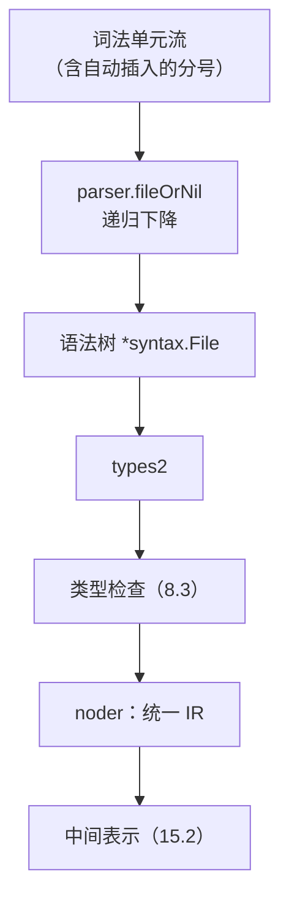
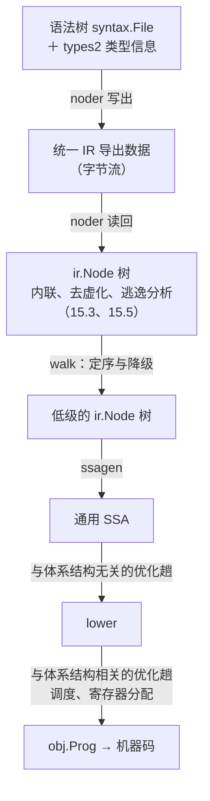

15 编译器流水线

15.1 词法与文法
15.2 中间表示
15.3 优化器
15.4 指针检查器
15.5 逃逸分析
15.6 cgo
15.7 过去现在和未来

一个程序不含特洛伊木马，这样的生命可以信任到什么程度？也许更重要的是信任编写软件的人。

这两句话印在Ken Thompson图灵奖演讲`<<Refletion on Trusting Truse>>`的篇首。演讲描述了一个能够代代相传的编译器后门：它只存在于编译器的二进制文件只能够，源码里面看不出任何痕迹（3.3.4）。程
序员审查的是源码，运行的却是编译器的产物，二者之间隔着编译器这一环。本章打开这一环，考察Go 1.26的编译器如何把源码变为机器码。

本章沿着编译流水线展开，流水线纵览见3.2。15.1讨论词法与文法分析：分号的自动插入，递归下降分析器如处理文法中的歧义从错误中恢复，以及前端从yacc到syntax包的演变。15.2讨论中间表示，统一IR,ir与
walk，以及SSA的构造，优化躺与重写规则。15.3讨论优化器中的内联，去虚化，性能制导与边界检查消除。15.4讨论unsafe.Pointer的合法模式，以及在运行时检查这些模式的checkptr。15.5讨论逃逸分析如何
把程序抽象为一张带权有向图，并在图上求解，以及这一实现的演变与局限。15.6讨论cgo如何在Go与C两套运行约定之间转换，指针传递规则的由来，以及跨越这一边界的代价。15.7按照时间回顾编译器演进。汇编与调用约定见第2章，自举见第3章。

## 15.1 词法与文法

编译器第一个阶段把源码文本转换为语法树。3.2.2已经指出，Go的文法经过有意设计，解析时无须类型信息或者符号表。本节深入这一阶段的实现：词法分析器如何切分词法单元并自动插入分号，语法分析器如何递归下
降的方式构造语法树，处理文法中仅有的几处歧义，在出错之后继续分析，以及gc的前端如何从yacc生成的分析器演变为今天的syntax包。

这一阶段由cmd/compile/internal/syntax包完成，其中scanner.go是词法分析器，parser.go是语法分析器，nodes.go定义语法的节点。按照编译器README描述，每棵语法数都是对应源文件的精确表示，节点
与源码中的表达式，声明，语句一一对应，并携带位置信息，供报告错误与生成调试信息之用。编译器为包内的每个源文件各启动一个goroutine进行解析，同时打开的文件数以GOMAXPROCS+10为限制；全部文件解析完
毕后，语法树交给类型检查，再转换为编译器中端的中间表示。



### 15.1.1 词法单元与分号的自动插入

词法分析把字符流切分为词法单元（token）：标识符，关键字，运算符与标点，字面量。Go词法规则大体沿袭C，最显著的差别在于分号。Go的形式文法与C一样以分号终结语句，源码中却几乎看不到分号，因为语言规范
规定了两条省略的规则：

1. 把输入切分为词法单元时，若一行的最后一个词法单元是标识符，整数，浮点数，虚数，rune或者字符串字面量，关键字break, continue， fallthrough, return之一，或者运算符与标点`++,--,),],}`
   之一，则紧随其后自动插入一个分号；
2. 为使复杂语句可以写在一行之内，闭合的`)`或者`}`之前的分号可以省略。

`<<Effective Go>>`把第一条规则概括为：换行若出现在一个可以结束语句的词法单元之后，就插入一个分号。这条规则只看换行之前的那一个词法单元，与下一行写了什么，语法分析进行到哪一步都无关，因此完全可
以在词法分析阶段完成，读代码的人可能一眼判断分号插在何处。JavaScript的自动分好插入可以作为对照：ECMAScript规范规定，当语言分析遇到一个人和产生式都不允许的词法单元（称为offending token），且
它与前一个词法单元之间隔着换行时，才在它之前补一个分号；另有return, continue等少数受限产生式不允许气候换行。哪里的分号是语法分析失败后的补救，是否插入取决于下一行能否接续当前的产生式；Go的分号
由词法规则事先决定。

syntax包的词法分析器用一个布尔字段nlsemi实现第一条规则：

```go
type scanner struct {
    source
    mode uint
    nlsemi bool
}
```

每次调用next读取一个词法单元时，先读取上一个词法单元留下的nlsemi,再把字段清零。跳过空白时，换行只在nlsemi为假时才被当作空白；mlsemi为真时，换行与文件结束被翻译为分号，字面值分别记为
"newline"与“EOF”。识别出`),],}`时，再把nlsemi置为真，留给下一次调用：

```go
func (s *scanner) next() {
    nlsemi := s.nlsemi
    s.mlsemi = false

redo:
    // skip white space
    s.stop()
    startLine, startCol := s.pos()
    for s.ch == ' ' || s.ch == '\t' || s.ch == '\n' && !nlsemi || s.ch == '\r' {
        s.nextch()
    }
    // ......
    switch s.ch {
    case -1:
        if nlsemi {
            s.lit = "EOF"
            s.tok = _Semi
            break
        }
        s.tok = _EOF
    case '\n':
        s.nextch()
        s.lit = "newline"
        s.tok = _Semi
    // ...
    case ')':
        s.nextch()
        s.nlsemi = true
        s.tok = _Rparen
    }
}
```

字面量由setLit统一置位nlsemi,++与-各自置位。标识符与关键字共用一条路径：ident读完一个名字后，先用一个完美散列表函数查找关键字（散列值由前两个字节与名字长度算出，表长为64，初始化时若出现冲突
即panic）。查得关键字时，只有break, continue,fallthrough, return或者nlsemi为真；查不到则普通标识符，nlsemi一律为真：

```go
// possibly a keyword
lit := s.segment()
if len(lit) >= 2 {
    if tok := keywordMap[hash(lit)]; tok != 0 && tokStrFast(tok) == string(lit) {
        s.nlsemi = contains(1<<_Break|1<<_Continue|1<<Fallthrough|1<<_Return, tok)
        s.tok = tok
        return
    }
}
s.nlsemi = true
s.lit = string(lit)
s.tok = _Name
```

第一条规则的全部内容都落在nlsemi何时为真上，词法分析器中并没有单独的分号插入步骤。跨越多行的`/* */`注释出现在应当插入分号的位置，也被视为一次换行，同样由nlsemi决定是否翻译为分号。第二条规则
则无须词法分析器参与，语法分析器在列表的闭合符号之前接受可有可无的分号即可。

编译器内部的syntax包无法从外部导入，标准库的`go/scanner`则按照同一份规范实现了相同的规则：自动插入的分号以字面值“\n”区别于源码中写出的分号。下面的程序用它切分一段代码，把由换行转换而来的分号
标为（;）:

```go
package main

import (
    "fmt"
    "go/scanner"
    "go/token"
    "strings"
)

func main() {
    src := []byte("x := f(a,\n\tb)\ny++\nif x > 0 {\n\treturn\n}\n")

    fset := token.NewFileSet()
    file := fset.AddFile("", fset.Base(), len(src))
    var s scanner.Scanner
    s.Init(file, src, nil 0)

    line, toks := 1, []string{}
    for {
        pos, tok, lit := s.Scan()
        if tok == token.EOF {
            break
        }
        if l := fset.Position(pos).Line; l != line {
            fmt.Printf("%d: %s\n", line, strings.Join(toks, " "))
            line, toks = l, nil
        }
        switch {
        case tok == token.SEMICOLON && lit == "\n":
            toks = append(toks, "(;)") // 由于换行转换而来的分号
        case lit != "":
            toks = append(toks, lit)
        default:
            toks = append(toks, tok.String())
        }
    }
    fmt.Printf("%d: %s\n", line, strings.Join(toks, " "))
}
```

第1行以,结尾，换行被当作空白，函数调用的实参因而可以跨行书写；第2行的`)`,第3行的`++`，第5行的return与第6行的`}`都使其后的换行变成分号；第4行以`{`结尾，不插入分号。

这条规则并非一开始就是这个样子。2008年10月，gc实现的规则是所有语句与声明都以分号终结，但在顶以及闭合的`)`或者`}`前后都可以省略，类型和语句的文法因此各要写两个版本。2009年6月，Russ Cox改由于
词法分析器协助插入分号，不再需要重复的文法。Go于2009年11月开源，一个月后，规范改为今天的规则，gc随即实现。源码需要从旧语法迁移到新语法，gofmt被用来批量改写整数源码树，删去不再需要的分号。

### 15.1.2 左花括号的位置

分号的自定插入直接决定了左花括号的位置：它不能另起一行。下面的函数声明把`{`放在下一行：

```go
package main

func f()
{

}

func main() {}
```

以为Go 1.26.10为准，编译时报告：

```bash
$ go build .
#example
/main.go:4:1: syntax error: unexpected semicolon or newline before {
```

第3行以`)`结尾，词法分析器在其后插入分号，语法分析器看到的是 func() f();,然后才是`{`，func f();本身是合法的声明：规范允许没有类型参数的函数声明省略函数体，这样的声明为在Go之外实现的函数提供
签名。错误因而不再第3行，而在第4行出现顶层的`{`。语法分析器专门识别了这种情形：顶层出现`{`，而上一个声明恰好是没有函数体的函数声明，就给出了上面这条针对性的提示；否侧报告函数体之外出现了非声明
语句：

```go
default:
    if p.tok == _Lbrack && len(f.DeclList) > 0 && isEmptyFuncDecl(f.DeclList[len(f.DeclList) - 1]) {
        p.synctaxError("unexpected semicolon or newline before {")
    } else {
        p.synctexError("non-declaration statement outside function body")
    }
    p.advance(_Import, _Const, _Type, _Var, _Func)
```

控制结构的情形与此相同。if x > 0以字面量结尾，其后的换行变为分号，于是报告syntax error: unexpected newline, expected `{` after if clause。`<<Effective Go>>`把这一点列为分号规则
的直接后果：控制结构的左花括号不能写在下一行。在C系语言里面，花括号的位置是一种书写风格，由各个项目自行决定；在Go里面，它是词法规则的推论，其余的排版细节再由gofmt统一，这类争论也就无从发生。

### 15.1.3 递归下降

语法分析器采用递归下降（recursive descent）的方法：文法中的每条产生式对应一个方法，方法依据当前的词法单元选择分支，并调用其他产生式对应的方法分析各个组成部分。源文件的文法是包子句，气候是若干
导入声明。入口方法fileOrNil先要求package子句，然后循环分析顶层声明：

```go
for p.tok != _EOF {
    // ......
    switch p.tok {
    case _Import:
        p.next()
        f.DeclList = p.appendGroup(f.DeclList, p.importDecl)
    case _Const:
        p.next()
        f.DeclList = p.appendGroup(f.DeclList, p.constDecl)
    // ......
    case _Func:
        p.next()
        if d := p.funcDeclOrNil(); d != nil{
            f.DeclList = append(f.DeclList, d)
        }
    }
}
```

p.tok是当前词法单元，p.next()读如下一个。每个顶层声明都以关键字开头，看一个词法单元就能确定声明的种类；importDecl, constDecl, funcDeclOrNil再逐层向下，直到表达式中的名字和字面量。为了
容错，fileOrNil允许导入声明出现在其他声明之后，但会报告imports must appear before other declarations.

分析的产物是nodes.go定义的语法树。每个节点都实现Node接口并带有一个位置：终结符（名字，字面量）的位置就是它在源码中的位置；非终结符的位置就是与该产生式唯一关联的词法单元的位置，通常是最左边的一
个，例如IfStmt的位置就是关键字if。语法分析器只检语法，x == T{1}中的T是否确为类型，留待类型检查回答。例外是标签与跳转：编译器以CheckBranches模式调用语法分析器，标签以及break, continue,
goto的正确使用在解析阶段就已检查。

### 15.1.4 文法中的歧义

Pike在`<<Go at Google>>`中写道，Go的文法是规则的，因而易于解析，随即又补充了一句：大体如此；有几处怪癖，我们本可以修正，只是发现得不够早。与C++相比，这几处怪癖微不足道：C++中Widget
w(Thing());在文法上既可以是对象定义，也可以是函数声明，标准规定按照函数声明解析，这就是所谓最令人烦恼的解析。Go的语言规范明确记载了自己的两处歧义，它们恰好展示了递归下降分析器如何处理凭借
一个词法单元无法判定的结构。

第一处就是复合字面量与语句块的冲突。if,for,switch的头部之后紧跟着语句块的`{`，而T{1}这样的复合字面量同样以`{`开始。分析`if x == T{1}`时，读到第一个`{`的那一刻，无法判断它属于复合字面
量还是语句块。规范的裁决是：在这种位置上，若以类型名形式书写的复合字面量没有被圆括号，方括号或者花括号包围，它的`{`一律被当作语句块的开始；需要复合字面量时，必须用圆括号括起来。下面的程序
因此无法编译：

```go
package main

type T struct{ a int }

func main() {
    x := T{1}
    if x == T{1} {
        println("equal")
    }
}
```

以Go 1.26.10为准，编译时报告：

```bash
$ go build .
# example
./main.go:7:15: syntax error: unexpected { at end of statement
./main.go:10:1: syntax error: non-declaration statement outside function body
```

语法分析器把 x == T当作条件，`{1}`当作语句块，第二个`{`于是成了多余的词法单元，气候的花括号也全部错位。写成`if x == (T{1})`即可通过编译。实现这一裁决的是语法分析器中的计数器xnest，它记录表
达式的嵌套层次：

```go
xnest int // expression nesting level(for complit ambiguity resolution)
```

分析控制结构的头部之前，header方法把xnest置为-1:

```go
outer := p.xnest
p.xnest = -1
```

此后每进入一层圆括号（包括函数调用的实参列表），方括号或者复合字面量的花括号，xnest加1,离开时减1。分析操作数时遇到`{`,若操作数是名字或者限定名，只有在xnext非负时才把`{`视为复合字面量的开始；
若操作数本身就是数组，切片，结构题或者映射类型的字面写法，则不存在歧义：

```go
case _Lbrace:
    // operand may have returned a parenthesized complit
    // type; accept it but complain if we have a complit
    t := Unparen(x)
    // determine if '{' belongs to a composite literal or a block statement
    complit_ok := false
    switch t.(type) {
    case *Name, *SelectorExpr:
        if p.xnest >= 0 {
            // x is possibly a composite literal type
            complit_ok = true
        }
    }
    // ......
    case *ArrayType, *SliceType, *StructType, *MapType:
        // x is a comptype
        complit_ok = true
    }
    if !complit_ok {
        break loop
    }
```

yacc时代的分析器处理同条规则的方式，与此形成鲜明对比。若要在LALR(1)文法中直接表达这一限制，需要为控制结构的头部另写一套不含裸复合字面量的表达式文法。Go 1.4的gc没有这样做，而是让手写的词法分析
器 lex.c 维护一个状态loophack：读到if, for, switch, select之后，把下一个不在括号内`{`作为另一种词法单元LBODY交给分析器，文法再规定这些语句块以LBODY开始：

```go
/**
 clumsy dance:
 to implement rule that disallows
 if T{1}[0] {...}
 but allows
 if (T{1}[0]){...}
 the block bodies for if/for/switch/select
 begin with an LBODY token, not `{`

 when se see the keyword, the next
 non-parenthesied '{' becomes an LBODY.
 loophack is normally 0.
 a keyword makes it go up to 1.
 parens push loophack onto a stack and go back to 0.
 a `{` with loophack == 1 becomes LBODY and disables loophack.

 i said it was clumsy.
 */
```

注释的最后一句是我说过这很笨拙。词法分析器为此必须了解语法分析的状态，两者的界线被打破了。递归下降分析器把同一份上下文保存在自己的一个整数字段里，词法分析器重新只看字符。

第二处歧义来自泛型。type T[P *C] ...即可以理解为类型参数P,约束*C的范型类型，也可以理解为长度为常量表达式P * C的数组类型。规范规定，这种情况数组类型解析；需要类型参数时，把约束写成interface
{*C}，或者在末尾加一个逗号。以Go 1.26.10编译type C int与type T[P *C] struct { p P}，报告undefined: P与C(type) is not an expression,可见P * C却是被当作了数组长度；改为type T
[P *C,] struct {p P}即可通过，读到`type T[`时，语法分析器同样无法立即判定，它的做法是按两者公共形式，即一个表达式，分析下去，再检查结果能否拆分为类型参数名与约束：

```go
if pname,ptype := extractName(x, p.tok == _Comma); pname != nil && (ptype != nil || p.tok != _Rbrack) {
    // d.Name "[" pname ...
    // d.Name "[" pname ptype ...
    // d.Name "[" pname ptype "," ...
    d.TParamList = p.paramList(pname, ptype, _RBrack, true, false) // ptype
    d.Alias = p.gotAssign()
    d.Type = p.typeOrNil()
} else {
    // d.Name "[" name "]" ...
    // d.Name "[" x ...
    d.Type = p.arrayType(pos, x)
}
```

两处处理都有一个共同点：分析器从不回退重读词法单元。遇到凭一个词法单元无法判定的结构，要么向xnest那样依据已知的上下问直接裁决，要么先按照公共形式分析，事后在归类。

### 15.1.5 错误恢复

一处语法错误不应该终止整个文件的分析。语法分析器报告错误之后调用advance，跳过若干词法单元，直到一个可以重新开始分析的位置：

```go
// The stopset contains keywords that start a statement.
// They are good synchronization points in case of syntax
// errors and (usually) shouldn't be skipped over.
const stopset uint64 = 1 <<_Break | 1 << _Const
    | // ......
    1 <<_Var

// advance consumes tokens until it finds a token of the stopset or followlist
// The stopset is only considered if we are inside a function (p.fnest > 0).
// The followlist is the list of valid tokens that can follow a production;
// if it is empty, exactly one(non-EOF) token is consumed to ensure progress.
func (p *parser) advande(followlist ...token)
```

同步点有两类：一类是当前产生式之后可以合法出现的词法单元，由调用方给出，例如 fileOrNil在顶层出错时传入import, const, type, var, func；另一类是在函数体内开始一条语句的关键字。丢弃输入直到
遇到同步词法单元，是编译原理教科书所称的恐慌模式恢复。下面的文件爱两个函数中各有一处错误。

```go
package main

func f(a int) int {
    return a + )
}
func g(b bool) {
    if b {
        println(1
    }
}
func main() {

}
```

```bash
$ go build .
./main.go:4:13: syntax error: unexpected ), expected expression
./main.go:9:12: syntax error: unexpected newline in argument list; possibly missing comma or )
```

第二条信息同样得益于分号规则：实参1之后的换行被翻译成分号，语法分析器在实参列表中读到分号，便推断出可能漏写了逗号或者右括号。

### 15.1.6 从yacc到syntax包

Go 1.4以及以前，gc用c写成，语法分析器由bison从文法文件go.y生成，词法分析器lex.c是手写的。bison生成的是LALR(1)分析器；go.y用若干优先级声明消除文法中的冲突，并借助脚本bisonerrors把分析器的
出错状态映射成定制的错误信息。go.y开头的注释说明了当时的分号规则：语句与声明都以分号终结，闭合的`)`或者`}`之前可以省略分号，换行之前的分号由词法分析器插入。

Go 1.5把编译器从C机械地翻译为Go(15.7)，go.y改由Go版本的yacc处理。Go 1.6的开发周期中，Robert Griesemer把yacc文法翻译为一个手写的递归下降分析器。据提交说明，新分析器对yacc分析器的翻译，做
了使用文法适用于递归下降的调整，yacc的语义动作保证正确大多原样照搬；对make.bash中的文件，平均每个文件的解析时间缩短约18%，编译cmd/compile本身的时间缩短3%；至于错误信息，要在所有情况下复现
yacc分析器的措辞非常困难，新分析器有时候还能给出更好的信息。十余天后，yacc分析器被删除。Go 1.6的发布说明称，编译器内部最重要的变化是语法分析器改为手写，不再由yacc生成。

这个分析器仍然一边分析一边直接构造编译器内部的Node，语法树与编译器的数据结构没有分开。2016年8月，Griessemer提交了独立的syntax包，包括语法树节点，词法分析器，语法分析器和打印器；提交说明记录，
在预热状态下，它解析了整个标准库的速度约为每秒180万行。Mattthew Dempsky随后编写了noder,把syntax的语法树转换为编译器的Node；同年10月，新前端称为默认，就的词法分析器与语法分析器随即被删除。
Go 1.8的发布说明称，新的编译器前端对用不不可见，但今后的性能工作奠定了基础。此后，syntax的语法树先后成为type2与统一IR。

标准库的go/scanner,go/parser与go/ast时另一套独立实现。编译器README解释了原因：编译器最最初用C写成。go/*系列包是为gofmt，vet这类处理Go代码的工具而开发的，编译器基本不使用它们。gopls
等工具也建立在go/*之上。两套前端各自实现了同一规范，泛型这样的语法变化需要在两处分别实现，错误信息也各不相同：把15.1.4中无法编译的`if x == T{1}{` 交给基于go/parser的 go vet，他在同一位置
报告的事expected ";", found `{`。

### 15.1.7 小结

Go的前端可以概括为两个只看一个：词法分析器只看换行之前的一个词法单元决定是否插入分号，语法分析器在绝大多数位置只看当前的一个词法单元决定分支。规范记载的两处歧义，由一条明确的裁决规则加上分析器
内部的计数器与事后归类解决，从不回退。这样的文法让手写的递归下降分析器足以胜任：它比yacc生成的分析器更快，错误信息可以逐处定制，标准库也能以同样的方式为工具提供一套独立的解析器。

## 15.2 中间表示

一个Go函数从语法树到机器码，要依次经过好几种表示：经过类型检查的语法树与序列化为统一IR(unified IR)的导出数据，再读回为编译器中端的ir节点树；内联，去虚化，逃逸分析与walk都在ir上进行；walk
之后，函数被转换为静态单赋值形式（SSA），经过数十趟与体系结构无关和相关的变换，最后生成机器指令。3.2已概述了这些阶段，并以一个小函数说明了SSA与 φ 函数的含义。本节关注表示本身：每一种表示为何
存在，相邻的两种如何衔接，以及SSA在Go编译器中的数据结构，优化趟的组织方式和重写规则。



### 15.2.1 统一IR

编译器的终端使用自己的语法树与类型表示，它们是编译器还用C编写的遗产，中端的全部代码都以这套表示写成；因此，类型检查之后的第一步，是把syntax的语法树与type2的类型信息转换为ir与types,这一过程
称为noding。从Go 1.20起，noding采用统一IR的方式：它不直接遍历语法树构造ir节点，而是先把经类型检查的代码序列化为一份导出数据，再从这份数据构造ir。

绕开一圈的理由，见Matthew Dempsky引入统一IR的提交说明。在此之前，一个函数体在编译过程中要被复制多次，而每次赋值都由一套独立的实现完成：noding把语法树复制为ir；为支持泛型，模版化
（stenciling）把泛型的ir复制为实例化后的ir;内敛器先为可内联函数保存一份副本，内联时在复制一次，改写位置信息，变量引用与return语句；导出器把内联器保存的ir写出，导入器再读回。提交说明指出，
这几件事在概念上是同一件事，即复制一个函数体，可能附带少量替换，但它们是互相独立实现，ir的种种细节又多，同样的问题因而一再出现。统一IR把这些复制合并为一条路径：写出器遍历语法树与type2的类型
信息，产生一份分节的字节流；读入器从字节流重建ir。同一个读入器即用于构造包的函数，也用于按需读入导入包中可内联的函数体，还为type2读取其他包的导出数据，导出格式与编译器中的中间表示由此合而为一。
noder包中的unified函数得注释概括了这条流水线：

```go
// unified constructs the local package's Internal Representation (IR)
// from its syntax tree (AST)
//
// The pipeline contains 2 steps:
//
// 1. Generate the export data "stub"
//
// 2. Generate the IR from the export data above
//
// The package data "stub" at step (1) contains everything from the local package,
// but nothing that has been imported.When we're actually writing out export data
// to the output files (see writeNewExport), we run the "linker", which:
//
//  - Updates compiler extensions data (e.g. inlining cost, escape analysis results).
//
// - Handles re-exporting any transitive dependencies.
//
// - Prunes out any unnecessary details (e.g. non-inlineable functions, because any
//   downstream importers only care about inlinable functions).
```

同一段注释还承认，源文件目前要经过两次类型检查：写出导出数据之前由type2检查一次，读回之后再由旧的typecheck检查一次；后者仍负责若干改写，例如把多值函数调用展开，把映射的下标运算区分出来。

统一IR在Go 1.18的开发分支上以实验形式加入，Go 1.20称为默认，Go 1.21删除了旧的noding路径。它的格式长期只由noder包的代码隐式定义；Go 1.25起，noder/doc.go开始以文法的形式描述字节流：
一个包由头部，若干字节（字符串，元信息，包，名字，剋行，对象，函数体等）与一个8字节的SHA-256指纹组成。泛型的实现，即按GC形式共享代码并以字典传递类型信息，也建立在统一IR上。

### 15.2.2 if与walk

ir的节点是一棵树，与源码结构大体对应，但已经经过类型检查，名字都已经更新。直到Go 1.16，整个前端只用一种庞大的Node结构题表示所有节点，left,Right,List等字段按操作的不同而含义各异。2020年11月
至12月，Russ Cox在dev.regabi分支上把他改造为有类型的中间表示：先为每个字段加上存取方法并改写所有调用者，再把\*Node替换接口Node,随后逐步分离出ir.Name, ir.Func， ir.CallExpr等具体的节点
类型，遍历与复制节点的方法改由程序根据结构体定义生成。这些改动大多由重构工具脚本机械地完成，随着Go 1.17发布。今天的ir.Node接口如下：

```go
// A Node is the abstract interface to an IR node.
type Node interface {
    // Formatting
    Format(s fmt.State, verb rune)

    // Source position.
    Pos() src.XPos
    SetPos(x src.XPos)

    // For making copies. For Copy and SepCopy
    copy() Node

    doChildren(func(Node) bool) bool
    // ......
    // Abstract graph structure, for generic traversals.
    Op() Op
    Init() Nodes

    // fields specific to certain Ops only.
    Type() *types.Type
    SetType(t *types.Type)

    // ......
}
```

内联，去虚化与逃逸分析都在ir上进行。中端的最后一趟是walk,它有两项任务：把复杂的语句分解为一系列简单语句，引入临时变量并遵守求值顺序，这一步又称为order;把高级的语言构造降级为更基本的形式，例如
把switch转换为二分查找或者跳转表，把映射与channel的操作替换为运行时调用。下面的函数交换两个指针所指的值：

```go
// go:noinline
func swap(p, q *int) {
    *p, *q = *q, *p
}
```

以Go 1.26.10为准，设置GOSSAFUNC=swap+编译，编译器首先打印walk之后的ir。

一条元组赋值被分解为三条单一赋值：先把*p存入临时变量autotmp_2,再执行 *p = *q，最后执行*q = autotmap_2。规范要求元组赋值右侧的操作数全部求值之后才进行赋值，walk用这个临时变量兑现这一顺序。

### 15.2.3 构造SSA

把SSA引入Go编译器的设想，出自Keith Randall 于2015年2月撰写的设计文档。当时编译器即将从C翻译为Go，文档提一次后把基于语法树的中间表示换成基于SSA的中间表示，并分阶段执行，从后端开始：在walk
之后分叉，因为此时的中间表示已相当低级，又基本与体系结构无关；文档认为，容易获得的改进大多发生在这一点之后，而棘手的Go持有处理大多发生在这一点之前。逃逸分析，内联以及把Go的语法降级为运行时调用，
都不在第一阶段之内。对于常被问到的为何不直接转换为LLVM或者GCC的中间表示，文档给出三条理由：编译器速度，新的SSA及其优化趟要在设计上就足够，尽可能采用线性时间的算法；运行时信息，垃圾回收于栈
拷贝需要精确的栈帧映射，现成的后端无法提供；以及不愿为构建Go再增加一项外部的依赖。

这个设计随着Go1.7首先用于64位X86，发布说明称新后端生成的代码紧凑，更高效，启基准程序的CPU时间减少5%至35%；Go1.8把它推广到所有体系结构，32位ARM的CPU时间减少20%至30%。Randall在GopherCon
2017年以Generating Better Machine Code With SSA为题介绍了这一后端。今天ssagen包把walk之后的每个函数转换为SSA，内在函数的替换也在这一步完成：编译器认得一些函数，例如math/bits中的位运
算，被直接替换为相应的指令序列。

构造SSA得关键在于放置φ 函数。ssagen顺序每个基本块，遇到变量的读取，若本块尚未定义该变量，就先放置一个占位的FwdRef值；整个函数翻译完毕后，再统一决定哪些块需要φ 函数，并把每个FwdRef替换为定义
或者φ 函数。phi.go的开头说明了所用到的算法：

```go
// This file contains the algorithm to place phi nodes in a function.
// For small functions, we use Braun, Buchwald, Hack, LeiBa,Mallon, and Zwinkau.
// ......
const smallBlocks = 500
```

经典的做法来自Cytron等人：先计算支配树与支配边界，而在每个变量全部定义点的迭代支配边界上放置φ 函数，Braun等人的算法不需要预先计算支配关系，在翻译过程中按照需要向前驱块查找变量的定义，只在控制
流会和处生成φ 函数，实现简单，对小函数很快。Sreedhar与Gao的算法借助一种称为DJ图的结构，在线性时间内求出φ 函数的位置。Randall与2016年为大函数换用后者，提交说明称旧算法在小函数上更快，因此以
500个基本块为界；对issue #16407中的例子，编译时间从约20分钟降低至约30秒。

### 15.2.4 值与块

Go的SSA由值（value）与（block）组成，块即控制流图中的基本块。SSA中没有变量，也没有作用域；值以顺序编号命令，很少对应源码中的名字，编号又使编译器可以用以编号为下标的切片代替映射，需要时则借助
位置信息回溯源码。Value的定义如下：

```go
// A value represents a value in the SSA representation of the program
// The ID and Type fields must no be modified. The remainder may be modified.
// if they preserve the value of the Value(e.g changing a (mul 2 x) to an (add x x)).
type Value struct {
    // A unique identifier for the value. For performance we allocate these IDs
    // densely starting at 1. There is no guarantee that there won't be occasional holes, though
    ID ID

    // The operation that computes this value. See op.go
    Op Op

    // The type of this value. Normally this will be a Go type, but there
    // are a few other pseudo-types, see ../types/type.go
    Type *types.Type

    // ......
    AuxInt  int64
    Aux Aux

    // Arguments of this value
    Args []*Value

    // Containing basic block
    Block *Block

    // ......
    // Use count. Each appearance in Value.Args and Block.Controls counts once.
    Uses int32
}
```

开头的注释解决了Go的SSA如何被改写。一个值通过Args指向它所使用的值，却不记录谁使用了它，只保留了一个使用计数Uses。改写一个值时，编译器不新建一个值再逐一修改使用者，而是就地修改这个值Op与Args:
只要新的计算与原来等价，ID不变，所有持有它的指针自然看到新的定义。注释中把(mul 2 x)改为(add x x)正是这种就地改写。这段注释在Randall 2015年设计文档所附的原型中就已出现，几乎一字未改。

Block的定义中两处值得注意：

```go
// Subsequent blocks, if any. The number and order depend on the block kind
succs []Edge

// Inverse of successors.
// The order is significant to Phi nodes in the block
// ......
Preds []Edge

// ......
Controls [2]*Value
// ...
// The unordered set of Values that define the operation of this block
// After teh scheduling pass, this list is ordered.
Values []*Value
```

其一，前驱的顺序有意义：φ 函数的第i个参数对应第i个前驱。其二，块中的值在调度之前时一个无需集合。值之间的先后只由两种依赖约束：一个值的参数必须先于它的计算；读写内存的操作通过类型为memory的值
串联，每个读内存的操作以一个内存状态为参数，每个写内存的操作产生新的内存状态。仍以swap为例子，以Go 1.26.10为准，它最初的SSA形式如下：

...

### 15.2.5 优化趟

SSA上的变换组织为一串趟（pass），每趟处理一个函数，默认按照顺序各运行一次。compile.go中的passes数组列出全部的趟，Go 1.26中共有57项，其中3项默认关闭：

...

### 12.2.6 重写规则

### 12.2.7 小结

Go编译器的集中中间表示各有分工。统一IR让noding,泛型实例化，内联与导入导出共用一条复制函数体的路径；ir承载内联，逃逸分析等需要源码结构分析，walk把它降到接近运行时调用的层次；SSA从walk之后开
始，以就地改写的值，只在调度时才排定次序的块，以及由规则生成的化简，完成与体系结构无关的相关优化。从2015年的设计文档到今天，SSA得基本数据结构几乎没有变化，编译速度与精确的运行信息这两项最初的设
计约束，也一直时这套表示的取舍依据。

## 15.3 优化器

Go的编译器的优化分为两层进行。第一层在ir节点树上，包括内联，去虚化与逃逸分析。这几项角色需要同时看到调用者与被调用者，只能在各函数的函数体仍然彼此可见时进行。第二层在SSA上，每个函数经过十余趟
变换，这些躺只处理单个函数的内部，因而可以并行。3.2.3已介绍了内联预算80与PGO下预算2000，本节讨论这些数字所属的成本模型及其演化，去虚化与性能制导优化如何扩大内联的作用范围，以及SSA上prove趟
如何删除边界检查。
