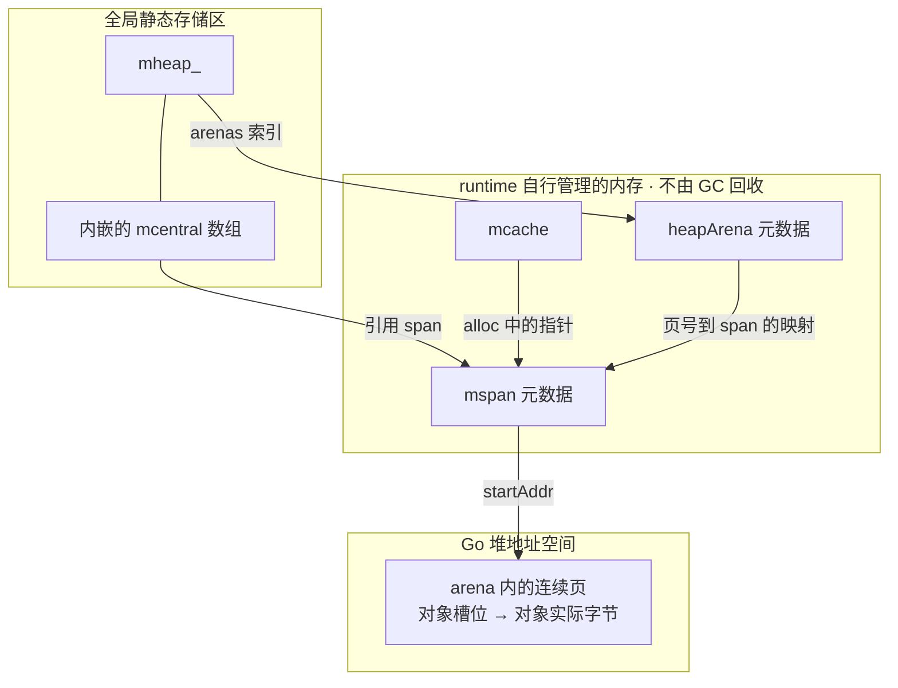

**如果“堆”指 Go GC 管理的堆，那么 `mspan`、`mcache`、`mcentral`、`mheap` 这些管理结构本身都不在其中。** 它们位于全局静态存储区，或 runtime 自行分配、管理的内存中。

你说的 `area` 应该是 **`arena`**，这里需要区分“实际内存区域”和“描述它的元数据”。

- **`mheap`：全局静态存储区。**  
  runtime 使用全局变量 `var mheap_ mheap`。这个结构体本身具有静态存储期，不经过普通 Go 堆分配。[源码](https://go.dev/src/runtime/mheap.go#L264)

- **`mcentral`：内嵌在全局 `mheap_` 中。**  
  `mheap_.central[i].mcentral` 是数组里的结构体值，因此它本身也在全局静态存储区；它引用的 span 等数据可以位于其他地方。[源码](https://go.dev/src/runtime/mheap.go#L206)

- **`mspan`：runtime 管理的堆外内存。**  
  通常通过 `mheap_.spanalloc` 分配。这是一个 `fixalloc` 分配器，不走普通 Go 对象分配流程。**`mspan` 结构体与它描述的那几页内存，位于不同的位置。**[源码](https://go.dev/src/runtime/mheap.go#L782)

- **`mcache`：runtime 管理的堆外内存。**  
  通过 `mheap_.cachealloc` 分配，同样使用 `fixalloc`。每个 P 使用自己的 `mcache`，但这个结构体不由 GC 回收。[源码](https://go.dev/src/runtime/mcache.go#L97)

- **`arena` 和 `heapArena`：两种不同的东西。**  
  **arena** 是构成 Go 堆的内存区域，对象的实际字节存放在其中。**`heapArena`** 是描述这块区域的结构体，保存页到 `mspan` 的映射等信息；它分配在 Go 堆之外。[源码](https://go.dev/src/runtime/mheap.go#L266)

可以把存放位置画成这样，箭头表示引用关系：

这里的**“堆外”仍然属于同一个进程的内存，也不表示它在栈上**。runtime 通过 `sysAlloc`、`persistentalloc`、`fixalloc` 等机制管理这些内存；例如，`fixalloc` 可以回收并复用 `mspan`、`mcache` 的存储空间。这让内存管理器自身的运行不必依赖普通 GC 堆分配。[runtime 内存管理说明](https://go.dev/src/runtime/HACKING#unmanaged-memory)
